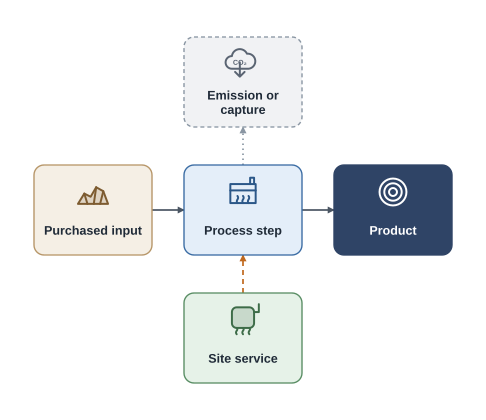
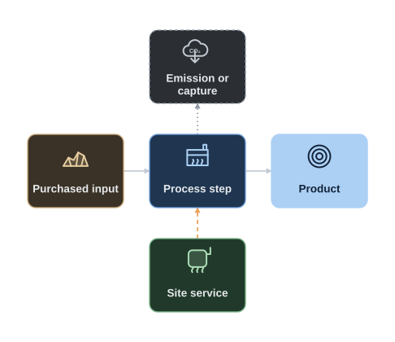
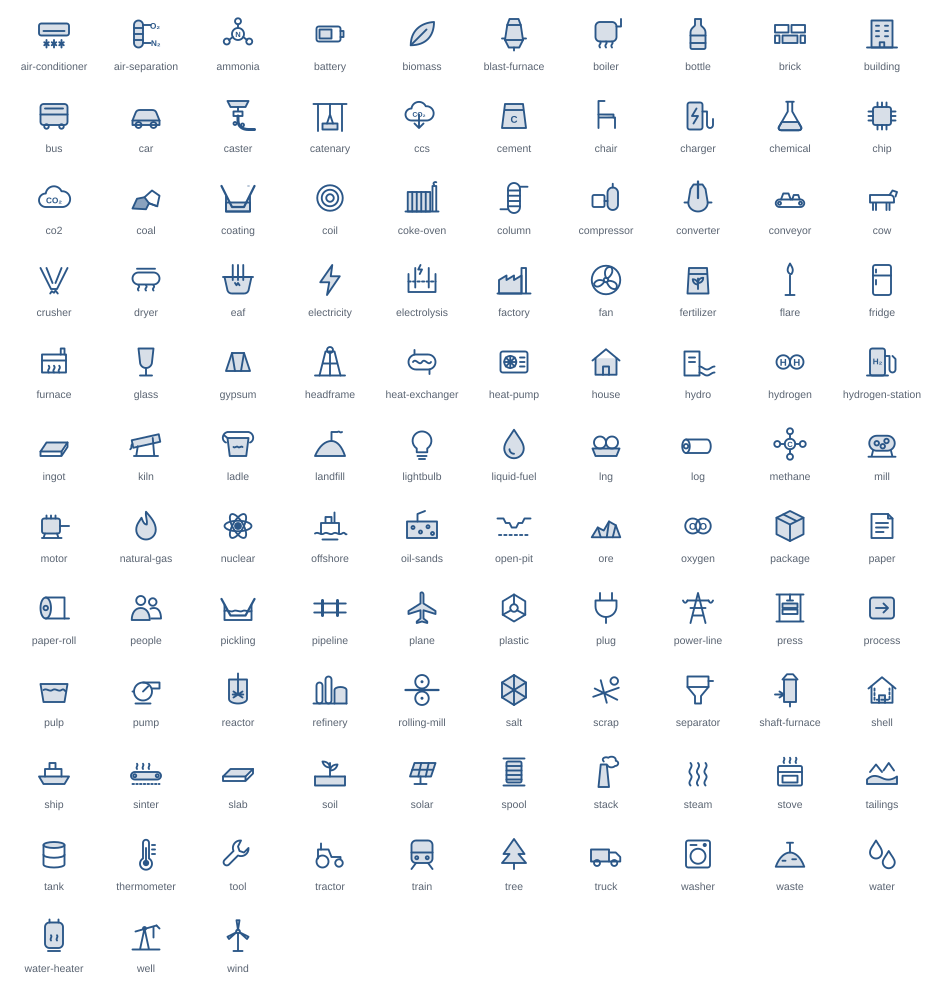
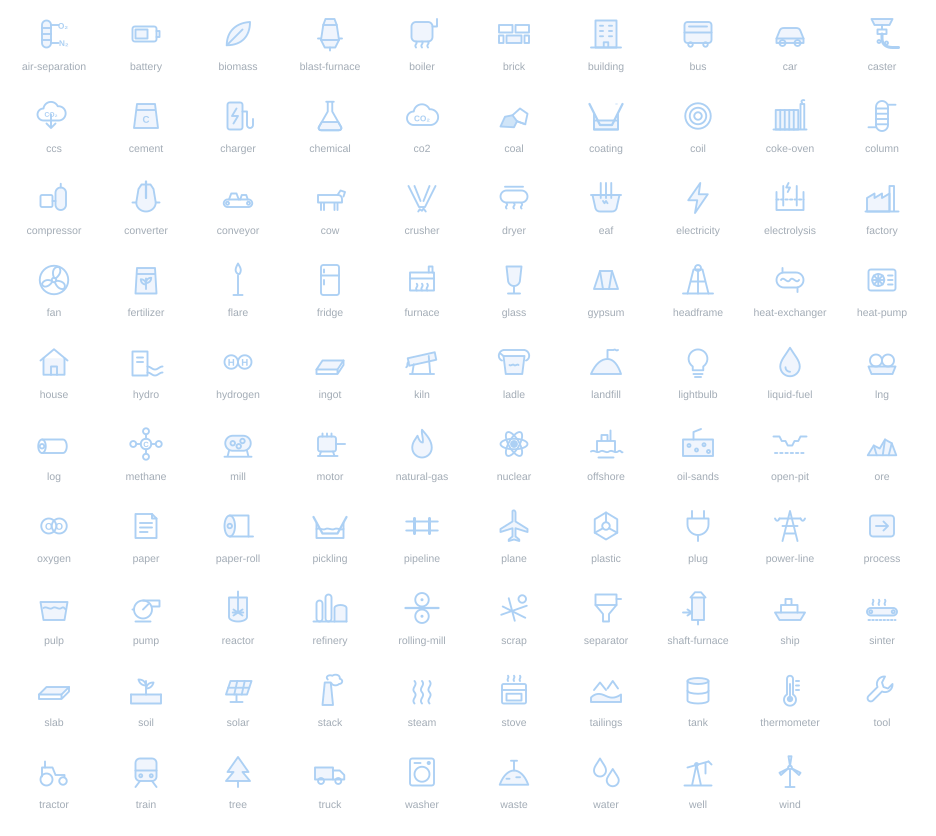

# Figure Style {#sec-figure-style}

The sector chapters each open with a process flowchart: a pictogram diagram of the steps that turn purchased inputs into the sector's products, the site services those steps draw on, and the flows between them. One script builds every chart from a shared style file, so a single change restyles them all. This appendix documents that style and explains how to change it.

## Files

| File | What it holds |
|:-----|:-------------|
| `flowcharts/flowchart_style.yml` | Fonts, sizes, line weights, the card style for each role, the line pattern for each kind of flow, and the light and dark palettes. |
| `flowcharts/icons/<icon-name>.svg` | One pictogram per file, drawn on a 48 × 48 grid with a 2.5-unit stroke in `currentColor`. |
| `flowcharts/<hierarchy-sector>.yml` | One spec per sector chart: its nodes, their positions and icons, and the flows between them. |
| `flowcharts/build_flowcharts.py` | Lays out each spec, applies the style, checks the hierarchy branches, and writes the SVGs. |
| `images/flowcharts/<hierarchy-sector>_process-flow_light.svg` and `_dark.svg` | The generated charts. Don't edit these by hand: the script rewrites them. |

## Building the charts

Run the script from the repository root after changing the style, an icon, or a spec:

```bash
uv run --with pyyaml python docs/flowcharts/build_flowcharts.py              # every chart
uv run --with pyyaml python docs/flowcharts/build_flowcharts.py mining       # one chart
uv run --with pyyaml python docs/flowcharts/build_flowcharts.py --check      # check only
```

The script checks every `branch:` in a spec against the CIMS hierarchy, `cims_hierarchy.csv` in the technology database, and stops with an error if a chart names a node the hierarchy no longer has. It looks for the hierarchy at the path in `hierarchy_csv` in the style file; set the environment variable `CIMS_HIERARCHY_CSV` to point it somewhere else.

## Roles and flows

Each card has a role, which sets its colours and its entry in the legend. Each flow has a kind, which sets its line pattern. @fig-style-sample shows them all.

| Role | Use it for |
|:-----|:-----------|
| `input` | Purchased inputs and feedstocks that enter the sector from outside: ore, scrap, coal, natural gas. |
| `process` | Steps in the sector's Product sub-tree: the production chain itself. |
| `service` | Steps in the sector's Service sub-tree that a process step requests, such as cokemaking, oxygen, or steam. |
| `output` | The sector's saleable products. |
| `emission` | Emission sources and carbon capture. |

| Kind | Line | Use it for |
|:-----|:-----|:-----------|
| `material` | Solid | Material moving through the production chain. |
| `energy` | Dashed | Energy and services a step requests. |
| `emission` | Dotted | CO₂ and other emissions, including flows to capture. |

::: {#fig-style-sample}
{.light-content width=60%}

{.dark-content width=60%}

Card roles and flow kinds used in the sector flowcharts.
:::

## Writing a sector spec

A spec places each card on a grid of columns and rows (counted from 0, fractions allowed) and lists the flows between cards. Read the flowchart left to right: purchased inputs in the first column, products in the last.

```yaml
sector: iron-and-steel          # hierarchy sector name; sets the output file names
title: Iron and steel

groups:                         # optional labelled bands behind a block of cards
  - {label: Ironmaking, cols: [1, 2], rows: [0, 2]}

nodes:
  - {id: ore, label: Iron ore, icon: ore, role: input, at: [0, 1]}
  - {id: hot-metal, label: Ironmaking, icon: blast-furnace, role: service, at: [2, 0],
     branch: iron-and-steel.service.hot-metal}
  - {id: finishing, label: Annealing and coating, icon: coating, role: process, at: [6, 3],
     branches: [iron-and-steel.product.continuous-cast.annealing-and-coating.annealing,
                iron-and-steel.product.continuous-cast.annealing-and-coating.coating]}

edges:
  - [ore, agglomeration]                                  # material flow
  - {from: oxygen, to: molten-steel, kind: energy}
  - {from: hot-metal, to: molten-steel, label: hot metal, turn: late}
  - {from: ladle, to: molten-steel, kind: energy, sides: [left, top]}
```

- `branch` or `branches` name the hierarchy nodes a card stands for, without the `<sector>.` prefix. Every card except inputs and products should carry at least one.
- A flow leaves the right side of its source and enters the left side of its target when the target sits further right; otherwise it runs vertically. Set `sides: [source side, target side]` to override this, `turn: early` or `turn: late` to move the bend of a stepped flow towards its source or target, and `route: below` or `route: above` to send a flow around a row.
- Keep a chart to seven columns or fewer, so that it stays legible at page width, and avoid flows that cross cards. If a sector needs more, split it across its sub-sector chapters.

## Changing the style

Edit `flowcharts/flowchart_style.yml` and rebuild. The settings most likely to need adjusting are:

- `palettes`: every colour, once for the light theme and once for the dark theme. `halo` should match the page background, since it outlines edge labels.
- `roles`: which palette colours each card role uses, and its legend text.
- `edge.kinds`: the dash pattern and colour of each kind of flow.
- `layout` and `node`: grid spacing and card size. Wider cards need a wider `col_width`.
- `font`: the font stack and sizes. The charts are embedded as images, so they use the reader's system fonts rather than the page's web font.

## Icons

Add an icon by saving a new file in `flowcharts/icons/`, named for what it shows, with the same frame as the others:

```xml
<svg xmlns="http://www.w3.org/2000/svg" viewBox="0 0 48 48" fill="none"
     stroke="currentColor" stroke-width="2.5" stroke-linecap="round" stroke-linejoin="round">
  <!-- paths here; use fill="currentColor" fill-opacity="0.18" for a light tint -->
</svg>
```

Keep icons to simple outlines with few details, so they read at about 38 pixels. @fig-icon-gallery shows the current set.

::: {#fig-icon-gallery}
{.light-content}

{.dark-content}

Flowchart icons, labelled with their file names.
:::

## Technology blocks

Each process step in a sector chapter lists the technologies that compete to provide it in a block set apart from the text. Write it as a fenced div with the `.tech-block` class; its first paragraph becomes the block's heading:

```markdown
::: {.tech-block}
Technologies

| Technology | What it does | Type | TRL |
|:-----------|:-------------|:-----|:----|
| Blast furnace | Reduces iron ore to hot metal with coke | Conventional | 9 |
:::
```

The block style lives in `style.css` under "Technology blocks".
