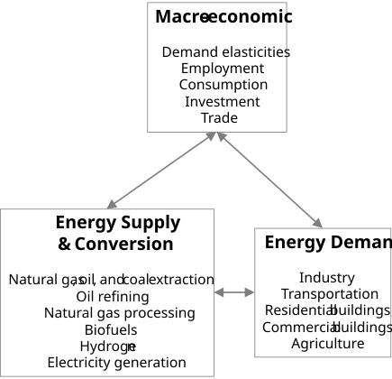
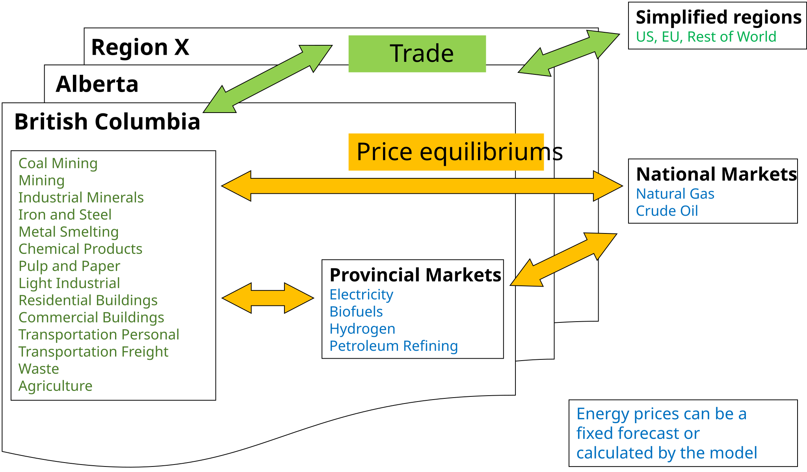

# Model Architecture {#sec-architecture}

## Scale and Scope

CIMS covers the entire Canadian economy and can connect to aggregated representations of other regions (e.g., United States, Europe, or Rest of World). @tbl-sectors-by-region shows the sectors and regions currently covered in CIMS.[^arch-territories]

[^arch-territories]: Canadian territories are not currently represented in CIMS.

<!-- Generated from data/model_inputs by _tables/build_sectors_by_region.py.
     Rerun that script when the model inputs change, then re-render. -->


<mark>TODO: Could include major metro regions like Toronto, Montreal, and Vancouver to represent city building and transportation policies.</mark>

While the model is simple in operation, it can appear complex because it is technologically explicit and covers the whole economy. CIMS represents a detailed list of technologies (fridges, light bulbs, cars, industrial motors, steel furnaces, buildings, power plants, etc.), and includes their linkages to each other. The model is especially large for the industrial sectors because industry has the largest variety of technologies.

CIMS highlights the interplay of energy supply and demand because energy-related GHG emissions are currently a key policy concern. Thus, the model focuses on the interaction between sectors that use energy (industrial, residential, commercial / institutional, and transportation sectors) and sectors that produce or transform energy (electricity generation, fossil fuel supply, oil refining, natural gas processing, biofuels, and hydrogen). This interaction is shown in @fig-general_model_structure. A policy that seeks to influence energy supply and demand may also influence the cost of producing goods and services, thus affecting their price and final demand. To reflect these interactions, CIMS includes a goods and services final demand feedback loop, composed of Armington elasticities for traded goods and empirically driven relationships between the traded and non-traded sectors.

{#fig-general_model_structure .lightbox width=70%}

## Simulation: Six Steps

As a simulation model, CIMS simulates the evolution of technologies acquired to meet energy services, and it uses both engineering and economic information. The engineering information details the unit energy consumption of each energy service technology and explains, using flow models of technologically heterogeneous sectors, how final energy service demands, intermediate products, and energy supply are related. The economic information determines which technologies are preferable in terms of cost minimization. While CIMS is not an optimization model, it can be adapted to produce results like those of an optimization model by calling on certain built-in functions. These functions are known as winner-take-all functions, and they give all new market shares in a given competition to the technology or process with the least cost.

CIMS is designed to mimic a sector or industry by representing a number of industrial establishments, residential or commercial buildings, and delivery of goods or personal travel within a defined region. The model focuses its analysis on the aggregate energy end-use requirements of that industry or sector. For example, in industry the major end-uses are process heat, motive force, space heat, and lighting. In the pulp and paper sector, the major end-uses are steam heat or mechanical energy to digest wood fibre into pulp, mechanical energy to convey and form pulp into paper, mechanical energy to press moisture out of formed pulp or paper, steam heat to dry pulp or paper, space heat, and lighting. In residential and commercial buildings, the primary end-uses include space heating and cooling, hot water production, refrigeration, and other assorted appliances.

**A CIMS simulation comprises six basic steps:**

1.  The baseline macroeconomic drivers, energy supply drivers, and energy service technology characteristics are set for the desired time frame (15 years, 20 years, etc.) in five-year increments.

    a.  Technologies are represented in the model in terms of the quantity of energy service they provide. This could be, for example, vehicle kilometers traveled, tonnes of paper, or square metres of floor space heated and cooled. Then, a forecast of growth in energy service demand is used to drive future demand for energy services, usually in five-year increments.

    b.  Macro-economic drivers include income, economic output, structural evolution of sectors, interest rates, employment rates, regulations, etc. They account for all energy service demands in the energy demand module.

    c.  Energy supply drivers include international commodity prices, domestic market developments, forecasts of costs and availability of marginal energy supplies, and the resulting forecasts of domestic prices.

    d.  Energy service technology characteristics include the date a technology or process will be available, technology energy efficiencies and capital / operating costs, firm and household time preferences (discount rates) for discretionary and non-discretionary expenditures (new and retrofit), and other behavioural parameters (perceived risks and consumer surpluses of different technologies, interdependence of certain technology choices that serve different energy services, such as domestic water heating and domestic space heating).

2.  The energy demand module (industry, commercial, residential, and transportation) is run for the initial driver values (including energy supply prices).

    a.  In each future period, a portion of the initial year's stock of technologies is retired. Retirement depends only on age. The remaining technology stocks in each period are subtracted from the forecast energy service demand and this difference determines the amount of new technology stocks in which to invest.

    b.  Prospective energy service technologies compete to fill the new service demand. The objective of the model is to simulate this competition so that the outcome approximates what would happen in the real world. Here the model relies heavily on market research of past and prospective firm and household behavior. Technology costs depend on recognized and financial costs, but also on identified differences in non-financial preferences (e.g., differences in the quality of lighting from different light bulbs) and risks (one technology is seen as more likely to fail than another). Even the determination of financial costs is not straightforward as time preferences (discount rates) can differ depending on the decision maker (household vs. firm) and the type of decision (non-discretionary vs. discretionary). Consequently, the competition is simulated probabilistically; new stock purchases are distributed among prospective technologies with financial costs being just one of several factors in determining market share.

    c.  In each period, a similar competition occurs with remaining technology stocks to simulate retrofitting (if desirable and likely from the firm or household's perspective). The same financial and non-financial information is required, except that the capital costs of remaining technology stocks are excluded, having been spent earlier when the remaining technology stock was originally acquired.

3.  The demand models then send their requirements for energy to the energy supply models. The supply models send back corresponding energy prices. If the changes in energy prices are over a set threshold value for equilibrium (usually 5%), the demand models are then rerun with the new energy prices. This process is repeated until all energy price changes fall under the threshold value. @fig-demand_supply_feedbacks describes this process:

{#fig-demand_supply_feedbacks .lightbox}

4.  Policy or market driven energy price changes may change the lifecycle cost of some energy services, thereby changing the end-use price for these services. If the change in lifecycle cost from the business-as-usual case is beyond a pre-set threshold price elasticities for these services are applied, thereby changing the demand for these services. This new demand is sent back to the supply and demand models for re-calculation.

5.  The model reiterates step 2, 3 and 4 until all variables stabilize. It then proceeds to the next time period. Steps 1 through 5 are repeated for all time periods.

6.  Output is provided for new and total capital stock, energy use, and trade flows, GHG emissions, levelized lifecycle costs by service and technology,