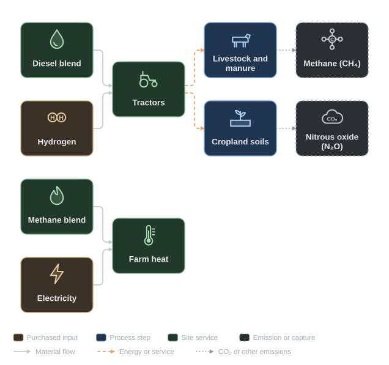

# Agriculture {#sec-agriculture}

Most of agriculture's greenhouse-gas emissions come not from burning fuel but from biological and chemical processes. Cattle and other livestock release methane (CH₄) as they digest their feed, stored manure releases methane and nitrous oxide (N₂O), and farm soils release nitrous oxide. CIMS builds the sector around these emissions and the farming practices that cut them, with tractors and farm heating as smaller energy uses. The sector's activity is measured in tonnes of CO₂-equivalent (the warming effect of all its gases expressed as CO₂), because emissions, not energy or farm output, are what the sector is organized around.

## Scope

The sub-model covers four things:

- methane from livestock digestion and from manure;
- nitrous oxide from cropland soils, with the land-management practices that affect it;
- farm tractors; and
- heat for farm processes and buildings, such as grain drying and barns.

Related activities sit elsewhere:

- Making nitrogen fertilizer belongs to [Chemicals](sector_chemicals.qmd).
- Food and beverage processing belongs to @sec-light-industrial.
- Producing biofuels, including growing their crops, belongs to the Biofuels sector.
- The fuels burned on farms come from the energy-supply sectors.

## Context

Agriculture produces roughly 8 % of Canada's greenhouse-gas emissions, almost all of them from gases other than CO₂. The largest single source, about 46 % of agricultural emissions, is enteric fermentation: the digestion of grass and other feed by cattle and other ruminants, whose gut microbes produce methane that the animals then breathe out. Storing and handling manure adds about 27 %, as methane and nitrous oxide. Soils release nitrous oxide, mainly from nitrogen fertilizer and crop residues [@nfu-ag-ghg]. Fuel used on farms for tractors, grain drying, and heating is comparatively small, and is mostly diesel and natural gas.

Because the emissions are biological, the ways to cut them depend more on farming practices and animal diets than on machinery. They include feed additives and other changes to how animals digest feed, better manure handling, managing nitrogen and tillage to cut soil emissions, and land uses such as agroforestry (growing trees among crops) and restoring wetlands, which store carbon. The feed additive 3-nitrooxypropanol (3-NOP), for example, cuts the methane cattle produce by about 30 % on average [@threenop].

## Process flow

::: {#fig-agriculture-process}
{.light-content .lightbox group="agriculture-light" width=80%}

{.dark-content .lightbox group="agriculture-dark" width=80%}

Process flow of the agriculture sector. Livestock and cropland are the emitting processes, and both request tractor work; farm heat serves drying and livestock housing. Fuels and electricity are shown generically, since the mix depends on which tractors and heaters win the competition.
:::

## Model structure

The Product sub-tree holds the two emitting processes: livestock and manure, and cropland soils. The Service sub-tree holds tractors, farm heat, and the diesel and methane fuel blends. The technology database does not yet cover agriculture, so the technologies below come from the model inputs until the database adds them.

### Livestock and manure

The **livestock and manure** process carries the methane that animals produce as they digest feed, and the methane from their manure. Conventional livestock farming competes with a package of changes to the animals' diet and digestion: feed additives such as 3-NOP, vaccines that suppress the microbes that make methane, and other changes to the rumen (the first stomach of cattle, where most of the methane forms). In the model data, this package cuts digestive methane by roughly 60 %. Both options also request tractor work, for moving feed and manure.

::: {.tech-block}
Technologies (from the model inputs, pending the technology database)

| Technology | What it is | Type |
|:--------------------------|:----------------------------------------------------------|:----------------|
| Livestock | Conventional livestock farming, releasing methane from digestion and manure. | Conventional |
| Livestock with vaccines and rumen changes | Feed additives, methane vaccines, and changes to digestion; available from 2035 in the data. | Prospective |

:::

### Cropland soils

The **cropland soils** process carries the nitrous oxide that soils release. Soil microbes turn some of the nitrogen in fertilizer, manure, and crop residues into nitrous oxide, a greenhouse gas about 270 times as potent as CO₂. How a farmer tills the soil affects how much forms, and how much tractor work the field needs. Conventional tillage turns the soil over fully before planting; reduced and zero tillage disturb it less, which lowers emissions and saves tractor fuel. Two land uses compete here as well: agroforestry and wetland restoration, which take land out of crops and store carbon in trees, plants, and soil.

::: {.tech-block}
Technologies (from the model inputs, pending the technology database)

| Technology | What it is | Type |
|:--------------------------|:----------------------------------------------------------|:----------------|
| Conventional tillage | Full tillage, with the highest soil emissions and the most tractor work. | Conventional |
| Minimal tillage | Reduced tillage, with lower emissions and about half the tractor work. | Alternative |
| Zero tillage | Seeding without tillage, with the lowest emissions and tractor work. | Alternative |
| Agroforestry | Trees grown among crops, storing carbon in wood and soil. | Alternative |
| Wetland restoration | Restored wetlands that avoid emissions and store carbon. | Alternative |

:::

### Tractors

The **tractors** service supplies the field work that the livestock and soil practices request: ploughing, seeding, spraying, harvesting, and moving feed. Diesel tractors burn the diesel fuel blend, so any renewable fuel in that blend lowers their emissions automatically. A more efficient diesel tractor does the same work on less fuel. A hydrogen tractor uses hydrogen instead of diesel and releases no CO₂, but depends on hydrogen reaching the farm.

::: {.tech-block}
Technologies (from the model inputs, pending the technology database)

| Technology | What it is | Type |
|:--------------------------|:----------------------------------------------------------|:----------------|
| Diesel, standard | Standard diesel tractor. | Conventional |
| Diesel, medium efficiency | More efficient diesel tractor. | Efficiency variant |
| Hydrogen | Tractor running on hydrogen. | Prospective |

:::

### Farm heat

The **farm heat** service supplies heat for farm processes and buildings, such as drying grain after harvest and heating barns and greenhouses. Gas-fired heaters burn the methane fuel blend; electric heaters avoid on-farm emissions and shift the demand to the grid.

::: {.tech-block}
Technologies (from the model inputs, pending the technology database)

| Technology | What it is | Type |
|:--------------------------|:----------------------------------------------------------|:----------------|
| Standard natural gas | Gas-fired farm heater burning the methane blend. | Conventional |
| Efficient natural gas | More efficient gas-fired heater. | Efficiency variant |
| Standard electric | Electric farm heater. | Alternative |
| Efficient electric | More efficient electric heater. | Alternative |

:::

The diesel and methane fuel blends are described in @sec-fuel-blends.

<mark>TODO: Separate manure management from enteric fermentation, so that anaerobic digestion, covered storage, and solid–liquid separation can be represented; manure is about a quarter of agricultural emissions and has distinct, often low-cost, ways to cut them.</mark>

<mark>TODO: Add nitrogen-management options (4R stewardship and nitrification inhibitors) to cropland soils, since nitrous oxide from fertilizer is a large source that is often cheap to cut.</mark>

## Decarbonisation

- **Methane from digestion.** Feed additives, vaccines, and changes to digestion, represented as one package, are the main lever on the largest source.
- **Methane from manure.** Anaerobic digestion (breaking manure down in a sealed tank to make biogas) and covered storage would capture or avoid manure methane, but the model does not yet separate manure from digestion.
- **Soil emissions and carbon storage.** Reduced and zero tillage cut nitrous oxide and tractor fuel; agroforestry and wetland restoration store carbon and can remove more than they emit.
- **On-farm energy.** Efficient and hydrogen tractors cut diesel use, and electric and efficient heaters cut heating emissions.

Almost all of the sector's emissions are gases other than CO₂. Methane from livestock and nitrous oxide from soils are counted at their full warming effect relative to CO₂, and the land uses that store carbon can have negative emissions. A carbon price therefore acts directly on the farming practices that cut emissions.

## Regional coverage and differences

All seven modelled regions carry the agriculture sector. The Prairie provinces (Alberta, Saskatchewan, and Manitoba) dominate both cattle and cropland emissions; Ontario and Québec have a mix of livestock and crops; and the Atlantic region and British Columbia have smaller, more specialized farm sectors.

<mark>TODO: Calibrate the regional balance of livestock and cropland emissions and the starting mix of tillage practices, since the effect and cost of the practices depend on them.</mark>

## Limitations and planned extensions

The agriculture sub-model captures the largest emission sources and the main farming practices that cut them, but it is coarse. Manure is lumped in with digestion, nitrogen management is missing, and carbon stored in soil is simplified, even though it is hard to measure and may not be permanent.

<mark>TODO: Check modelled agricultural methane and nitrous oxide against the National Inventory Report and Agriculture and Agri-Food Canada data.</mark>



```{=latex}
\phantomsection
```

## References {.unnumbered}

```{=latex}
\printbibliography[heading=none]
```

::: {#refs}
:::
