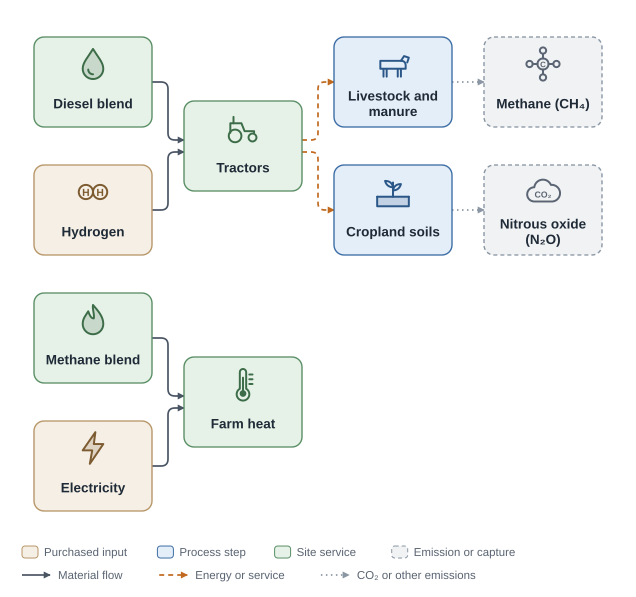

# Agriculture {#sec-agriculture}

Most of agriculture's greenhouse-gas emissions come not from burning fuel but from biological and chemical processes: methane (CH₄) from livestock digestion and manure, and nitrous oxide (N₂O) from soils. CIMS builds the sector around those process emissions and the practices that cut them, with on-farm tractors and heat as smaller energy services. The sector's activity is measured in tonnes of CO₂-equivalent, because emissions, not energy or output, are its organising variable.

## Scope

The sub-model covers livestock enteric fermentation and manure management (the CH₄ sources), cropland soils (the N₂O source, with the land-management practices that affect it), farm tractors, and farm process and building heat. Adjacent activities sit elsewhere:

- Nitrogen fertilizer manufacture belongs to [Chemicals](sector_chemicals.qmd).
- Food and beverage processing belongs to @sec-light-industrial.
- Biofuel production, including the cultivation of its feedstock, belongs to the Biofuels sector.
- The fuels burned on farms come from the energy-supply sectors.

## Context

Agriculture produces roughly 8 % of Canada's greenhouse-gas emissions, almost all of them non-CO₂. Enteric fermentation, the methane cattle and other ruminants produce as they digest forage, is the largest single source at about 46 % of agricultural emissions; manure management (CH₄ and N₂O) adds about 27 %; and soils emit N₂O, chiefly from nitrogen fertilizer and crop residues [@nfu-ag-ghg]. On-farm fuel use for tractors, grain drying, and heating is comparatively small and mostly diesel and natural gas.

Because the emissions are biological, the levers are agronomic and dietary more than technological: feed additives and rumen modification to cut enteric methane, changes to manure handling, nitrogen and tillage management to cut soil N₂O, and land uses such as agroforestry and wetland restoration that store carbon. The feed additive 3-nitrooxypropanol (3-NOP), for example, cuts enteric methane by about 30 % on average [@threenop].

## Process flow

::: {#fig-agriculture-process}
{.light-content .lightbox group="agriculture-light" width=85%}

{.dark-content .lightbox group="agriculture-dark" width=85%}

Process flow of the agriculture sector. The emitting processes request tractor work; farm heat serves drying and livestock housing.
:::

## Model structure

The Product sub-tree holds the two emitting processes; the Service sub-tree holds tractors, heat, and the diesel and methane fuel blends. The technology database does not yet cover agriculture, so the technologies below come from the model inputs, pending the database.

### Livestock and manure

The **Enteric Fermentation and Manure Management** node carries the livestock methane source. Conventional livestock competes with a package of dietary and biological interventions (feed additives such as 3-NOP, methane vaccines, and rumen modification) that cuts the enteric-CH₄ factor by roughly 60 % in the data. Both request tractor work.

::: {.tech-block}
Technologies (from the model inputs, pending the technology database)

| Technology | What it is | Type | TRL |
|:------------------------|:------------------------------------------------------|:--------------|:------|
| Livestock | Conventional livestock practice, emitting enteric and manure CH₄. | Conventional | n/a |
| Livestock + vaccines + rumen changes | Feed additives, methane vaccines, and rumen modification; available from 2035 in the data. | Prospective | n/a |

:::

### Cropland soils

The **Soils** node carries the cropland N₂O source. Tillage practices compete on their N₂O intensity and the tractor work they need, and two land uses store carbon.

::: {.tech-block}
Technologies (from the model inputs, pending the technology database)

| Technology | What it is | Type | TRL |
|:------------------------|:------------------------------------------------------|:--------------|:------|
| Conventional tillage | Full tillage, with the highest soil N₂O and tractor work. | Conventional | n/a |
| Minimal tillage | Reduced tillage, with lower N₂O and about half the tractor work. | Alternative | n/a |
| Zero tillage | No-till seeding, with the lowest N₂O and tractor work. | Alternative | n/a |
| Agroforestry | Trees integrated with cropland, storing carbon in biomass and soil. | Alternative | n/a |
| Wetland restoration | Restored wetlands that avoid emissions and store carbon. | Alternative | n/a |

:::

### Tractors

The **Tractors** node supplies the field work that the livestock and soils practices request. Diesel tractors burn the diesel blend; the hydrogen option requests hydrogen directly.

::: {.tech-block}
Technologies (from the model inputs, pending the technology database)

| Technology | What it is | Type | TRL |
|:------------------------|:------------------------------------------------------|:--------------|:------|
| Diesel, standard | Standard diesel tractor. | Conventional | 9 |
| Diesel, medium efficiency | More efficient diesel tractor. | Efficiency variant | 9 |
| Hydrogen | Hydrogen-fuelled tractor. | Prospective | n/a |

:::

### Farm heat

The **Heat** node supplies farm process and building heat, such as grain drying and livestock housing.

::: {.tech-block}
Technologies (from the model inputs, pending the technology database)

| Technology | What it is | Type | TRL |
|:------------------------|:------------------------------------------------------|:--------------|:------|
| Standard natural gas | Gas-fired farm heater burning the methane blend. | Conventional | 9 |
| Efficient natural gas | Higher-efficiency gas-fired heater. | Efficiency variant | 9 |
| Standard electric | Electric farm heater. | Alternative | 9 |
| Efficient electric | Higher-efficiency electric heater. | Alternative | 9 |

:::

The diesel and methane fuel blends are described in @sec-fuel-blends.

<mark>TODO: Separate manure management from enteric fermentation, so that anaerobic digestion, covered storage, and solid–liquid separation can be represented; manure is about a quarter of agricultural emissions and has distinct, often low-cost, abatement.</mark>

<mark>TODO: Add nitrogen-management options (4R stewardship and nitrification inhibitors) at the Soils node, since fertilizer-driven N₂O is a major and low-cost source of abatement.</mark>

## Decarbonisation

- **Enteric methane.** Feed additives, vaccines, and rumen modification, represented as one package, are the main lever on the largest source.
- **Manure methane.** Anaerobic digestion and covered storage would capture or avoid manure methane, but the model does not yet separate manure from enteric emissions.
- **Soil N₂O and carbon storage.** Reduced and zero tillage cut N₂O and tractor fuel; agroforestry and wetland restoration store carbon and can be net-sequestering.
- **On-farm energy.** Efficient and hydrogen tractors cut diesel CO₂, and electric and efficient heaters cut heating emissions.

The emissions accounting is almost entirely non-CO₂: CH₄ factors on the livestock node and N₂O factors on the soils node enter on a CO₂-equivalent basis at their high global-warming potentials, and the carbon-storing land uses can carry net-negative factors. A carbon price therefore acts directly on the abatement practices.

## Regional coverage and differences

All seven modelled regions carry the agriculture structure. The Prairie provinces (Alberta, Saskatchewan, and Manitoba) dominate both cattle and cropland emissions; Ontario and Québec have mixed livestock and cropping; and the Atlantic region and British Columbia have smaller, more specialised farm sectors.

<mark>TODO: Calibrate the regional balance of livestock and cropland emissions and the baseline tillage mix, since the effect and cost of the abatement practices depend on them.</mark>

## Limitations and planned extensions

The agriculture sub-model captures the dominant emissions and the main practice-based levers, but it is coarse: manure is lumped with enteric fermentation, nitrogen management is missing, and soil-carbon storage is simplified even though its permanence and measurement are difficult.

<mark>TODO: Benchmark modelled agricultural CH₄ and N₂O against the National Inventory Report and Agriculture and Agri-Food Canada data.</mark>



```{=latex}
\phantomsection
```

## References {.unnumbered}

```{=latex}
\printbibliography[heading=none]
```

::: {#refs}
:::
