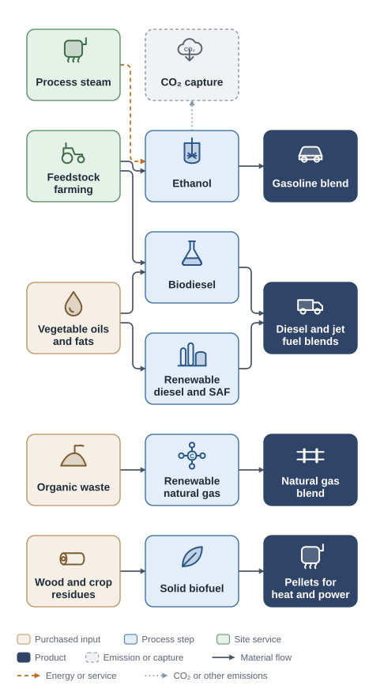
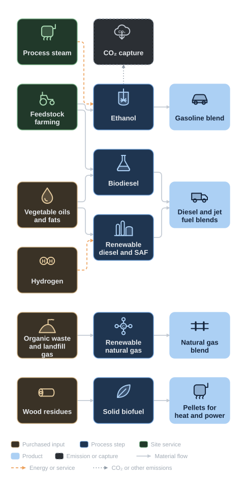

---
bibliography:
  - references.bib
  - tech-data_references.bib
aliases:
  - sector_ethanol.html
  - sector_biodiesel.html
  - sector_biofuels_ethanol.html
  - sector_biofuels_biodiesel.html
---

# Biofuels {#sec-biofuels}

The Biofuels sector makes fuels from plants, wood, and waste. Other sectors blend these fuels into the gasoline, diesel, jet fuel, and natural gas they burn. The sector makes five products: ethanol, biodiesel, renewable diesel and sustainable aviation fuel (SAF), renewable natural gas (RNG), and wood pellets.

A biofuel is only as clean as the way it is made. Growing crops takes diesel for farm machinery and nitrogen fertilizer, which releases nitrous oxide (N₂O), a strong greenhouse gas. So CIMS counts the emissions of growing the feedstock, not just of running the plant, and does not treat biofuels as automatically carbon-free. Ethanol plants also give off a stream of almost pure carbon dioxide (CO₂) when the grain ferments. That stream is one of the cheapest sources of CO₂ to capture anywhere in the energy system.

## Scope

The sector covers the plants that make each fuel and the services those plants use: growing the feedstock, process steam, fuel and electricity for the plant, and carbon capture. Its products go into the fuel blends that other sectors draw on (see @sec-fuel-blends). Demand for biofuels therefore comes from the fuel choices in those sectors and from renewable-fuel policy, not from a fixed production target.

Some related activities sit in other chapters:

- Fossil gasoline and diesel, and refineries that process plant oils alongside crude oil, are covered in @sec-petroleum-refining.
- The hydrogen that renewable diesel plants use can come from @sec-hydrogen.
- Feedstock farming appears here only as a service, the **Feedstock Farming** step, not through the full farm model in @sec-agriculture. Landfill methane that is flared or burned on site belongs to @sec-waste.
- The fuels are burned in the transport, industry, and building sectors that use the blends.

## Context

Canada can make about 1,900 million litres of ethanol and about 700 million litres of biodiesel a year. Most Canadian ethanol comes from grain: corn in Ontario and the East, and wheat in the West. It is fermented and blended into gasoline to meet the federal Clean Fuel Regulations and provincial blending rules [@nrcan-ethanol]. Ethanol can also be made from crop residues, wood, and other plant fibre, called cellulosic ethanol. That route is much less developed, but its emissions are far lower because it avoids growing a dedicated grain crop [@cen-ethanol].

Biodiesel is made by reacting vegetable oils or animal fats with methanol. About 90 % of Canada's plant-based diesel comes from canola, with tallow and used cooking oil making up the rest [@nrcan-biodiesel; @cer-renewable-diesel]. Renewable diesel uses the same oils and fats but treats them with hydrogen instead. The result is chemically the same as fossil diesel, so engines can use it at any blend. Renewable diesel now dominates new Canadian capacity: Canada made about 687 million litres in 2024, and planned plants could triple that.

Feedstock matters most. Crop-based fuels carry the emissions of farm diesel and fertilizer, while fuels made from waste fats and used cooking oil can cut lifecycle emissions by 79–86 % compared with fossil diesel [@cer-renewable-diesel].

## Process flow

@fig-biofuels-process shows the five products, the feedstocks and services they draw on, and the fuel blends they supply.

::: {#fig-biofuels-process}
{.light-content .lightbox group="biofuels-light"}

{.dark-content .lightbox group="biofuels-dark"}

Process flow of the Biofuels sector. Each product feeds a fuel blend in the sectors that burn it. Plant fuel and electricity, and the hydrogen renewable diesel plants use, are not shown: the plants' choices among them change over time.
:::

## Model structure

Each of the five fuels is a competition among ways of making it. The plants then request services: feedstock from farms, steam, fuel and electricity, and carbon capture.

### Ethanol

A grain ethanol plant grinds the grain, cooks it with water and enzymes to turn its starch into sugar, and ferments the sugar with yeast. Fermentation makes a weak alcohol mixture, which the plant boils and condenses (distils) and then dries to make fuel ethanol. The leftover solids are dried into animal feed. Cooking, distilling, and drying all need heat, which is where most of a plant's energy goes [@kwiatkowski_2006_001].

Fermentation also releases CO₂ that is almost pure. A plant can capture it with little more than drying and compression, which is why the capture-equipped fermenter is among the cheapest capture options in the model [@sanchez_2018_001]. Cellulosic plants first break down tough plant fibre into sugars, which takes more processing. Emerging options make ethanol from gasified biomass or from captured CO₂ and hydrogen.



### Biodiesel

A biodiesel plant first cleans the oil or fat. It then reacts it with methanol and a catalyst, a process called transesterification, which splits the fat into biodiesel and glycerin. The plant recovers the leftover methanol, refines the glycerin for sale, and distils the biodiesel. Waste oils contain more free fatty acids, which need an acid catalyst or extra pretreatment [@haas_2006_001].



### Renewable diesel and SAF

Renewable diesel plants react oils and fats with hydrogen at high temperature and pressure. This removes the oxygen and reshapes the molecules into diesel and jet fuel. These plants include converted refineries. Hydrogen is their main energy input, which sets them apart from biodiesel plants. Emerging routes gasify biomass or waste and build liquid fuels from the gas, turn ethanol into jet fuel, or make fuel from captured CO₂ and hydrogen [@brown_2020_001].



### Renewable natural gas

Renewable natural gas starts as biogas: the methane-rich gas that bacteria make when they break down manure, food waste, or landfilled waste without air. Plants clean the biogas and remove its CO₂ so it can go into the gas grid. Gasifying wood and turning the gas into methane is an emerging alternative [@etsap_2013_012].



### Solid biofuel

Pellet mills dry, grind, and press sawdust, shavings, and chips into wood pellets for heating and power plants. Torrefaction, which roasts the wood without air before pressing it, makes denser pellets that resist water [@etsap_2013_010].



### Feedstock farming

The **Feedstock Farming** service covers the energy and emissions of growing grain and oilseed feedstocks. Farm equipment running on diesel, more efficient diesel equipment, and equipment running on biodiesel compete to provide it. The technology database does not cover this service; its technologies come from the CIMS model inputs.

### Shared services

| Service | What it supplies | Technologies |
|:--------|:-----------------|:-------------|
| Steam | Heat for cooking, distilling, drying, and reactions | @sec-industrial-heat |
| Fuel blends | The diesel and natural gas blends the plants burn | @sec-fuel-blends |
| CCS | Capture of the pure CO₂ from fermentation and gasifiers, and of CO₂ in flue gas | @sec-ccus |

: Shared services in the Biofuels sector {#tbl-biofuels-shared}

The steam service also offers one option specific to biofuel plants:



## Decarbonisation

Cutting biofuel emissions means cutting the emissions over the fuel's whole life, from the farm to the plant.

- **Feedstock.** Waste oils and crop residues avoid most of the emissions of growing crops, including fertilizer N₂O, and cellulosic feedstock does the same for ethanol. Waste oil is limited, and renewable diesel and biodiesel compete for it.
- **Capturing fermentation CO₂.** Fermentation CO₂ needs only drying and compression before storage, so capturing it costs a small fraction of capturing CO₂ from flue gas. Because the carbon came from plants, storing it removes CO₂ from the atmosphere overall, an approach known as bioenergy with carbon capture and storage (BECCS).
- **Plant energy.** Electric boilers, biomass and biogas boilers, and biogas engines that also supply heat reduce the plants' own emissions. The natural gas blend can swap fossil gas for biogas or hydrogen.
- **Farm energy.** More efficient or biodiesel-powered farm equipment reduces the emissions of growing feedstock.

CIMS counts CO₂, methane, and N₂O over each fuel's whole life. A biofuel's benefit is the difference between its lifecycle emissions and those of the fossil fuel it replaces.

## Regional coverage and differences

All seven regions in the model carry the sector. Corn ethanol is concentrated in Ontario and the East, and wheat ethanol in the Prairies. Canola biodiesel is concentrated in Saskatchewan, Alberta, and Manitoba, while waste oils and tallow come from across the country. Regions differ mainly in their feedstocks and in how clean the electricity is that their plants use.

<mark>TODO: Calibrate the regional feedstock mixes and carbon intensities (corn, wheat, and cellulosic ethanol; canola, tallow, and used cooking oil) against Clean Fuel Regulations pathway data and Canadian crop-residue supply estimates.</mark>

## Limitations and planned extensions

<mark>TODO: The ethanol and biodiesel input files predate the new hierarchy. Build the renewable diesel and SAF, renewable natural gas, and solid biofuel products in the regional input files, with renewable diesel's hydrogen demand drawn from the Hydrogen sector.</mark>

<mark>TODO: Add a feedstock-supply limit so that the supply of waste oil and residues caps the lowest-emission routes, and consider linking feedstock farming to the Agriculture sector.</mark>

<mark>TODO: Benchmark modelled biofuel output and carbon intensity against Natural Resources Canada, Canada Energy Regulator, and Clean Fuel Regulations data.</mark>



```{=latex}
\phantomsection
```

## References {.unnumbered}

```{=latex}
\printbibliography[heading=none]
```

::: {#refs}
:::
