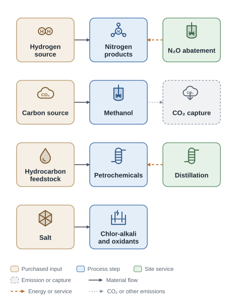

# Chemicals {#sec-chemical-products}

The chemicals sector is not one production chain but several: nitrogen products made from ammonia, methanol, petrochemicals made from ethane, propane, and naphtha, and the electrochemical products made from salt and electricity. Much of its emissions are **process emissions** rather than fuel combustion: CO₂ released when natural gas is reformed or hydrocarbons are cracked, and N₂O from nitric and adipic acid production. This chapter covers the sector as a whole; three sub-sector chapters describe each chain's process steps and technologies:

- @sec-chemicals-nitrogen: ammonia, nitric acid, urea, other fertilizers, adipic acid, and N₂O abatement;
- @sec-chemicals-chlor-alkali: chlorine and caustic soda, sodium chlorate, and hydrogen peroxide; and
- @sec-chemicals-petrochemicals: olefins, aromatics, polymers, olefin derivatives, and methanol.

## Scope

CIMS represents the energy-intensive chemical products that dominate the sector's energy use and emissions. A forecast of output for each product, in tonnes, drives its process steps and the services they request.

Several adjacent activities sit elsewhere in CIMS to avoid double-counting:

- Petroleum refining, which produces the fuels and refinery streams some chemical plants use as feedstock, is covered in @sec-petroleum-refining. This sub-model takes ethane, propane, naphtha, and natural gas as purchased inputs.
- Merchant hydrogen production is covered in @sec-hydrogen.
- Fuel and feedstock supply enters through the energy supply sectors and the fuel blend nodes (@sec-fuel-blends).

The sub-model stops at saleable primary and intermediate chemicals, fertilizers, and polymers. Compounding and plastics fabrication belong to Rubber and Plastics in @sec-light-industrial.

## Context

Canada's chemical industry is large, export-oriented, and regional, and it sits on the country's cheap natural gas. Alberta hosts the largest concentration of chemical and petrochemical plants in Canada, centred on the Industrial Heartland northeast of Edmonton: its four ethane crackers have a combined capacity of about 4.1 Mt per year of ethylene, roughly 80 % of national capacity, and the province is also the centre of ammonia, urea, and methanol production, which locate near low-cost gas [@invest-alberta; @cer-ethane]. Ontario has the most diverse product slate, including the country's adipic acid production alongside petrochemicals and chlor-alkali; Québec and Saskatchewan add ammonia, fertilizer, and petrochemical capacity; and British Columbia makes mainly pulp-bleaching chemicals (chlor-alkali, sodium chlorate, and hydrogen peroxide).

Feedstock chemistry sets the sector apart. In ammonia and methanol plants, natural gas is reformed to synthesis gas, and the carbon in that gas leaves as CO₂ as an unavoidable part of the chemistry; conventional ammonia carries roughly 1.8–2.4 t CO₂ per tonne on this basis [@rmi-ammonia]. Steam crackers break ethane or naphtha into olefins in high-temperature furnaces, releasing both combustion and process CO₂. Nitric and adipic acid plants release nitrous oxide (N₂O), a greenhouse gas with roughly 270–300 times the warming effect of CO₂.

## Process flow

@fig-chemicals-process shows the four production chains, the purchased inputs they start from, and the sector-wide services they request. Each chain has its own flowchart in its sub-sector chapter.

::: {#fig-chemicals-process}
{.light-content .lightbox group="chemicals-light"}

{.dark-content .lightbox group="chemicals-dark"}

Process flow of the chemicals sector. Each production chain is described in its own sub-sector chapter.
:::

## Model structure

Each chemical product is its own node in the Product sub-tree, with the technologies that make it competing at that node. Two services are specific to the sector:

- **N₂O abatement**, requested by the nitric and adipic acid plants, is described with them in @sec-chemicals-nitrogen.
- **Distillation**, the trains that separate petrochemical intermediates and products, is requested by the petrochemical steps. It is measured in tonnes of product.

**Distillation**



### Shared services

The sector also draws on the shared services documented in the General Services part:

| Service | What it supplies | Technologies |
|:--------|:-----------------|:-------------|
| Steam | Process steam, from boilers, CHP, heat pumps, and other heat supply; a large load in chemicals | @sec-industrial-heat |
| Machine drive | Pumps, fans and blowers, compressed air, materials handling, and materials processing; compressors are a major load in synthesis and refrigeration | @sec-machine-drive |
| HVAC and lighting | Heating, cooling, and lighting of plant buildings | @sec-hvac-lighting |
| Fuel blends | Diesel and methane blends | @sec-fuel-blends |
| CCS | Capture of concentrated CO₂ from reforming, gasification, and ethylene oxide plants, and of diffuse CO₂ from cracker furnaces | @sec-ccus |

: Shared services in the chemicals sector {#tbl-chemicals-shared}

## Decarbonisation

Because so much of the sector's emissions come from feedstock chemistry, the decisive levers are the production routes themselves, and whether their process CO₂ is captured or avoided:

- **Ammonia and methanol.** Capture on the reformer's concentrated CO₂ stream (blue production), electrolytic hydrogen in place of the reformer (green production, cutting emissions by roughly 95–98 % relative to conventional ammonia when the electricity is low-carbon [@rmi-ammonia]), and biomass gasification.
- **Olefins.** Capture on cracker furnace flue gas, hydrogen-fired or electrified cracker furnaces, and alternative routes from ethanol, methanol, or biomass. An electrified cracker demonstrated at pilot scale can transfer about 95 % of its heat to the process and cut cracking-furnace CO₂ by up to about 90 % on low-carbon electricity [@basf-ecracker; @rmi-chemistry].
- **N₂O.** Catalytic and thermal destruction remove most of the N₂O from acid plants. Their value in the model depends on the carbon price applying to N₂O on a CO₂-equivalent basis.
- **Heat and electrochemistry.** Steam and distillation heat can move to heat pumps, electric boilers, and heat-integrated or heat-pumped distillation. The electrochemical products already run on electricity, so their emissions follow the grid and the efficiency of the cells and evaporators.

## Regional coverage and differences

The tree is region-agnostic: each province is built from the same structure and carries no production on branches that don't apply. In the current regional data, five regions are represented:

- Alberta is by far the largest, dominated by ammonia, methanol, and petrochemicals, consistent with its gas-based Industrial Heartland; its modelled output grows over the projection.
- Ontario carries the most diverse slate and is the only region with adipic acid, alongside ammonia, chlor-alkali, hydrogen peroxide, petrochemicals, and sodium chlorate.
- Québec and Saskatchewan carry ammonia, the chlor-alkali group, and petrochemicals at smaller scale.
- British Columbia carries the pulp-bleaching chemicals and ammonia, but no petrochemicals.

<mark>TODO: Only five provinces are represented. Confirm whether any other region hosts chemical production that should be included, and whether British Columbia still has no petrochemical production.</mark>

<mark>TODO: The product-demand trajectories and regional product mixes are inherited from older calibrations. Revisit them against announced Alberta petrochemical and low-carbon ammonia and hydrogen projects.</mark>

## Limitations and planned extensions

<mark>TODO: The hierarchy now splits ammonia and methanol into separate products, adds urea and other fertilizers ahead of CIMS, regroups the petrochemicals into olefins, aromatics, polymers, and derivatives, and adds N₂O abatement and distillation services. Update the regional model input files to match.</mark>

<mark>TODO: Benchmark modelled chemicals energy use and emissions, including process CO₂ and N₂O, against CIEEDAC, the National Inventory Report, and Natural Resources Canada data.</mark>



```{=latex}
\phantomsection
```

## References {.unnumbered}

```{=latex}
\printbibliography[heading=none]
```

::: {#refs}
:::
