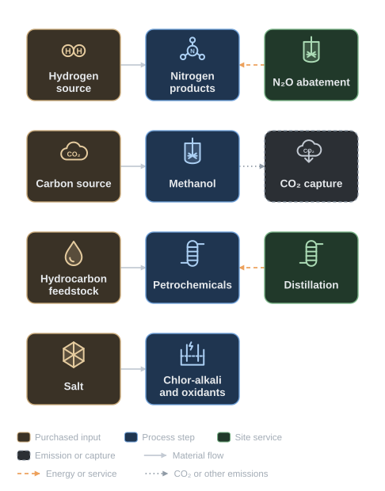

---
bibliography:
  - references.bib
  - tech-data_references.bib
aliases:
  - sector_chemical_products.html
---

# Chemicals {#sec-chemical-products}

The chemicals sector is not one production chain but four. Ammonia is the base for nitrogen fertilizers and nitric and adipic acid. Methanol is a basic building block for other chemicals and fuels. Petrochemicals turn light hydrocarbons into plastics, glycol, and solvents. And electrochemical plants turn salt and electricity into chlorine, caustic soda, and pulp-bleaching chemicals.

A large share of the sector's emissions does not come from burning fuel. It comes from the chemistry itself. Making hydrogen for ammonia and methanol from natural gas releases the gas's carbon as CO₂, and cracking hydrocarbons into olefins releases more. Nitric and adipic acid plants release nitrous oxide (N₂O), a greenhouse gas with roughly 270–300 times the warming effect of CO₂. These **process emissions** shape both how CIMS represents the sector and which technologies can cut its emissions.

This chapter covers the sector as a whole. Three sub-sector chapters describe each chain's process steps and technologies:

- @sec-chemicals-nitrogen: ammonia, nitric acid, urea, other fertilizers, adipic acid, and N₂O abatement;
- @sec-chemicals-chlor-alkali: chlorine and caustic soda, sodium chlorate, and hydrogen peroxide; and
- @sec-chemicals-petrochemicals: olefins, aromatics, polymers, olefin derivatives, and methanol.

## Scope

CIMS represents the chemical products that account for most of the sector's energy use and emissions. A forecast of how much of each product the sector makes drives its process steps and the services those steps request.

Some related activities sit elsewhere in CIMS, so their energy and emissions are not counted twice:

- Petroleum refining, which supplies some of the streams chemical plants use as feedstock, is covered in @sec-petroleum-refining.
- Hydrogen made for sale to other users is covered in @sec-hydrogen.
- Fuels reach the sector through the energy supply sectors and the fuel blends (@sec-fuel-blends).
- The sub-model stops at saleable chemicals, fertilizers, and plastic pellets. Turning plastics into finished goods belongs to Rubber and Plastics in @sec-light-industrial.

## Context

Canada's chemical industry is large, sells much of its output abroad, and clusters where its raw materials are. Alberta has the largest concentration of chemical plants in Canada, in the Industrial Heartland northeast of Edmonton. Its four ethane crackers make about 4.1 Mt of ethylene a year, roughly 80 % of national capacity, and the province also leads in ammonia, urea, and methanol, which locate near low-cost natural gas [@invest-alberta; @cer-ethane]. Ontario makes the widest range of products, including all of Canada's adipic acid alongside petrochemicals and chlor-alkali. Québec and Saskatchewan add ammonia, fertilizer, and petrochemical capacity. British Columbia makes mainly pulp-bleaching chemicals: chlor-alkali, sodium chlorate, and hydrogen peroxide.

The chemistry explains where the emissions come from. An ammonia or methanol plant first turns natural gas and steam into a mixture of hydrogen and carbon oxides called synthesis gas. The carbon has nowhere to go but out as CO₂, so a conventional ammonia plant emits roughly 1.8–2.4 t CO₂ for each tonne of ammonia even before any fuel is counted [@rmi-ammonia; @iea_2021_001]. Steam crackers heat ethane or naphtha above 800 °C in furnaces to break the molecules into ethylene and propylene, and the furnaces burn the cracker's own by-product gas as well as natural gas [@iea_2018_001]. Nitric acid plants make N₂O as a side reaction when they burn ammonia, and adipic acid plants release it when nitric acid oxidizes their feedstock.

## Process flow

@fig-chemicals-process shows the four production chains, the kinds of raw material they start from, and the sector-wide services they request. The inputs are named generically on purpose. The hydrogen for ammonia and methanol can come from natural gas, coal, biomass, or electrolysis of water; methanol's carbon can come from fossil fuels, biomass, or captured CO₂; and olefins can be made from ethane, naphtha, ethanol, methanol, or biomass. Which source wins depends on how the competition at each step plays out. Each chain has a more detailed flowchart in its sub-sector chapter.

::: {#fig-chemicals-process}
{.light-content .lightbox group="chemicals-light"}

{.dark-content .lightbox group="chemicals-dark"}

Process flow of the chemicals sector. Each production chain is described in its own sub-sector chapter.
:::

## Model structure

Each chemical product is its own node in the sector's Product sub-tree, and the technologies that can make it compete at that node. Two services are specific to the sector:

- **N₂O abatement** destroys the N₂O from nitric and adipic acid plants. It is described with those plants in @sec-chemicals-nitrogen.
- **Distillation** separates mixtures of chemicals by boiling them in tall columns, where lighter components rise and heavier ones fall. Petrochemical plants depend on it to separate their products, and it is one of the largest heat users in the sector. Conventional columns boil the liquid at the bottom with steam or a fired heater and throw the heat away at the top in a condenser. Heat-integrated designs reuse part of that heat inside the column train, and heat-pumped columns compress the vapour from the top so it can boil the liquid at the bottom, replacing steam with electricity [@kiss_2012_001].

**Distillation**



### Shared services

The sector also draws on the shared services documented in the General Services part:

| Service | What it supplies | Technologies |
|:--------|:-----------------|:-------------|
| Steam | Process steam from boilers, cogeneration, heat pumps, and other heat supply; a large load in chemicals | @sec-industrial-heat |
| Machine drive | Pumps, fans and blowers, compressed air, materials handling, and materials processing; compressors are a major load in synthesis and refrigeration | @sec-machine-drive |
| HVAC and lighting | Heating, cooling, and lighting of plant buildings | @sec-hvac-lighting |
| Fuel blends | Diesel and methane blends | @sec-fuel-blends |
| CCS | Capture of concentrated CO₂ from reforming, gasification, and ethylene oxide plants, and of diluted CO₂ from cracker furnaces | @sec-ccus |

: Shared services in the chemicals sector {#tbl-chemicals-shared}

## Decarbonisation

Because so much of the sector's emissions comes from the chemistry, the biggest levers are the production routes themselves, and whether their process CO₂ is captured or avoided:

- **Ammonia and methanol.** A plant can capture the concentrated CO₂ its reformer already separates (often called blue production). Or it can make hydrogen by electrolysis of water instead of reforming gas (green production), which cuts emissions by roughly 95–98 % compared with conventional ammonia when the electricity is low-carbon [@rmi-ammonia; @iea_2021_001]. Biomass gasification is a further route.
- **Olefins.** Crackers can capture CO₂ from furnace flue gas, burn hydrogen in their furnaces, or heat the cracking coils with electricity. An electric cracker demonstrated at pilot scale transfers about 95 % of its heat to the process and can cut cracking-furnace CO₂ by up to about 90 % on low-carbon electricity [@basf-ecracker; @rmi-chemistry]. Olefins can also be made from ethanol, methanol, or biomass.
- **N₂O.** Catalytic and thermal destruction remove most of the N₂O from acid plants. In the model, they pay off only when a carbon price applies to N₂O.
- **Heat and electrochemistry.** Steam and distillation heat can move to heat pumps, electric boilers, and heat-integrated or heat-pumped distillation. The electrochemical products already run on electricity, so their emissions follow the grid and the efficiency of their cells and evaporators.

## Regional coverage and differences

The model uses one structure for every province, and a province carries no production on branches that don't apply to it. In the current regional data, five regions have chemical production:

- Alberta is by far the largest, dominated by ammonia, methanol, and petrochemicals, in line with its gas-based Industrial Heartland; its modelled output grows over the projection.
- Ontario makes the widest range of products and is the only region with adipic acid, alongside ammonia, chlor-alkali, hydrogen peroxide, petrochemicals, and sodium chlorate.
- Québec and Saskatchewan carry ammonia, the chlor-alkali group, and petrochemicals at smaller scale.
- British Columbia carries the pulp-bleaching chemicals and ammonia, but no petrochemicals.

<mark>TODO: Only five provinces are represented. Confirm whether any other region hosts chemical production that should be included, and whether British Columbia still has no petrochemical production.</mark>

<mark>TODO: The product-demand trajectories and regional product mixes come from older calibrations. Revisit them against announced Alberta petrochemical and low-carbon ammonia and hydrogen projects.</mark>

## Limitations and planned extensions

<mark>TODO: The hierarchy now splits ammonia and methanol into separate products, adds urea and other fertilizers ahead of CIMS, regroups the petrochemicals into olefins, aromatics, polymers, and derivatives, and adds N₂O abatement and distillation services. Update the regional model input files to match.</mark>

<mark>TODO: Benchmark modelled chemicals energy use and emissions, including process CO₂ and N₂O, against CIEEDAC, the National Inventory Report, and Natural Resources Canada data.</mark>



```{=latex}
\phantomsection
```

## References {.unnumbered}

```{=latex}
\printbibliography[heading=none]
```

::: {#refs}
:::
