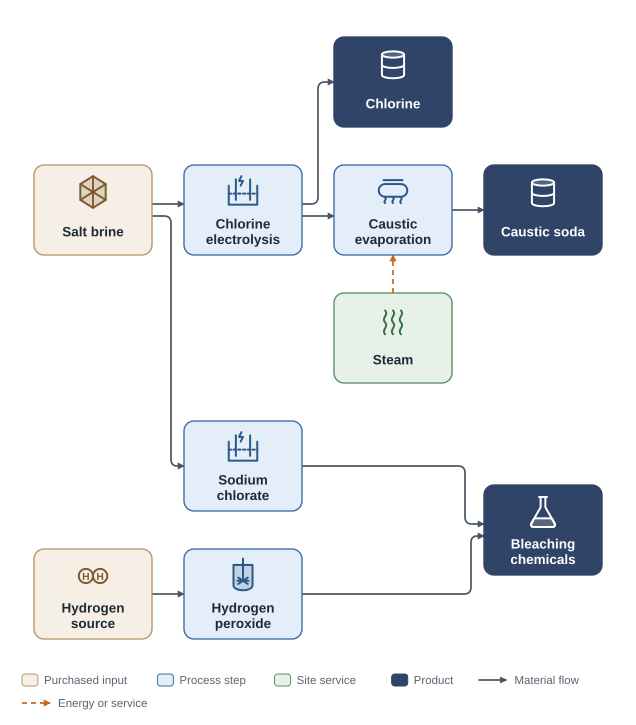
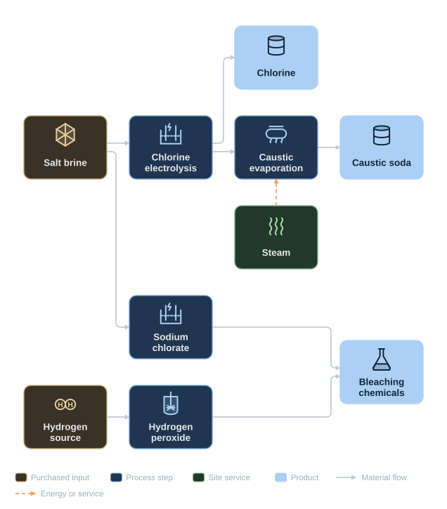

# Chemicals: Chlor-Alkali and Oxidants {#sec-chemicals-chlor-alkali}

Chlorine, caustic soda, sodium chlorate, and hydrogen peroxide are made mostly with electricity, and much of Canada's output supplies pulp bleaching. Their emissions therefore follow the grid more than any fuel or feedstock. This chapter covers this chain of the chemicals sector; @sec-chemical-products describes the sector as a whole.

## Process flow

@fig-chemicals-chlor-alkali-process shows the chain. Electrolysis of salt brine makes chlorine, weak caustic soda, and hydrogen; the caustic is concentrated by evaporation, using steam. Sodium chlorate cells also electrolyze brine. Hydrogen peroxide is made by hydrogenating and oxidizing an anthraquinone working solution.

::: {#fig-chemicals-chlor-alkali-process}
{.light-content .lightbox group="chemicals-chlor-alkali-light"}

{.dark-content .lightbox group="chemicals-chlor-alkali-dark"}

Process flow of chlor-alkali and oxidants.
:::

## Model structure

### Chlorine electrolysis

Chlor-alkali cells split salt brine into chlorine, caustic soda, and hydrogen. Membrane cells are today's standard; diaphragm and mercury cells are legacy stock that use more energy, and oxygen-depolarized cathodes cut cell voltage further. The node is measured in tonnes of product.



### Caustic evaporation

Membrane-cell caustic soda leaves the cell at about 32 % and is concentrated to 50 % in steam-heated evaporators. Mechanical vapour recompression replaces most of the live steam with electricity.



### Sodium chlorate

Sodium chlorate cells electrolyze brine to make chlorate for pulp bleaching. The node is measured in tonnes of product.



### Hydrogen peroxide

Anthraquinone plants hydrogenate and air-oxidize a working solution, then extract and distil the peroxide. The node is measured in tonnes of hydrogen peroxide.



## Decarbonisation

These products already run mainly on electricity, so their emissions fall as the grid decarbonizes. Within the sector, the levers are more efficient cells (membrane and oxygen-depolarized cathodes in place of diaphragm and mercury cells) and electrified evaporation through mechanical vapour recompression, which cuts the steam the evaporators draw.
