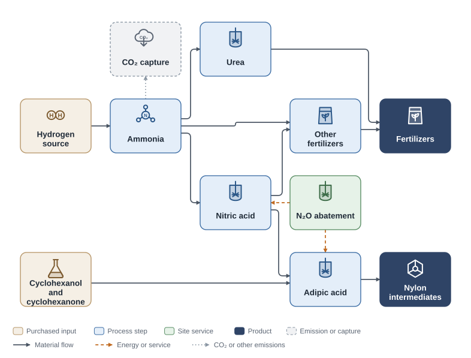
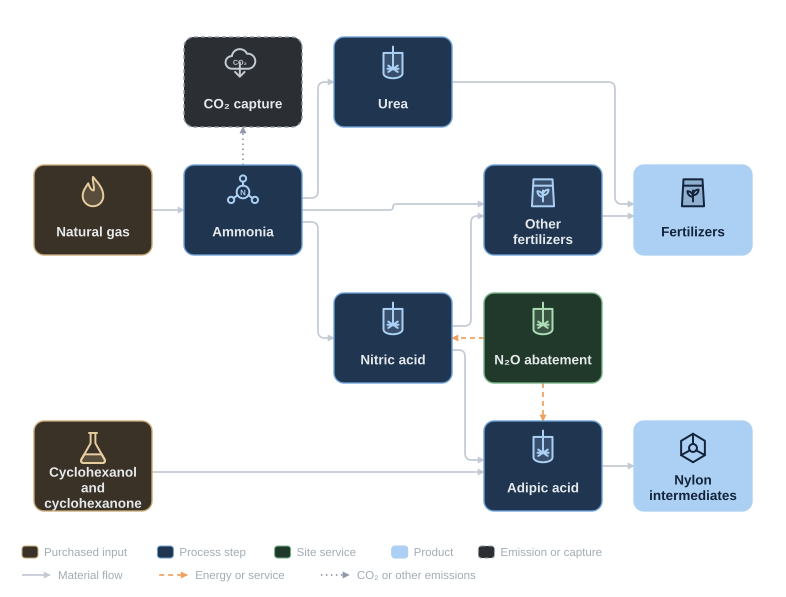

---
bibliography:
  - references.bib
  - tech-data_references.bib
---

# Chemicals: Nitrogen Products {#sec-chemicals-nitrogen}

Ammonia is the starting point for Canada's nitrogen fertilizers and for nitric and adipic acid. It is also the chemicals sector's largest source of process CO₂, and the acids made from it are the sector's source of nitrous oxide (N₂O). This chapter covers the nitrogen chain; @sec-chemical-products describes the sector as a whole.

## Process flow

@fig-chemicals-nitrogen-process shows the chain. Ammonia is made by combining hydrogen with nitrogen from the air. Most ammonia then goes into fertilizers: urea, made by reacting ammonia with CO₂, and other fertilizers such as ammonium nitrate. Some ammonia is burned to make nitric acid, which goes into fertilizers or is used to make adipic acid, a building block for nylon.

The hydrogen source is shown generically. Today it comes from reforming natural gas, but coal or biomass gasification and electrolysis of water compete to supply it.

::: {#fig-chemicals-nitrogen-process}
{.light-content .lightbox group="chemicals-nitrogen-light"}

{.dark-content .lightbox group="chemicals-nitrogen-dark"}

Process flow of nitrogen products. The nitric and adipic acid plants request N₂O abatement.
:::

## Model structure

### Ammonia

An ammonia plant has two main parts. The first makes hydrogen. In a conventional plant, a **steam reformer** heats natural gas with steam over a catalyst in tubes inside a large furnace, producing a mix of hydrogen, carbon monoxide, and CO₂. Further steps convert the carbon monoxide to more hydrogen and CO₂ and then strip the CO₂ out as a nearly pure stream. The second part, the **Haber-Bosch synthesis loop**, combines the hydrogen with nitrogen from the air at high pressure and temperature over an iron catalyst to make ammonia.

The energy goes mainly into the reformer furnace and into the large compressors that pressurize the synthesis loop. The emissions come from two places: the furnace's flue gas, and the CO₂ separated from the hydrogen, which is chemistry rather than combustion [@iea_2021_001; @fertilizer-canada_2023_001]. Part of that separated CO₂ already goes to urea.

The competing technologies differ in how they make the hydrogen:

- Efficiency measures on a conventional plant recover more heat and cut fuel use.
- An autothermal reformer burns part of the gas with oxygen inside the reactor instead of heating it in an external furnace, which puts nearly all the CO₂ into one concentrated stream that is easier to capture.
- Coal or biomass gasification makes the hydrogen by partly burning the solid fuel with oxygen and steam.
- An electrolytic plant splits water with electricity and needs no reformer at all; the synthesis loop is unchanged [@smith_2020_001]. Like the reforming and gasification routes, it is a whole plant: its electrolysers are on site, and their electricity and cost are part of the technology, as its sources describe, so it buys no hydrogen.



### Urea

Urea plants react ammonia with CO₂ under pressure, then dry the urea into small beads or granules for sale as fertilizer. The CO₂ comes from the ammonia plant's hydrogen step, so urea locks up part of the process CO₂ until the fertilizer is applied to fields and releases it. A switch to electrolytic hydrogen leaves urea plants needing another source of CO₂.

In CIMS, the urea plant carries that credit itself. Urea fixes about 0.733 t CO₂ per tonne and releases about 0.038 t, so its process emission is −0.695 t CO₂ per tonne of urea. The credit has to sit on the technology: CIMS passes technology emissions through with no floor, but a negative service request carries no emissions. The ammonia plant still counts all of its process CO₂, and capture on ammonia should apply only to the CO₂ that urea does not take; the database records this as a note, not a cap.



### Nitric acid

Nitric acid plants burn ammonia with air over a platinum gauze, then absorb the resulting gases in water (the Ostwald process). The reaction gives off heat, so the plants raise steam rather than consume much fuel. A side reaction on the gauze also makes N₂O, which leaves in the tail gas unless the plant destroys it [@epa_2010_001].



### Other fertilizers

This step makes ammonium nitrate and calcium ammonium nitrate, urea-ammonium nitrate solutions, and ammonium phosphates and sulphate. Plants neutralize nitric acid or other acids with ammonia, then evaporate the water and form the product into granules or prills, which takes steam and drying heat.



### Adipic acid

Adipic acid plants oxidize cyclohexanol and cyclohexanone, purchased from petrochemical plants, with nitric acid. The reaction releases N₂O in the off-gas, in larger amounts per tonne of product than a nitric acid plant.



### N₂O abatement

The nitric and adipic acid plants request **N₂O abatement** in tonnes of N₂O: about 0.0085 t per tonne of nitric acid and 0.30 t per tonne of adipic acid. The acid plants' own N₂O emissions are left out, so the N₂O is counted once, at the abatement service. Each abatement option is counted per tonne of N₂O handled: with no abatement the whole tonne escapes, thermal destruction leaves about 0.01 t, and catalytic abatement about 0.22 t (a pooled value). Leaving the N₂O untreated costs nothing, and it competes with two ways of destroying it. Catalytic abatement adds a catalyst inside or after the ammonia burner that breaks N₂O into nitrogen and oxygen. Thermal destruction burns the adipic acid off-gas, which also raises steam [@epa_2010_001]. In the model, abatement wins only when a carbon price applies to N₂O.



## Decarbonisation

A conventional ammonia plant emits roughly 1.8–2.4 t CO₂ per tonne of ammonia, most of it process CO₂ from making hydrogen [@rmi-ammonia]. Three kinds of route cut it:

- capturing the concentrated process CO₂ the plant already separates, either on a conventional steam reformer or on an autothermal reformer designed for capture;
- making the hydrogen by electrolysis of water, which cuts emissions by roughly 95–98 % when the electricity is low-carbon [@rmi-ammonia; @iea_2021_001]; and
- gasifying biomass instead of reforming natural gas.

For the acids, catalytic and thermal destruction remove most of the N₂O, a gas with roughly 270–300 times the warming effect of CO₂.

<mark>TODO: The electrolytic ammonia plant makes its own hydrogen on site. When the Hydrogen sector (@sec-hydrogen) is revised to choose between on-site and pipeline hydrogen, consider offering the synthesis loop alone, buying hydrogen from that sector, alongside or instead of the whole plant.</mark>

<mark>TODO: No technology yet serves the other-fertilizers node beyond ammonium nitrate; add urea-ammonium nitrate and ammonium phosphate and sulphate plants as data allow.</mark>



```{=latex}
\phantomsection
```

## References {.unnumbered}

```{=latex}
\printbibliography[heading=none]
```

::: {#refs}
:::
