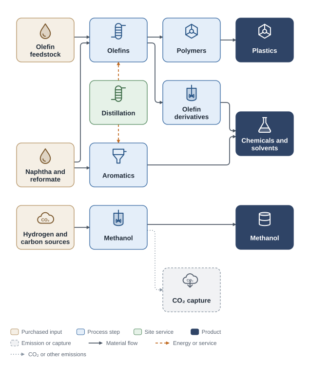
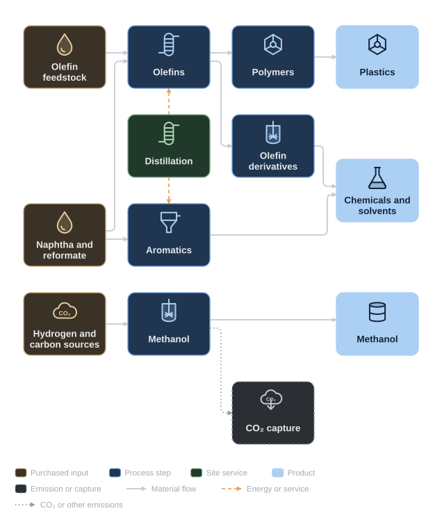

# Chemicals: Petrochemicals and Methanol {#sec-chemicals-petrochemicals}

Canada's petrochemical industry cracks ethane, mainly in Alberta, to make ethylene and the polyethylene and ethylene glycol made from it, with naphtha cracking and aromatics recovery at Sarnia. Methanol is made from natural gas, mainly in Alberta. This chapter covers this chain of the chemicals sector; @sec-chemical-products describes the sector as a whole.

## Process flow

@fig-chemicals-petrochemicals-process shows the chain. Steam crackers and propane dehydrogenation make olefins (ethylene and propylene), which go to polymers and to derivatives such as ethylene oxide and glycol. Aromatics are recovered from refinery reformate or pyrolysis gasoline. Both steps request distillation. Methanol is synthesized from reformed natural gas.

::: {#fig-chemicals-petrochemicals-process}
{.light-content .lightbox group="chemicals-petrochemicals-light"}

{.dark-content .lightbox group="chemicals-petrochemicals-dark"}

Process flow of petrochemicals and methanol. Distillation is described in @sec-chemical-products.
:::

## Model structure

### Olefins

The olefins node makes ethylene and propylene, measured in tonnes of high-value chemicals. Fired tubular steam crackers on ethane are the incumbent; propane dehydrogenation makes propylene; and the alternatives include catalytic and electrified cracking, hydrogen-fired furnaces, and olefins made from methanol, ethanol, or biomass.



### Aromatics

Aromatics plants recover benzene, toluene, and xylenes from reformate or pyrolysis gasoline by solvent extraction and extractive distillation. In Canada they are mostly integrated with refineries, at Sarnia and in Alberta. The node is measured in tonnes of aromatics.



### Polymers

Polyethylene and polypropylene reactors, with extrusion and pelletizing, turn olefins into polymer. The node is measured in tonnes of polymer.



### Olefin derivatives

This node holds ethylene oxide and glycol, made in Alberta, other olefin and aromatic derivatives, and chemical depolymerization of plastics back to monomer. It is measured in tonnes of product.



### Methanol

Methanol is synthesized from reformed natural gas, gasified coal or biomass, or captured CO₂ and hydrogen. It is measured in tonnes.



## Decarbonisation

Steam cracking is both energy- and emissions-intensive. The model offers capture on the cracker furnace flue gas, hydrogen-fired and electrified furnaces, catalytic cracking at lower temperature, and olefins made from ethanol, methanol, or biomass. An electrified cracker demonstrated at pilot scale can transfer about 95 % of its heat to the process and cut cracking-furnace CO₂ by up to about 90 % on low-carbon electricity [@basf-ecracker; @rmi-chemistry]. Ethylene oxide plants separate a nearly pure CO₂ stream that capture can take cheaply. For methanol, the options are capture on gasification routes, biomass or waste gasification, and synthesis from captured CO₂ and hydrogen.

<mark>TODO: The derivatives node groups products made by different processes (ethylene oxide, other derivatives, and depolymerization), so costs per tonne are not comparable across its technologies. Check whether it should be split.</mark>



```{=latex}
\phantomsection
```

## References {.unnumbered}

```{=latex}
\printbibliography[heading=none]
```

::: {#refs}
:::
