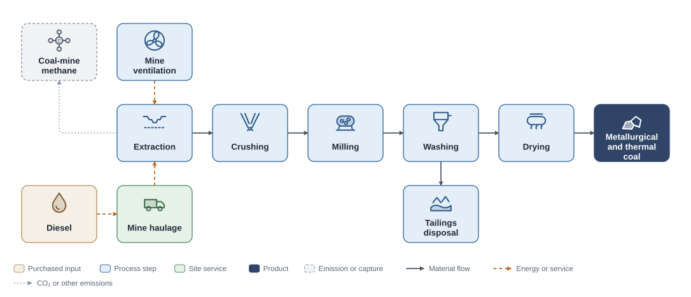

# Coal Mining {#sec-coal-mining}

Coal mining produces metallurgical coal for steelmaking and thermal coal for power and industrial heat. Its emissions come from two places: diesel in the mobile equipment, and methane released from the coal seam during mining. Coal-mine methane is the larger of the two, and the hierarchy now gives it its own node with technologies that drain, use, or destroy it.

## Scope

The sub-model covers coal extraction, size reduction, and preparation, from the mine face through crushing, milling, washing, and drying to a saleable product. Coal output, in tonnes, drives the sector. Both metallurgical and thermal coal are in scope.

Adjacent activities sit elsewhere to avoid double-counting: burning thermal coal for power is in @sec-electricity, and for industrial heat in the industrial chapters; making coke from metallurgical coal and using it in ironmaking is in @sec-iron-and-steel; and other mining is in @sec-mining.

## Context

Canada produced about 42.6 Mt of coal in 2024, roughly two-thirds of it metallurgical [@nrcan-coal]. British Columbia accounts for around 69 % of tonnage (the Elk Valley coking-coal mines), Alberta about 19 % (metallurgical and thermal), and Saskatchewan about 11 % (lignite and thermal coal). The two coal types are on opposite paths. Thermal coal is in steep decline as Canada phases out unabated coal-fired electricity by 2030 and moves to end thermal-coal exports, while metallurgical coal, for which conventional steelmaking has no large-scale substitute, has held up as an export commodity [@nrcan-coal]. Canadian coal production has fallen about 31 % over the past decade, almost all of it thermal.

Methane trapped in the coal seam escapes during mining, much of it in the ventilation air. Coal-mine methane is on the order of 60 % of the sector's greenhouse-gas emissions, and mature technologies exist to drain and use it or to destroy it: ventilation-air methane oxidizers can destroy more than 98 % of the methane in mine exhaust air [@iea-methane-coal; @csiro-vam].

## Process flow

@fig-coal-mining-process shows the sector's process steps. Extraction requests mine haulage, ventilation, and methane control; the coal then passes through crushing and milling to washing and drying, and washing sends its tailings for disposal.

::: {#fig-coal-mining-process}
{.light-content .lightbox group="coal-mining-light"}

{.dark-content .lightbox group="coal-mining-dark"}

Process flow of the coal mining sector.
:::

## Model structure

The Product sub-tree holds three stages: the raw product (extraction, ventilation, and methane control), size reduction (crushing and milling), and coal preparation (washing, drying, and tailings disposal). Simplified extraction and simplified production nodes offer lower-resolution alternatives to the full chain, for regions or runs where the detail isn't needed. Extraction and the preparation steps are measured in tonnes of coal.

### Extraction and haulage

Extraction competes whole open-pit and underground mines, each including its own dewatering, ventilation, and hoisting where relevant. The simplified extraction node offers the same two mines. **Mine haulage**, in the Service sub-tree, moves coal and overburden.

**Extraction**



**Simplified extraction**



**Mine haulage**



### Mine ventilation and methane control

Underground mines ventilate their workings with large fans, and that ventilation carries away much of the seam methane. The **mine-methane** node, requested by extraction, competes letting the methane escape untreated against draining it from the seam for use and oxidizing the dilute methane in ventilation air.

**Mine ventilation**



**Coal-mine methane**



### Crushing and milling

Run-of-mine coal is crushed and milled to size. The milling node has no technologies in the database yet.



### Coal preparation

Washing removes rock and ash, mainly for metallurgical coal; drying brings washed coal to specification; and tailings disposal thickens, filters, and stores the rejects.

**Washing**



**Drying**



**Tailings disposal**



### Shared services

| Service | What it supplies | Technologies |
|:--------|:-----------------|:-------------|
| Machine drive | Pumps, fans and blowers, compressed air, materials handling, and materials processing | @sec-machine-drive |
| HVAC and lighting | Heating, cooling, and lighting of mine buildings | @sec-hvac-lighting |
| Fuel blends | Diesel and methane blends | @sec-fuel-blends |

: Shared services in the coal mining sector {#tbl-coal-mining-shared}

The pumps node also carries a mining-specific technology for dewatering:



## Decarbonisation

- **Coal-mine methane.** Draining seam methane for use, and oxidizing ventilation-air methane, address the largest share of the sector's emissions with mature technology [@csiro-vam; @iea-methane-coal].
- **Mobile equipment.** Battery-electric, trolley-assist, and hydrogen fuel-cell haulage reach the diesel load, as in metal mining, and biodiesel and renewable diesel reach the remaining fleet through the diesel blend [@bisulandu-mining-2026].
- **Drying and auxiliaries.** Electric dryers replace fuel-fired drying, and efficient fans, motors, and drives cut ventilation and auxiliary energy through the shared machine-drive service.

## Regional coverage and differences

Four regions carry coal mining: British Columbia, with export-oriented metallurgical coal from the Elk Valley; Alberta, with metallurgical and declining thermal coal; Saskatchewan, with lignite and thermal coal, the most exposed to the coal-power phase-out; and the Atlantic region, with a small presence. Ontario, Québec, and Manitoba have no coal mining.

<mark>TODO: Represent the diverging paths of metallurgical and thermal coal explicitly (durable, export-driven coking-coal demand against a sharp thermal-coal decline), since lumping them understates the structural change underway.</mark>

## Limitations and planned extensions

<mark>TODO: The mine-methane node and its technologies were added to the hierarchy ahead of the CIMS model inputs. Add them to the regional input files, with extraction requesting methane control, and remove the fixed fugitive-methane factor from the extraction technologies.</mark>

<mark>TODO: The milling node has no technologies in the technology database yet, and mine-water treatment has no node; see the hierarchy change requests in the technology database.</mark>

<mark>TODO: Benchmark modelled coal output and fugitive methane emissions against Natural Resources Canada coal statistics and the National Inventory Report.</mark>



```{=latex}
\phantomsection
```

## References {.unnumbered}

```{=latex}
\printbibliography[heading=none]
```

::: {#refs}
:::
