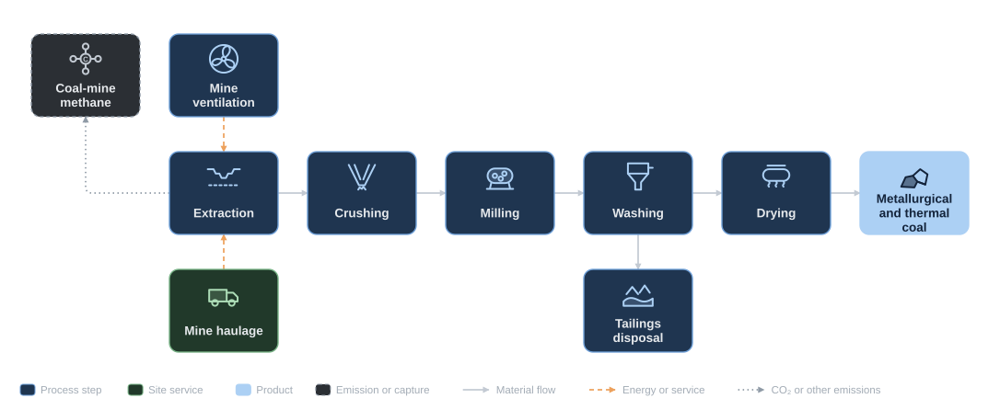

---
bibliography:
  - references.bib
  - tech-data_references.bib
aliases:
  - sector_coal_mining.html
---

# Coal Mining {#sec-coal-mining}

Coal mining produces metallurgical coal for steelmaking and thermal coal for power plants and industrial heat. Its emissions come from two places: the fuel burned by trucks and other mobile equipment, and methane that escapes from the coal seam as it is mined. Methane is the larger of the two, and the sector now has its own set of technologies to capture, use, or destroy it.

## Scope

The sub-model follows coal from the mine to a saleable product: digging it out, breaking it to size, and cleaning and drying it. Coal output drives the sector, and both metallurgical and thermal coal are in scope.

Related activities sit elsewhere in CIMS, so their energy is counted once:

- Burning thermal coal for power is covered in @sec-electricity, and burning it for industrial heat in the industrial chapters.
- Turning metallurgical coal into coke and using it to make iron is covered in @sec-iron-and-steel.
- Other mining is covered in @sec-mining.

## Context

Canada produced about 42.6 Mt of coal in 2024, roughly two-thirds of it metallurgical [@nrcan-coal]. British Columbia mines around 69 % of it, mostly coking coal from the Elk Valley; Alberta about 19 %, both metallurgical and thermal; and Saskatchewan about 11 %, mostly lignite for power plants. The two kinds of coal are heading in opposite directions. Thermal coal is in steep decline as Canada phases out conventional coal-fired electricity by 2030 and moves to end thermal coal exports. Metallurgical coal has held up as an export, because conventional steelmaking has no large-scale substitute for it yet [@nrcan-coal]. Canadian coal production has fallen about 31 % over the past decade, almost all of it thermal coal.

Coal seams hold methane, the main component of natural gas. Mining releases it, and much of it leaves an underground mine in the ventilation air. Coal-mine methane makes up roughly 60 % of the sector's greenhouse gas emissions. Proven technologies can capture it for use or destroy it: oxidizers fitted to mine ventilation shafts can destroy more than 98 % of the methane in the exhaust air [@iea-methane-coal; @csiro-vam].

## Process flow

@fig-coal-mining-process shows how coal moves through a mine. Extraction digs the coal and relies on haulage to move it and on ventilation to keep underground workings safe; it also releases seam methane, which methane control either lets escape, captures, or destroys. The coal is then crushed and milled to size, washed to remove rock and ash, and dried. Washing sends its rejects to tailings disposal.

::: {#fig-coal-mining-process}
{.light-content .lightbox group="coal-mining-light"}

{.dark-content .lightbox group="coal-mining-dark"}

Process flow of the coal mining sector.
:::

## Model structure

CIMS splits coal production into three stages: getting the raw coal out (extraction, ventilation, and methane control), size reduction (crushing and milling), and coal preparation (washing, drying, and tailings disposal). Two simpler alternatives, simplified extraction and simplified production, stand in for the full chain where a model run doesn't need the detail.

### Extraction and haulage

Coal comes from open-pit (surface) mines, where large machines strip away the soil and rock above the seam, and from underground mines, which cut the coal in rooms or along long faces and carry it to the surface. In CIMS, each kind of mine competes as a whole: an underground mine includes its own ventilation, hoisting, and pumping, and an open-pit mine its own pumping and overburden removal [@etsap_2014_002]. The simplified extraction option offers the same two mines.

**Mine haulage** moves coal and waste rock with trucks, loaders, and hoists, and is where most of the sector's diesel goes. As in metal mining, battery-electric, hydrogen fuel-cell, dual-fuel, and trolley-assist trucks compete with diesel trucks.

**Extraction**



**Simplified extraction**



**Mine haulage**



### Mine ventilation and methane control

Underground mines blow large volumes of fresh air through their workings with big fans. The air keeps methane below explosive levels, so it also carries much of the seam methane out of the mine, at concentrations too low to burn in an ordinary flame.

**Methane control** decides what happens to that methane. The mine can let it escape untreated; drill boreholes to drain methane from the seam before and after mining, so it can be used as fuel or flared; or pass the ventilation air through an oxidizer, which heats it until the dilute methane breaks down into CO₂ and water [@iea_2026_004; @epa_2019_001]. Because methane traps far more heat than CO₂ does, destroying it cuts emissions sharply even though it releases some CO₂.

**Mine ventilation**



**Coal-mine methane**



### Crushing and milling

Coal from the mine comes in lumps of every size. Crushing breaks it down, and milling grinds it further where a customer needs fine coal. Sensor-based sorting can pick out rock before it is crushed. The technology database has no technologies for milling yet.



### Coal preparation

Most metallurgical coal is washed to remove rock and ash, since steelmakers need clean, low-ash coal. Washing uses flotation, where chemicals and air bubbles lift fine coal away from the heavier rock. The washed coal is wet, so it is dried, usually with hot combustion gases, before shipping. Tailings disposal thickens and filters the rejected rock and recovers water.

**Washing**



**Drying**



**Tailings disposal**



### Shared services

| Service | What it supplies | Technologies |
|:--------|:-----------------|:-------------|
| Machine drive | Pumps, fans and blowers, compressed air, materials handling, and materials processing | @sec-machine-drive |
| HVAC and lighting | Heating, cooling, and lighting of mine buildings | @sec-hvac-lighting |
| Fuel blends | Diesel and natural gas blends | @sec-fuel-blends |

: Shared services in the coal mining sector {#tbl-coal-mining-shared}

The pumps service also has one technology specific to mining, for pumping water out of the pit or the underground workings:



## Decarbonisation

- **Coal-mine methane.** Draining seam methane for use, and oxidizing the methane in ventilation air, tackle the largest share of the sector's emissions with proven technology [@csiro-vam; @iea-methane-coal].
- **Trucks and haulage.** Battery-electric, trolley-assist, and hydrogen fuel-cell haulage can replace diesel trucks, as in metal mining, and biodiesel and renewable diesel reach the trucks that remain through the diesel blend [@bisulandu-mining-2026].
- **Drying and auxiliary loads.** Electric dryers can replace fuel-fired drying, and efficient fans, motors, and drives cut ventilation and other electricity use through the shared machine-drive service.

## Regional coverage and differences

Four regions mine coal: British Columbia, with export metallurgical coal from the Elk Valley; Alberta, with metallurgical and declining thermal coal; Saskatchewan, with lignite and thermal coal, which the coal-power phase-out affects most; and the Atlantic region, with a small presence. Ontario, Québec, and Manitoba have no coal mining.

<mark>TODO: Represent the diverging paths of metallurgical and thermal coal explicitly (durable, export-driven coking-coal demand against a sharp thermal-coal decline), since lumping them understates the structural change underway.</mark>

## Limitations and planned extensions

<mark>TODO: The mine-methane node and its technologies were added to the hierarchy ahead of the CIMS model inputs. Add them to the regional input files, with extraction requesting methane control, and remove the fixed fugitive-methane factor from the extraction technologies.</mark>

<mark>TODO: The milling node has no technologies in the technology database yet, and mine-water treatment has no node; see the hierarchy change requests in the technology database.</mark>

<mark>TODO: Benchmark modelled coal output and fugitive methane emissions against Natural Resources Canada coal statistics and the National Inventory Report.</mark>



```{=latex}
\phantomsection
```

## References {.unnumbered}

```{=latex}
\printbibliography[heading=none]
```

::: {#refs}
:::
