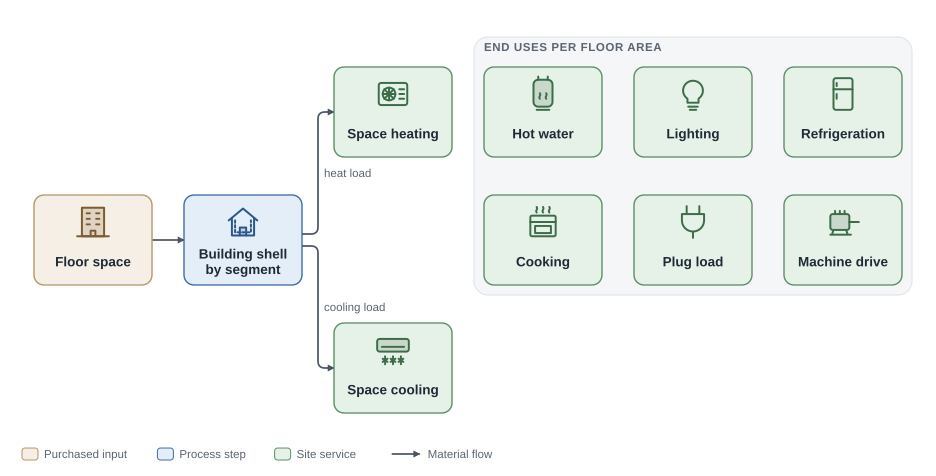
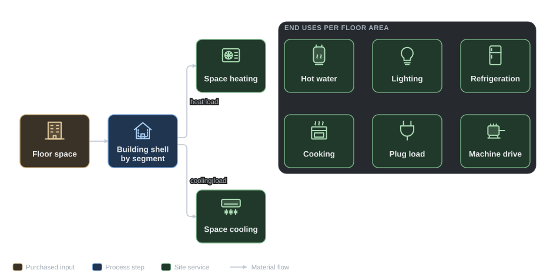

# Commercial and Institutional {#sec-commercial}

The commercial and institutional sector consumes energy to deliver building services (heating, cooling, ventilation, lighting, refrigeration, cooking, hot water, and plug loads) across offices, stores, schools, hospitals, hotels, and the rest of the non-residential building stock. It has no process emissions; all of its direct CO₂ comes from the fuels burned for heating, hot water, and cooking, so its decarbonisation is a matter of electrification and efficiency.

## Scope

The sub-model covers the energy services of commercial and institutional buildings, driven by floor space projected from population and economic growth. It excludes light industrial facilities (see @sec-light-industrial) and apartment buildings (see @sec-residential). The commercial sector accounts for roughly 20 % of energy use in Canada, of which lighting and HVAC together make up about 60 % [@nrcan-ceud]. Exterior lighting (street, parking, and architectural) is not represented for lack of data.

## Context

Commercial buildings are diverse (a warehouse, a hospital, and a small office have very different energy profiles), but their energy use shares a common structure dominated by space conditioning and lighting. The most common fuels are electricity, natural gas, and light fuel oil. Electricity is the only source for lighting, refrigeration, plug loads, cooling, fans, and pumps, while space and water heating use all three, so heating is where most of the sector's direct emissions arise.

Because the loads are mostly low-temperature, the sector is highly electrifiable: heat pumps serve space and water heating at a coefficient of performance well above one; LED lighting and efficient HVAC, controls, and refrigeration cut electricity use; and a tighter envelope reduces heating and cooling loads at source. Large facilities with coincident heat and power demand can use cogeneration.

## Process flow

@fig-commercial-process shows the structure of the sub-model. Floor space, split by building segment and climate, sets the building shell; the shell sets the heating and cooling loads; and the other end uses scale with floor area.

::: {#fig-commercial-process}
{.light-content .lightbox group="commercial-light"}

{.dark-content .lightbox group="commercial-dark"}

Process flow of the commercial and institutional sector. The building shell forms the Product sub-tree; the end uses form the Service sub-tree.
:::

## Model structure

The technology database does not yet cover the commercial sector, apart from the shared HVAC cooling technologies. The other technology tables in this chapter summarize the technologies in the current CIMS model input files and will be replaced by database archetypes when they are added.

### Building shell

The **Building Shell** node splits floor space into ten building segments (accommodation and food services; arts, entertainment, and recreation; educational; healthcare and social assistance; information and cultural; offices; other services; retail; transportation and warehousing; and wholesale), each in a **cold** and a **marine** climate. Each segment competes shell options of different thermal performance. A better shell lowers the heat load the HVAC service must meet: this shell-to-HVAC link captures the main interaction between end uses in commercial buildings.

::: {.tech-block}
Technologies (pending the technology database)

| Technology | What it is | Type | TRL |
|:------------------------|:------------------------------------------------------|:--------------|:------|
| Standard shell | The envelope typical of current construction. | Conventional | n/a |
| LEED Silver shell | Improved envelope meeting LEED Silver performance. | Efficiency variant | n/a |
| LEED Platinum shell | High-performance envelope meeting LEED Platinum performance. | Efficiency variant | n/a |
:::

### Space heating

**HVAC heating** is split by climate, because heating demand and heat-pump performance differ between the cold and marine zones. Each competition treats the HVAC system as one integrated unit.

::: {.tech-block}
Technologies (pending the technology database)

| Technology | What it is | Type | TRL |
|:------------------------|:------------------------------------------------------|:--------------|:------|
| Natural gas HVAC | Existing and improved-efficiency gas systems. | Conventional | n/a |
| Electric HVAC | Existing and improved-efficiency electric resistance systems. | Conventional | n/a |
| Oil and propane HVAC | Existing and improved oil systems; existing and new propane systems. | Conventional | n/a |
| Air-source heat pump | With electric backup, or (in the cold zone) with gas backup. | Alternative | n/a |
| Gas-fired heat pump | Heat pump driven by natural gas. | Alternative | n/a |
| Ground-source heat pump | Heat pump with a ground loop. | Alternative | n/a |
| Natural gas cogeneration | On-site combined heat and power for large facilities. | Alternative | n/a |
:::

Cogeneration is limited to 30–50 % of the demand in the segments where it applies, such as hospitals, universities, large offices, and hotels; it is sized to the facility's heat load and sells surplus electricity to the grid.

### Space cooling

**HVAC cooling** competes the shared cooling technologies from the technology database: electric chillers and free or evaporative cooling. They are listed in @sec-hvac-lighting.

### Other end uses

The remaining end uses are linked to floor area by historical engineering ratios. **Hot water**, **lighting** (general area, high-bay, and service lighting), **refrigeration**, **cooking**, **plug load**, and **machine drive** each compete existing equipment against more efficient options.

::: {.tech-block}
Technologies (pending the technology database)

| Technology | What it is | Type | TRL |
|:------------------------|:------------------------------------------------------|:--------------|:------|
| Hot water heaters | Average- and improved-efficiency electric and natural gas units, and average-efficiency oil units. | Conventional | n/a |
| Heat-pump water heater | Electric heat-pump unit. | Alternative | n/a |
| Solar water heating | Solar pre-heat with electric or gas backup. | Alternative | n/a |
| Hot water load reduction | Measures that cut hot water use, with electric or gas heating. | Efficiency variant | n/a |
| Lighting | Existing stock, incandescent and compact fluorescent, fluorescent, metal halide high-bay, and LED. | Conventional to alternative | n/a |
| Refrigeration | Existing and new units, super-efficient units, and retrofits to super-efficient. | Conventional to efficiency variant | n/a |
| Cooking | Electric, natural gas, and propane equipment. | Conventional | n/a |
| Plug load | Standard- and improved-efficiency equipment. | Conventional to efficiency variant | n/a |
| Machine drive | Low- and high-efficiency motors. | Conventional to efficiency variant | n/a |
:::

### Shared services

Gas- and diesel-fired equipment draws on the sector's methane and diesel blends; see @sec-fuel-blends.

## Decarbonisation

- **Heat pumps.** The central lever is electrifying space and water heat. Air-source, ground-source, and hybrid heat pumps compete with gas, oil, and propane systems in both climate zones; heat-pump water heaters electrify hot water.
- **Envelope.** Better shells lower heating and cooling loads before any equipment runs, through the shell-to-HVAC link.
- **Efficient equipment.** LED lighting cuts the largest electricity end use, efficient HVAC and controls trim the next largest, and efficient refrigeration addresses both energy use and refrigerant emissions.

Commercial technologies use behavioural discount rates of generally 40 % in the current data, with 30 % for cogeneration and for hospital and school shells and HVAC, reflecting their longer, owner-operated planning horizons (see @sec-technology-competition). Retirements of existing stock trigger a competition between keeping it and retrofitting it, so the model represents upgrades to existing buildings as well as new construction. Energy prices are average per-unit charges, so the demand-charge savings of efficiency measures are not captured.

## Regional coverage and differences

All seven modelled regions carry the commercial structure. The cold and marine climate split is the key regional dimension: most of Canada is cold, while coastal British Columbia and parts of the Atlantic region are marine, with milder heating demand and better heat-pump performance. The model assumes essentially no new oil heating after 1990 except in the Atlantic region, where natural gas is less available. Grid carbon intensity sets how much electrification actually reduces emissions.

<mark>TODO: Confirm the regional building-segment floor-space mix and the cold and marine zone assignments against current commercial building-stock data.</mark>

## Limitations and planned extensions

Only the shell-to-HVAC interaction between end uses is quantified, energy prices are averages, and floor-space and intensity calibrations are inherited from earlier versions of the model.

<mark>TODO: Add the commercial technologies to the technology database, add cold-climate heat-pump performance curves to the cold-zone HVAC competition, and benchmark modelled commercial energy use by end use against Natural Resources Canada's Comprehensive Energy Use Database.</mark>



```{=latex}
\phantomsection
```

## References {.unnumbered}

```{=latex}
\printbibliography[heading=none]
```

::: {#refs}
:::
