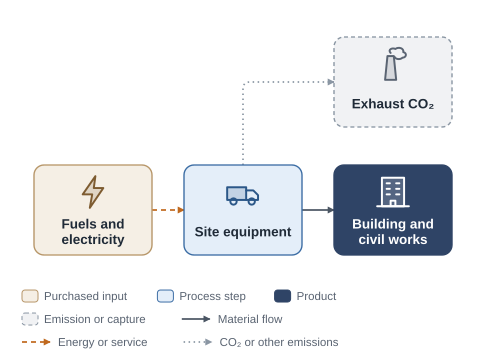
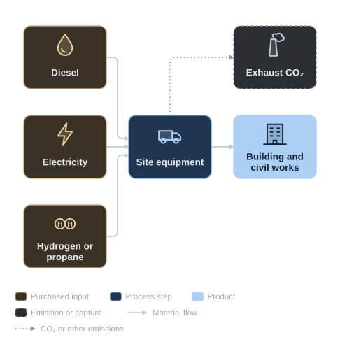

---
bibliography:
  - references.bib
  - tech-data_references.bib
---

# Construction {#sec-construction}

Construction's direct greenhouse-gas emissions come almost entirely from the fuel burned by the machines that work on building and civil-engineering sites: excavators, loaders, bulldozers, graders, cranes, and dump trucks. CIMS represents the sector as a single service, site equipment, where diesel machines compete with hybrid, electric, and hydrogen machines.

## Scope

The sub-model covers the **fuel use of construction's mobile equipment**: the off-road machines that dig, lift, level, and move material on site. A forecast of the sector's emissions drives it. It counts only the fuel these machines burn during construction:

- The carbon released in making construction materials sits with the industries that make them, such as cement in @sec-industrial-minerals and steel in @sec-iron-and-steel.
- The energy a finished building uses belongs to @sec-residential and @sec-commercial.

## Context

A construction site runs a wide mix of heavy machines, most of them diesel. They often idle and work in stop-start cycles, which wastes fuel. Three options can cut their emissions:

- Renewable diesel or biodiesel can replace fossil diesel without any change to the machines.
- Battery-electric machines remove exhaust emissions on site.
- Hydrogen engines and fuel cells could serve the heaviest machines in future.

Electric machines have spread faster in construction than in other off-road uses. Many construction machines are compact, work fixed shifts, and operate in cities, where noise and local air quality matter. Major manufacturers now sell battery-electric excavators and loaders. They cost roughly 50–100 % more to buy, but part of that comes back through lower fuel and maintenance costs [@idtechex-construction-ev].

## Process flow

::: {#fig-construction-process}
{.light-content .lightbox group="construction-light" width=60%}

{.dark-content .lightbox group="construction-dark" width=60%}

Process flow of the construction sector. Fuels and electricity power the site equipment that carries out building and civil works; the mix of fuels depends on which machines win the competition.
:::

## Model structure

### Site equipment

The sector has one process step, **site equipment** (the Transport node in its Product sub-tree). Here the machines compete to do the sector's site work. The options are the same on-site mobile equipment the technology database describes for other off-road uses, such as oil-and-gas field vehicles [@dea_2026_005]. They differ in how they turn fuel into work:

- A **diesel machine** burns diesel in an engine that drives the wheels, tracks, and hydraulics directly. It is cheap to buy and refuels quickly, but it wastes much of its fuel as heat, especially when idling.
- A **diesel-electric hybrid** adds a battery and electric drive. It recovers energy when the machine brakes or lowers a load, and lets the engine run more steadily, which saves fuel in stop-start work.
- A **battery-electric machine** draws all its energy from a battery charged from the grid. Electric motors waste far less energy than engines, and the machine uses almost nothing while idle [@kukkonen_2017_001]. Its limits are battery size, charging time, and purchase cost.
- A **hydrogen machine** uses either a hydrogen-burning engine or a fuel cell that turns hydrogen into electricity. Neither releases CO₂ at the machine, but both depend on hydrogen reaching the site. A hydrogen engine is about 30–40 % efficient at its best operating point, but only about 18 % over a typical duty cycle, which is the value the database uses.
- A **propane or natural-gas machine** uses a spark-ignition engine, like a car's, and is common in forklifts.

Diesel machines burn the diesel fuel blend, so any renewable fuel in that blend lowers their emissions automatically (see @sec-fuel-blends).



The current model input files carry only two of these options, diesel and electric equipment. Both last twenty years and need the same energy for each unit of work. Their fuel prices are borrowed from Agriculture.

<mark>TODO: Add the hybrid, spark-ignition, and hydrogen options from the technology database to the model inputs, and add their capital, operating, and emission data so that the competition can respond to cost and policy.</mark>

## Decarbonisation

- **Cleaner diesel.** Adding renewable fuel to the diesel blend cuts emissions across the whole fleet with no change to the machines.
- **Electrification.** Battery-electric machines remove exhaust emissions and move the energy demand to the grid, which @sec-electricity counts. They are already on the market for compact machines and are emerging for larger ones.
- **Hybrids and hydrogen.** Diesel-electric hybrids save fuel in stop-start work. Hydrogen engines and fuel cells are still at an early stage for heavy machines.

## Regional coverage

All seven modelled regions carry the construction sector, scaled by an emissions forecast that follows building activity. Ontario and Québec are the largest, followed by Alberta and British Columbia; the smaller provinces are well below.

## Limitations and planned extensions

The construction sub-model is a placeholder. It treats the whole off-road fleet as one service rather than separating machines by type or use, its technologies are not yet costed, and its fuel prices are borrowed from Agriculture. It covers only the fuel burned on site, not the carbon in materials.

<mark>TODO: Replace the prices borrowed from Agriculture with sector values from the model input files, and check modelled construction fuel use against Statistics Canada and National Inventory Report data.</mark>



```{=latex}
\phantomsection
```

## References {.unnumbered}

```{=latex}
\printbibliography[heading=none]
```

::: {#refs}
:::
