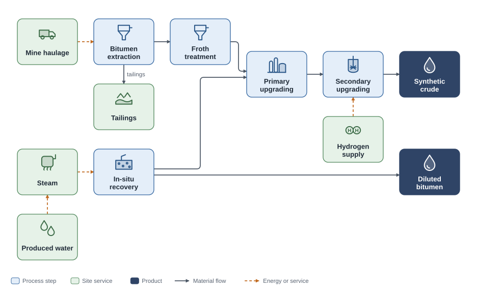
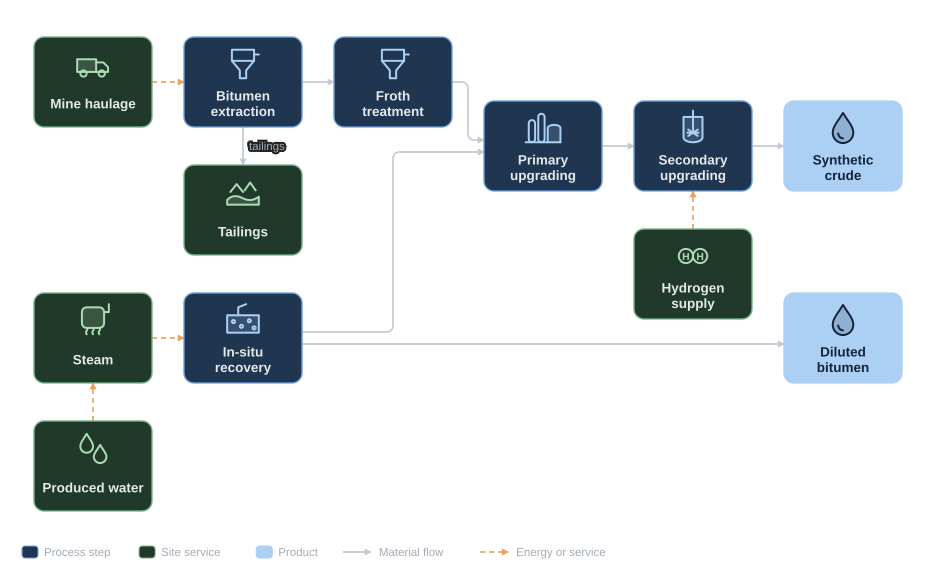

---
bibliography:
  - references.bib
  - tech-data_references.bib
aliases:
  - sector_petroleum-crude_oil-sands.html
---

# Oil Sands {#sec-oil-sands}

The oil sands are the largest part of the crude oil sector (@sec-crude-oil), in both output and emissions. They hold bitumen, a form of crude oil so thick that it won't flow at normal temperatures. Producers get it out in one of two ways. Near the surface, they mine the oil sand and wash the bitumen out with warm water. Deeper down, they heat the bitumen in place, usually with steam, so it can flow to wells. Mined bitumen is usually upgraded on site into a lighter synthetic crude. In-situ bitumen is either upgraded or thinned with a lighter liquid and shipped by pipeline. This chapter covers those steps and the services they draw on.

## Process flow

@fig-oil-sands-process shows the two routes and where they meet. Mining feeds extraction and froth treatment, and leaves tailings behind. In-situ recovery draws on steam made from treated produced water. Both routes can feed the upgrader, which uses hydrogen to make synthetic crude.

::: {#fig-oil-sands-process}
{.light-content .lightbox group="oil-sands-light"}

{.dark-content .lightbox group="oil-sands-dark"}

Process flow of oil sands mining, in-situ recovery, and upgrading.
:::

## Mining and extraction

Surface mining works deposits close enough to the surface to dig, in open pits. Giant shovels load the oil sand into haul trucks, which carry it to crushers. The crushed ore is mixed with warm water into a slurry and pumped through a pipeline to the extraction plant. On the way, the warm water and the tumbling start to free the bitumen from the sand. At the plant, the slurry settles in large separation vessels: the sand sinks, and the bitumen floats to the top as a froth of bitumen, water, and fine solids [@ceri_2017_002].

Mining uses energy in three main places. The haul trucks burn large amounts of diesel. Heating the water for extraction takes a lot of fuel, and much of that heat is lost when warm water goes to the tailings. Froth treatment and the pumps and crushers add the rest.

**Mine haulage** moves ore from the pit face to the crushers. Diesel trucks are the incumbent. Dual-fuel trucks burn liquefied natural gas alongside diesel, and battery-electric haulage removes the exhaust from the mine altogether.



**Bitumen extraction** separates bitumen from the sand with warm water. Non-aqueous extraction uses a solvent in place of water, which cuts the heat needed and produces dry tailings instead of a wet slurry.



**Froth treatment** cleans the bitumen froth by adding a light solvent, which lowers the bitumen's thickness so water and solids can settle out. The solvent is then recovered and reused. There are two kinds:

- Naphthenic treatment uses a naphtha solvent. It recovers nearly all the bitumen, but leaves some water and solids in it and keeps all the asphaltenes, the heaviest, most carbon-rich part of the oil. Its product must be upgraded.
- Paraffinic treatment uses a lighter solvent that makes some of the asphaltenes drop out. It recovers a little less bitumen, but the product is clean enough to sell to refineries or ship by pipeline once diluted.



**Tailings** are the sand, clay, and water left after extraction. They are usually pumped to large ponds, where the fine clay can take decades to settle. Thickening and filtering the tailings recovers warm water for reuse, which saves heat, and shrinks the ponds. Filtered or paste tailings go further, producing material dry enough to stack.



## In-situ recovery

Most oil sands bitumen lies too deep to mine. In-situ ("in place") recovery heats it underground until it flows, then brings it to the surface through wells [@etsap_2010_010]. Two methods dominate:

- In **steam-assisted gravity drainage** (SAGD), operators drill pairs of horizontal wells, one a few metres above the other. Steam injected through the upper well heats the bitumen, which drains down with the condensed water into the lower well and is pumped to the surface.
- In **cyclic steam stimulation**, a single well takes turns injecting steam, letting the reservoir soak, and producing the heated oil.

Making steam is where nearly all the energy goes. The key measure is the steam-to-oil ratio: how much steam a project needs for each barrel of bitumen. A reservoir that needs more steam burns more fuel and emits more CO₂ per barrel [@oilsands-intensity]. The steam comes from the sector's Steam service (@sec-industrial-heat), in boilers and cogeneration plants fed with produced water that has been treated to remove oil, hardness, and silica. The in-situ technologies don't make their own steam: each buys it from that service at its steam-to-oil ratio, so the choice between once-through boilers, cogeneration, electric boilers, and small nuclear reactors is made there. In-situ oxy-combustion, which makes its steam downhole, keeps its own fuel. Direct-contact steam generation, which mixes combustion gas straight into the water, is set aside for now, since the technology database has only one source for it and no cost.

Several newer methods aim to cut or replace that steam:

- **Solvent-assisted** processes add a light hydrocarbon solvent to the steam. The solvent mixes into the bitumen and thins it, so less steam is needed. Most of the solvent comes back up with the oil and is reused. Pilots at commercial sites have run this at field scale [@canadian-natural_2024_001; @cenovus_2025_002].
- **Solvent-only** processes inject solvent vapour with no steam at all.
- **Electromagnetic heating** uses radio-frequency energy, much like a microwave oven, to heat the reservoir with electricity, together with a solvent.
- **In-situ oxy-combustion** burns fuel in pure oxygen to make steam mixed with CO₂. The mixture is injected into the reservoir, where both gases help thin the bitumen.



The produced-water technologies, which prepare water for making steam, are listed in @sec-crude-oil.

## Upgrading

Upgrading turns bitumen into synthetic crude, a light, low-sulphur oil that refineries can run like conventional crude. Bitumen has too little hydrogen for its carbon, and too much sulphur and metal. Upgrading fixes this in two stages, by removing carbon or adding hydrogen.

**Primary upgrading** breaks the heaviest molecules into smaller ones. Cokers heat the bitumen residue until it cracks into lighter liquids and gas, leaving solid petroleum coke behind, so they remove carbon. Delayed coking does this in large drums filled and emptied in turns. Fluid coking does it in a bed of hot coke particles, and flexicoking also turns the coke into a fuel gas. Ebullated-bed hydrocracking instead adds hydrogen over a catalyst, so it turns more of the barrel into liquid but uses much more hydrogen. Partial upgrading is a smaller field-scale option. It treats bitumen just enough to flow through a pipeline without diluent.



**Secondary upgrading** treats the lighter liquids from primary upgrading with hydrogen over a catalyst at high temperature and pressure. This hydroprocessing removes sulphur and nitrogen and adds hydrogen, which stabilizes the oil. The upgrading units buy the heat their furnaces supply from the sector's **fired-heater** service, which offers the same heaters as a refinery: fuel-fired, electric, and solid-fuel heaters, among others. Hydrogen reaches those heaters through the fuel blend rather than as a heater of its own.



**Hydrogen** for upgrading is made on site. Most of it comes from steam methane reformers, which react natural gas with steam to produce hydrogen and CO₂. More than half of a reformer's CO₂ ends up in a concentrated stream inside the process, which is cheap to capture; the rest is in the dilute exhaust from its furnace. Water electrolysis makes hydrogen from water and electricity with no direct emissions. Gasifying coke, the by-product of coking, is another option.



## Decarbonisation

- **Less steam per barrel.** In-situ emissions follow the steam-to-oil ratio, so cutting steam cuts emissions directly. Solvent-assisted processes can lower a barrel's carbon intensity by up to about half [@oilsands-intensity]. Solvent-only processes and electromagnetic heating go further.
- **Low-carbon steam.** Electric boilers, cogeneration, and small nuclear reactors can make the steam itself with fewer emissions, through the Steam service.
- **Carbon capture.** The concentrated CO₂ from upgrader hydrogen plants and the dilute CO₂ from steam generators are the main targets of the Pathways Alliance capture network [@pathways-alliance].
- **Mining.** Battery-electric and dual-fuel haul trucks cut diesel use. Non-aqueous extraction cuts both the heat needed and the volume of wet tailings.

The economics of each project matter as much as the technology. Older mines and in-situ projects have very different costs and steam-to-oil ratios, which shapes which options pay off where [@ceri_2018_001].

<mark>TODO: The upgraders' hydrogen is made on site; link it to the [Hydrogen](sector_hydrogen.qmd) sector so upgrading can also draw on merchant blue or green hydrogen at that sector's cost and carbon intensity.</mark>

<mark>TODO: Refresh the solvent-SAGD and capture options against the Pathways Alliance project and current pilots.</mark>

<mark>TODO: The crude oil fired-heater service was added to the hierarchy ahead of the CIMS model inputs. Add it to the regional input files, with the upgrading units and in-situ wells requesting heat and steam rather than burning their own fuel.</mark>



```{=latex}
\phantomsection
```

## References {.unnumbered}

```{=latex}
\printbibliography[heading=none]
```

::: {#refs}
:::
