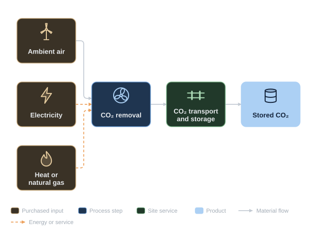

---
aliases:
  - sector_carbon_dioxide_removal.html
---

# Direct Air Capture {#sec-carbon-dioxide-removal}

Direct air capture (DAC) removes CO₂ from ambient air rather than from a smokestack. Because it serves no emitting process, CIMS keeps it apart from point-source capture: a DAC plant can sit anywhere, and it competes as a source of carbon removal (or of CO₂ feedstock) rather than as abatement on a particular plant.

## Scope

The sector covers the capture of CO₂ from air by liquid-solvent or solid-sorbent processes, with compression. Its single process step, **CO₂ removal**, is measured in tonnes of CO₂. The captured CO₂ then needs transport and storage, which the shared CO₂ pipeline and storage routes provide (see @sec-ccus); stored CO₂ counts as a removal. Capture from concentrated or dilute industrial streams belongs to the sectors that host it, also described in @sec-ccus.

## Context

DAC is at an early stage of deployment. It needs a great deal of energy, because CO₂ in air is far more dilute than in any flue gas, so its climate value depends on a low-carbon supply of electricity and heat and on permanent storage. Two families of technology lead: liquid-solvent systems, which capture CO₂ in an alkaline solution and release it in a high-temperature calciner, and solid-sorbent systems, which cycle sorbent beds at low temperature and suit waste heat and modular construction.

## Process flow

::: {#fig-direct-air-capture-process}
{.light-content .lightbox group="direct-air-capture-light" width=75%}

{.dark-content .lightbox group="direct-air-capture-dark" width=75%}

Process flow of direct air capture. Energy drives the capture of CO₂ from air, which is then transported and stored.
:::

## Model structure

### CO₂ removal

The **CO₂ removal** node in the Product sub-tree hosts the competition between capture technologies.



### Transport and storage

Each tonne removed needs a pipeline route and geological storage, supplied by the root-level CO₂ pipeline and storage branch described in @sec-ccus.

## Planned treatment of DAC demand

<mark>TODO: Document how the model sets the quantity of DAC it buys. The working design is:

- Run the year as normal with the carbon price.
- Re-run the year with a shadow carbon price, iterating until either the difference in total emissions between the runs equals the maximum DAC quantity, or the shadow price falls to the DAC cost.
- Treat the emissions difference between runs as the DAC each technology requests, changing the shadow price only in the sectors allowed to buy DAC.
- Decide whether DAC carries a maximum annual growth rate, and how to set it (for example, from expert opinion).</mark>

<mark>TODO: Document regional coverage, the energy supply each DAC technology draws, and how removals enter the emissions accounting.</mark>
