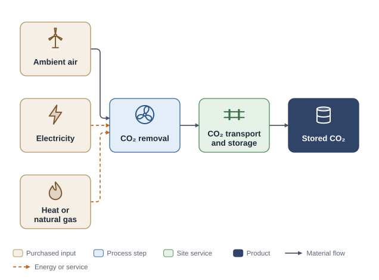

---
aliases:
  - sector_carbon_dioxide_removal.html
bibliography:
  - references.bib
  - tech-data_references.bib
---

# Direct Air Capture {#sec-carbon-dioxide-removal}

Direct air capture (DAC) takes CO₂ out of the open air rather than out of a smokestack. Because it serves no polluting process, CIMS keeps it separate from capture at industrial plants. A DAC plant can be built anywhere, and it supplies carbon removal, or CO₂ as a raw material, rather than cutting the emissions of one particular plant.

## Scope

The sector covers capturing CO₂ from air with a liquid solvent or a solid sorbent (a material that holds CO₂ on its surface), and compressing it. Its single process step is **CO₂ removal**, supported by a low-temperature **heat** service. The captured CO₂ then needs a pipeline and a place to store it underground, which the shared CO₂ transport and storage routes provide (see @sec-ccus). CO₂ that ends up stored counts as removed from the atmosphere. Capture at industrial plants belongs to the sectors that host it, also described in @sec-ccus.

## Context

DAC is still at an early stage, with only a few small plants operating worldwide. It needs a great deal of energy, because CO₂ in air is hundreds of times more dilute than in the exhaust of a power plant or factory. That makes its climate benefit depend on clean electricity and heat, and on storing the CO₂ permanently [@ipcc_2022_001]. Published cost estimates are high today but expected to fall as plants grow larger and more are built [@fasihi_2019_001].

## Process flow

::: {#fig-direct-air-capture-process}
{.light-content .lightbox group="direct-air-capture-light" width=75%}

{.dark-content .lightbox group="direct-air-capture-dark" width=75%}

Process flow of direct air capture. Heat and electricity drive the capture of CO₂ from air, which is then piped to underground storage.
:::

## Model structure

### CO₂ removal

The **CO₂ removal** process step hosts the competition between two families of capture technology. Both move large volumes of air past a material that binds CO₂, then use energy to release the CO₂ as a pure stream ready for compression. They differ in how they release it:

- **Liquid-solvent systems** pass air through a strong alkaline solution that absorbs CO₂. The CO₂ is then moved into a solid (calcium carbonate) and heated to about 900 °C in a kiln-like calciner, which drives it off. This needs high-temperature heat, usually from burning natural gas, so the plant must also capture the CO₂ from that fuel [@keith_2018_001].
- **Solid-sorbent systems** pass air over filters coated with a material that holds CO₂. Once the filters are full, heating them to around 100 °C, often under a vacuum, releases the CO₂. The low temperature means waste heat or heat pumps can supply it, and the units are small and modular [@layritz_2021_001]. In CIMS, solid-sorbent units buy that heat, about 6.3 GJ per tonne of CO₂, from the sector's **heat** service, where heat pumps, electric and fuel-fired boilers, waste-heat recovery, geothermal heat, and solar collectors compete to supply it.



Cost and energy figures for both families come from technology reviews such as @dea_2024_002.

### Transport and storage

Each tonne removed needs a pipeline route and underground storage, supplied by the shared CO₂ transport and storage routes described in @sec-ccus.

## Planned treatment of DAC demand

<mark>TODO: Document how the model sets the quantity of DAC it buys. The working design is:

- Run the year as normal with the carbon price.
- Re-run the year with a shadow carbon price, iterating until either the difference in total emissions between the runs equals the maximum DAC quantity, or the shadow price falls to the DAC cost.
- Treat the emissions difference between runs as the DAC each technology requests, changing the shadow price only in the sectors allowed to buy DAC.
- Decide whether DAC carries a maximum annual growth rate, and how to set it (for example, from expert opinion).</mark>

<mark>TODO: Document regional coverage, the energy supply each DAC technology draws, and how removals enter the emissions accounting.</mark>



```{=latex}
\phantomsection
```

## References {.unnumbered}

```{=latex}
\printbibliography[heading=none]
```

::: {#refs}
:::
