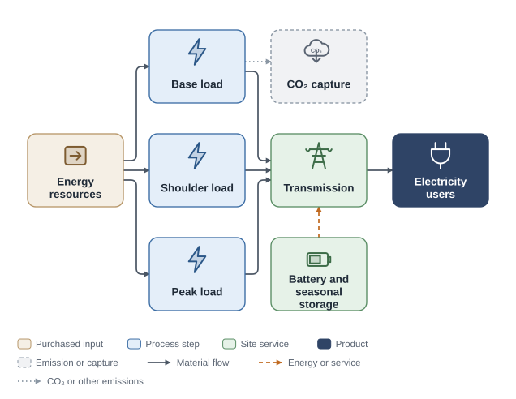
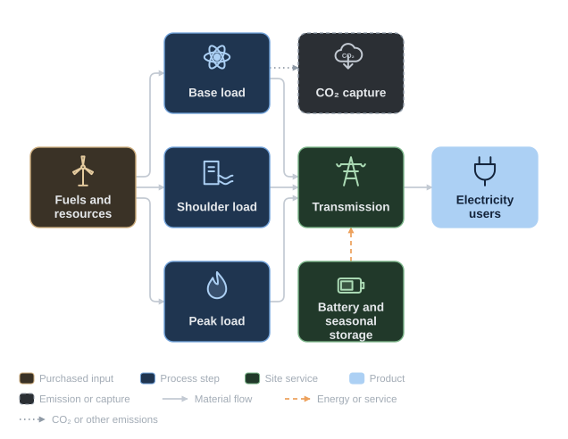

---
bibliography:
  - references.bib
  - tech-data_references.bib
---

# Electricity {#sec-electricity}

The Electricity sector turns fuels, flowing water, wind, sunlight, and nuclear energy into the power every other sector uses. As homes, vehicles, and industry switch to electricity, this sector increasingly decides how much the whole economy emits. CIMS splits the year's demand by how often power is needed, has power plants compete to meet each part, and adds the storage, transmission, and carbon capture that support them. Regional differences are larger here than in any other sector, because each province's grid rests on different resources.

## Scope

The sector covers large power plants and the storage, transmission, and carbon capture that support them. Power that industrial sites make for themselves belongs to the industrial sectors (see @sec-cogen), with one exception: all renewable generation is counted here, whoever runs it. Demand for electricity across the economy drives the sector. Imports and exports are handled by the model's economy module, which assumes export demand falls by about 1 % for every 1 % rise in price. The equipment that uses electricity belongs to the sectors that use it.

## Context

Canada has one of the cleanest electricity systems in the world. In 2024, renewables supplied about 65.5 % of power: hydro 55.3 % (Québec makes about half of it), wind 7.2 %, and solar 1.3 %. Nuclear supplied 13.7 %, almost all from Ontario's reactors, and fossil fuels 20.8 % (natural gas 15.8 % and coal 4.1 %) [@nrcan-electricity-factbook]. More than four-fifths of recent investment in new power plants has gone to sources that don't emit [@nrcan-electricity-factbook].

The system is very regional. British Columbia, Québec, and Manitoba run on hydro and emit almost nothing. Ontario combines nuclear, hydro, and a growing share of wind and solar. The Atlantic provinces have a mix. Alberta and Saskatchewan rely most on fossil fuels: historically coal, and increasingly natural gas. Federal rules are phasing out conventional coal plants and pushing toward a net-zero grid, so the central question is how each province's mix changes from its very different starting point.

## Process flow

@fig-electricity-process shows how power plants serving three parts of demand reach users through transmission, supported by storage and carbon capture.

::: {#fig-electricity-process}
{.light-content .lightbox group="electricity-light"}

{.dark-content .lightbox group="electricity-dark"}

Process flow of the Electricity sector. The energy resources (fuels, water, wind, sunlight, or nuclear fuel) depend on which power plants the model builds.
:::

## Model structure

The technology database does not yet cover power plants. The technologies below come from the current CIMS model inputs and keep their model names until the database covers them.

### Base, shoulder, and peak load

Electricity demand rises and falls through the day and the year. Some demand is there almost all the time; some appears only on the hottest or coldest days. CIMS splits total demand into three parts:

- **Base load**, the power needed almost all the time;
- **Shoulder load**, the power needed for part of the time; and
- **Peak load**, the power needed only at the highest points of demand.

The split comes from load-duration curves: past hourly demand sorted from highest to lowest. Within each part, power plants compete on their yearly cost of supplying it, including the cost of building them (see @sec-technology-competition).

The three parts matter less in a grid with a lot of wind and solar, whose output depends on the weather rather than on demand. So the technologies fall into three practical groups:

- *Variable renewables* (wind, solar, and run-of-river hydro), which generate when the resource is there;
- *Firm low-carbon plants* (hydro with reservoirs, nuclear, geothermal, biomass, and fossil plants with carbon capture), which can run whenever they are needed; and
- *Balancing* (storage paired with wind and solar), which shifts their output to when it is needed.

Base load offers the full set of plants. Shoulder load offers a narrower set: gas, coal, oil, biomass, reservoir hydro, and wind or solar paired with storage. Peak load offers only plants that can start quickly: simple-cycle gas turbines, reservoir hydro, oil, and wind with seasonal storage. Plants that take a long time to start, such as nuclear reactors, cannot serve the peak. Public cost studies such as the U.S. National Renewable Energy Laboratory's Annual Technology Baseline give a common reference for the costs and performance of these plants [@nrel_2025_001; @eia_2024_001].

::: {.tech-block}
Technologies (pending the technology database)

| Technology | What it is | Type |
|:--------------------------|:----------------------------------------------------------|:----------------|
| Natural gas CC | Combined-cycle gas plant: a gas turbine whose hot exhaust raises steam for a second, steam turbine | Conventional |
| Natural gas SC | Simple-cycle gas turbine that starts quickly to meet peaks | Conventional |
| Coal | Coal-fired steam plant | Conventional |
| Fuel oil | Oil-fired plant | Conventional |
| Hydro reservoir | Hydro dam with a reservoir that can store water and generate on demand | Conventional |
| Hydro river | Run-of-river hydro, which generates with the river's flow | Conventional |
| Nuclear | Large nuclear reactor | Conventional |
| Biomass | Biomass-fired steam plant | Conventional |
| Waste | Plant that burns municipal waste to make power | Conventional |
| Wind onshore | Wind farm on land | Alternative |
| Wind offshore | Wind farm at sea | Alternative |
| Solar PV | Large solar farm | Alternative |
| Solar PV + battery | Solar farm paired with a battery that stores power for a few hours | Alternative |
| Wind + battery | Wind farm paired with a battery that stores power for a few hours | Alternative |
| Wind + seasonal | Wind farm paired with long-term storage that holds energy across seasons | Prospective |
| Geoexchange | Geothermal power plant | Prospective |
| Nuclear SMR | Small modular nuclear reactor | Prospective |
| Natural gas CC CCS | Combined-cycle gas plant that captures the CO₂ in its exhaust | Prospective |
| Coal CCS | Coal plant that captures the CO₂ in its exhaust | Prospective |
| Biomass CCS | Biomass plant with carbon capture, which removes CO₂ from the atmosphere overall | Prospective |
:::

### Storage

The **Storage** service has two parts. **Battery** storage holds power for a few hours to smooth out daily swings. **Seasonal** storage holds energy for weeks or months, so that wind and solar can meet demand through long calm or dark periods. The paired wind and solar plants request them.

### Transmission

All power plants request the **Transmission** service: the lines and substations that carry power to users.

### Carbon capture

Electricity has its own carbon capture services, split by the fuel the plant burns: coal, natural gas, or biomass. The plants with capture request them. Capturing and storing the CO₂ from burning biomass removes CO₂ from the atmosphere overall, because the plants took that carbon from the air as they grew. The shared capture technologies are described in @sec-ccus.

::: {.tech-block}
Technologies (pending the technology database)

| Technology | What it is | Type |
|:--------------------------|:----------------------------------------------------------|:----------------|
| Battery | Battery storage for a few hours | Alternative |
| Seasonal | Long-term storage across seasons | Prospective |
| Transmission | Transmission and distribution network | Conventional |
| CCS | Capture of CO₂ from the exhaust of coal, gas, or biomass plants | Prospective |
:::

The sector also draws on the diesel and natural gas blends (see @sec-fuel-blends).

## Decarbonisation

Cutting emissions from electricity means building clean plants, both firm and variable, to replace coal and gas plants that don't capture their CO₂, along with the storage and transmission a grid with lots of wind and solar needs. Because Canada's grid is already clean overall, most of the change happens in the provinces that rely on fossil fuels.

- **Wind and solar with storage.** Wind on land and solar are the cheapest new sources of power in most of Canada. Paired with batteries or seasonal storage, they can meet demand when the wind and sun don't cooperate.
- **Firm low-carbon plants.** Reservoir hydro, nuclear (including small modular reactors), geothermal, and biomass can replace fossil plants and keep the grid reliable through calm, dark periods.
- **Carbon capture.** Capture on combined-cycle gas plants, coal plants (Saskatchewan's Boundary Dam was an early example), or biomass plants removes most of the CO₂ from burning their fuel. Biomass with capture removes CO₂ from the atmosphere overall.

Electricity feeds every other sector, so a carbon price has unusual reach here. It raises the cost of coal and gas plants without capture compared with renewables, nuclear, and capture. And through the price of electricity, it changes whether switching to electricity pays off everywhere else.

## Regional coverage and differences

- Québec, British Columbia, and Manitoba rely mostly on hydro and already emit almost nothing. Their main question is how to add enough power for growing electric demand.
- Ontario runs on nuclear and hydro with a growing share of wind and solar, and faces choices about refurbishing reactors, building small modular reactors, and adding wind, solar, and storage.
- Alberta and Saskatchewan rely most on fossil fuels, so the coal phase-out and the competition among gas, gas with capture, wind, solar, and storage matter most there.
- The Atlantic region has a mix of sources and good wind resources.

<mark>TODO: Confirm the regional capacity factors, resource limits (especially hydro and wind siting), and existing-stock vintages, since the regional generation mix is highly sensitive to them.</mark>

## Limitations and planned extensions

<mark>TODO: Add electricity generation, storage, and transmission archetypes to the technology database, and replace the model-input technology lists above with database blocks.</mark>

<mark>TODO: The current regional input files place generation under a `Utility Generation` node rather than the hierarchy's `product`. Migrate them, and reconcile the storage representation with @sec-energy-storage.</mark>

<mark>TODO: The base/shoulder/peak split is coarse relative to the hourly dynamics that drive integration of variable renewables. Benchmark the modelled generation mix and grid emissions intensity by province against Canada Energy Regulator data.</mark>



```{=latex}
\phantomsection
```

## References {.unnumbered}

```{=latex}
\printbibliography[heading=none]
```

::: {#refs}
:::
