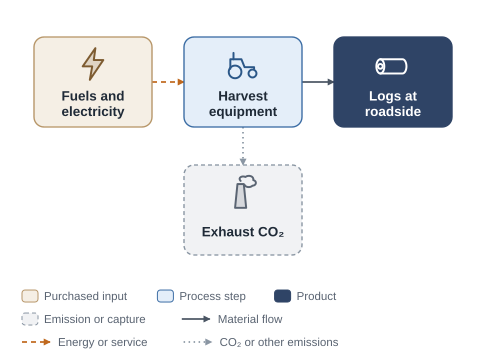
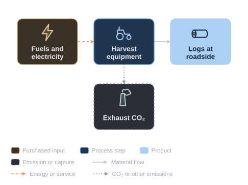

# Forestry {#sec-forestry}

Logging's direct greenhouse-gas emissions come almost entirely from the diesel burned by harvesting and handling equipment in the bush: feller-bunchers, skidders, harvesters, forwarders, and loaders. CIMS represents the sector as a single mobile-equipment service, in which diesel machines compete with electric ones.

## Scope

The sub-model covers the **fuel use of forestry's mobile equipment**: the off-road machinery that fells, gathers, and moves timber at the harvest site. An exogenous forecast of the sector's emissions, in tonnes of CO₂-equivalent, drives it. Everything beyond the roadside sits elsewhere:

- Log haulage on public roads belongs to @sec-transportation-freight.
- Milling logs into lumber and pulp belongs to @sec-pulp-and-paper and the wood-products part of @sec-light-industrial.
- The biological carbon of the forest itself (growth, harvest, and regrowth) belongs to land use, land-use change, and forestry (@sec-lulucf), not this sector.

## Context

Logging uses little energy compared with heavy industry, but what it uses is overwhelmingly diesel, burned in rugged machines that run long duty cycles far from grid power. High power demand, remote sites, and no charging infrastructure make the harvest fleet hard to electrify, which is why diesel still does essentially all the work. The options are those of any off-road diesel fleet: drop-in renewable diesel or biodiesel, battery-electric machines where duty cycles and charging allow, and hydrogen for the heaviest equipment. Canadian work on low- and zero-emission options for the forest sector, much of it through FPInnovations, has so far concentrated on log haulage, where battery-electric Class 8 trucks have shown more than 60 % lower energy use and at least 80 % lower greenhouse-gas emissions than diesel; in-bush machines are a harder, later problem [@fpinnovations-zev].

## Process flow

::: {#fig-forestry-process}
{.light-content .lightbox group="forestry-light" width=60%}

{.dark-content .lightbox group="forestry-dark" width=60%}

Process flow of the forestry sector. Diesel and electricity power the harvest equipment that delivers logs to the roadside.
:::

## Model structure

### Harvest equipment

The sector has one process step, the **Transport** node in its Product sub-tree, where harvest equipment competes to supply the sector's work. Diesel equipment burns the diesel transportation fuel blend, so renewable content in that blend lowers its lifecycle carbon automatically (see @sec-fuel-blends).

The technology database does not yet cover this node. The model inputs carry two technologies, listed below pending the database:

::: {.tech-block}
Technologies (from the model inputs, pending the technology database)

| Technology | What it is | Type | TRL |
|:------------------------|:------------------------------------------------------|:--------------|:------|
| Diesel | Diesel harvesting and handling equipment; the whole base-year fleet. | Conventional | 9 |
| Electric | Battery-electric equipment drawing grid electricity, with the same energy requirement per unit of work and a twenty-year lifetime. | Alternative | n/a |

:::

The two technologies carry only a lifetime and their energy requests; their fuel prices are borrowed from Agriculture as a proxy.

<mark>TODO: Map the forestry Transport node to the database's on-site mobile-equipment archetypes (diesel, hybrid, battery-electric, and hydrogen equipment), which currently serve construction and natural-gas field vehicles, and populate capital, operating, and emission data.</mark>

## Decarbonisation

- **Cleaner diesel.** Raising the renewable content of the diesel blend cuts lifecycle carbon across the whole fleet with no change to the machines.
- **Electrification.** Battery-electric equipment removes exhaust emissions, but in-bush power, runtime, and charging demands hold it back; it is emerging fastest in lighter machines and at the roadside.
- **Hydrogen.** Fuel cells remain early-stage and depend on hydrogen reaching remote sites.

## Regional coverage

All seven modelled regions carry the forestry structure, scaled by an exogenous emissions forecast that follows the size of each region's logging industry: British Columbia is by far the largest, followed by Québec and Ontario, with the Prairie provinces much smaller.

## Limitations and planned extensions

The forestry sub-model is a placeholder. It collapses the harvest fleet into one aggregate service, its technologies are not yet costed, and its fuel prices are proxied from agriculture. Because forestry's footprint is small, this coarse treatment is a reasonable interim, but costing the technologies is the minimum needed for the fleet to respond to policy.

<mark>TODO: Replace the agriculture-proxied prices with sector values, and benchmark modelled forestry fuel use against Natural Resources Canada and FPInnovations data.</mark>



```{=latex}
\phantomsection
```

## References {.unnumbered}

```{=latex}
\printbibliography[heading=none]
```

::: {#refs}
:::
