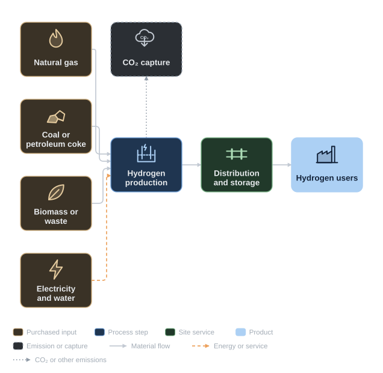

# Hydrogen {#sec-hydrogen}

The Hydrogen sector produces merchant hydrogen: hydrogen made for sale to other sectors rather than for a process on the same site. The molecule is the same however it is made, but its emissions depend entirely on the production route, so the sector is essentially one competition among routes that differ enormously in carbon intensity, plus the distribution that gets the hydrogen to its users.

## Scope

The sector covers centralized hydrogen plants (natural-gas reforming with and without capture, gasification, methane pyrolysis, and electrolysis), the compression, pipelines, liquefaction, and storage that deliver the hydrogen, and capture of the plants' CO₂. Its demand comes from the sectors that buy hydrogen and from policy, rather than from an exogenous production target.

Hydrogen made on site for a single process sits with that process instead: refinery and upgrader hydrogen units are covered in @sec-petroleum-refining and @sec-petroleum-crude, and ammonia and methanol plants make their own synthesis gas. The end uses of merchant hydrogen (as a fuel, a reductant in steelmaking, or a feedstock) are represented in the consuming sectors.

## Context

Almost all hydrogen made in Canada today is "grey": produced by steam methane reforming (SMR) of natural gas without capture, mostly in Alberta for oil-sands upgrading, refining, and ammonia. Grey hydrogen is the cheapest, at roughly CAD 1.5–2.5 per kg, but emits about 9–10 kg of CO₂ per kg of hydrogen [@nrcan-h2-strategy]. Canada's Hydrogen Strategy and a clean-hydrogen investment tax credit (15–40 % of capital, the top rate for the cleanest hydrogen) aim to shift production to low-carbon routes [@nrcan-h2-strategy].

"Blue" hydrogen, from reforming or gasification with capture, is the basis of large Alberta projects such as the Air Products net-zero hydrogen complex (1,500 t per day, capturing about 3 Mt CO₂ per year); it costs roughly CAD 2–3.5 per kg [@airproducts-canada; @nrcan-h2-strategy]. "Green" hydrogen, from electrolysis on low-carbon electricity, has the lowest emissions and suits regions with clean, cheap power, but at roughly CAD 4.8–6.3 per kg it remains the most expensive [@nrcan-h2-strategy].

## Process flow

@fig-hydrogen-process shows the production competition, its feedstocks, and the distribution step.

::: {#fig-hydrogen-process}
{.light-content .lightbox group="hydrogen-light"}

{.dark-content .lightbox group="hydrogen-dark"}

Process flow of the Hydrogen sector.
:::

## Model structure

### Hydrogen production

The **Centralized Hydrogen** node is a single competition among production routes, measured in GJ of hydrogen. Plants are sized for the merchant market rather than for one host process, and their emissions and capture economics belong to this sector rather than to the user. Routes with capture request the sector's concentrated capture node.



### Distribution and storage

Every unit of centralized hydrogen needs delivering: compression, pipeline transmission and distribution to industrial users, or liquefaction and trucking where there is no pipeline. Distribution energy is a real cost of centralized supply, and it is what sets centralized production apart from production at the point of use.



### Shared services

| Service | What it supplies | Technologies |
|:--------|:-----------------|:-------------|
| Fuel blends | Diesel and methane blends | @sec-fuel-blends |
| CCS | Capture of concentrated CO₂ from reformers and gasifiers | @sec-ccus |

: Shared services in the Hydrogen sector {#tbl-hydrogen-shared}

## Decarbonisation

Because the product is identical, decarbonising hydrogen is a pure cost-and-carbon competition between routes, and the carbon price acts directly on the production mix.

- **Blue hydrogen.** Capture on the reformer's shift gas, or an autothermal reformer designed for nearly full capture, keeps the established process and cuts CO₂ by about 90 %. Low-cost gas and viable CO₂ storage favour it in Alberta [@airproducts-canada].
- **Green hydrogen.** Electrolysis emits no CO₂ directly; its footprint is the carbon intensity of the electricity, so it is clean on Canada's hydro and wind power but only as clean as the grid elsewhere. Its cost is dominated by electricity and electrolyser capital.
- **Methane pyrolysis.** Splitting methane into hydrogen and solid carbon avoids CO₂ without needing storage.
- **Net-negative hydrogen.** Biomass gasification with capture stores biogenic carbon, giving hydrogen with net-negative emissions.

## Regional coverage and differences

All seven modelled regions carry the sector's structure, but the economic route differs by region. Alberta and Saskatchewan, with cheap natural gas and CO₂ storage, favour blue hydrogen; Québec, British Columbia, and Manitoba, with abundant hydro, favour electrolysis; and the Atlantic region's wind resource supports green production.

<mark>TODO: Confirm the regional electricity and natural-gas prices and CO₂-storage availability that drive the blue-versus-green split, since the regional production mix is highly sensitive to them.</mark>

## Limitations and planned extensions

<mark>TODO: The current input files compete centralized and distributed production (SMR, electrolysis, and ethanol reforming at small scale). The new hierarchy keeps centralized production only; decide whether distributed production returns as its own node or moves to the consuming sectors.</mark>

<mark>TODO: Link hydrogen demands elsewhere in CIMS (the methane blend, renewable diesel, hydrogen direct reduction in steel, and transport) to this sector, so that the cost and carbon intensity of the hydrogen actually used are consistent across the model, and represent the clean-hydrogen investment tax credit.</mark>

<mark>TODO: Benchmark modelled hydrogen production cost and carbon intensity against the Hydrogen Strategy for Canada and IEA data.</mark>



```{=latex}
\phantomsection
```

## References {.unnumbered}

```{=latex}
\printbibliography[heading=none]
```

::: {#refs}
:::
