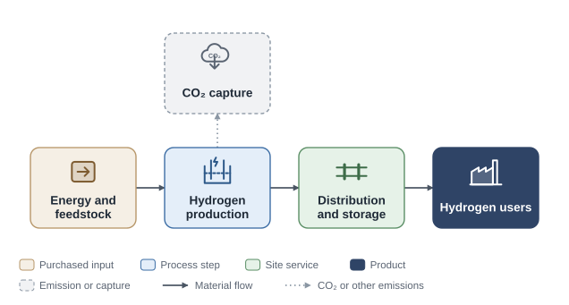

---
bibliography:
  - references.bib
  - tech-data_references.bib
---

# Hydrogen {#sec-hydrogen}

The Hydrogen sector makes hydrogen for sale to other sectors. Hydrogen is the same gas however it is made, but the emissions from making it vary enormously. Making it from natural gas without capturing the CO₂ is cheap and emits a lot; splitting water with clean electricity emits almost nothing but costs more. So this sector is mainly a competition among ways of making hydrogen, plus the pipelines, trucks, and storage that get it to the people who use it.

## Scope

The sector covers large central plants that make hydrogen for many users, the delivery and storage that get the hydrogen to them, and capture of the plants' CO₂. Demand comes from the sectors that buy hydrogen and from policy, not from a fixed production target.

Hydrogen made on site for one process stays with that process. Refinery and upgrader hydrogen units are covered in @sec-petroleum-refining and @sec-oil-sands, and ammonia and methanol plants make their own hydrogen-rich gas (see @sec-chemicals-nitrogen and @sec-chemicals-petrochemicals). The uses of hydrogen (as a fuel, as a way to remove oxygen from iron ore in steelmaking, or as a chemical feedstock) sit in the sectors that use it.

## Context

Almost all hydrogen made in Canada today is called "grey". It comes from steam methane reforming, which reacts natural gas with steam, without capturing the CO₂. Most of it is made in Alberta for oil sands upgrading, refining, and ammonia. Grey hydrogen is the cheapest, at roughly CAD 1.5–2.5 per kilogram, but it releases about 9–10 kilograms of CO₂ for every kilogram of hydrogen [@nrcan-h2-strategy]. Canada's Hydrogen Strategy and a clean hydrogen investment tax credit, worth 15–40 % of a plant's capital cost with the highest rate for the cleanest hydrogen, aim to shift production to low-emission routes [@nrcan-h2-strategy].

"Blue" hydrogen is made the same way but with most of the CO₂ captured and stored. It is the basis of large Alberta projects such as the Air Products net-zero hydrogen complex, which will make 1,500 tonnes of hydrogen a day and capture about 3 million tonnes of CO₂ a year; blue hydrogen costs roughly CAD 2–3.5 per kilogram [@airproducts-canada; @nrcan-h2-strategy]. How clean it really is depends on how much CO₂ the plant captures and how much methane leaks upstream [@pembina_2021_001]. "Green" hydrogen is made by splitting water with clean electricity. It has the lowest emissions and suits regions with clean, cheap power, but at roughly CAD 4.8–6.3 per kilogram it remains the most expensive [@nrcan-h2-strategy].

## Process flow

@fig-hydrogen-process shows how hydrogen moves from production to the people who use it.

::: {#fig-hydrogen-process}
{.light-content .lightbox group="hydrogen-light"}

{.dark-content .lightbox group="hydrogen-dark"}

Process flow of the Hydrogen sector. The energy and feedstock depend on the production route the model chooses: natural gas, coal or petroleum coke, biomass, or electricity and water.
:::

## Model structure

### Hydrogen production

The **Hydrogen Production** step is a single competition among ways of making hydrogen at large central plants. The plants serve many buyers, so their emissions and capture costs belong to this sector rather than to the users. Calibrate this node to merchant hydrogen supply, not to total Canadian hydrogen output: captive hydrogen made inside ammonia and methanol plants, refineries, and upgraders is already counted in those sectors.

- **Reforming natural gas.** A steam methane reformer heats natural gas with steam over a catalyst to make a gas rich in hydrogen and carbon monoxide. A second step, the shift reaction, turns the carbon monoxide and more steam into extra hydrogen and CO₂. The reformer burns more gas to supply the heat. The CO₂ from the shift is concentrated and easy to capture; the CO₂ in the furnace's exhaust is dilute and costs more to capture [@collodi_2010_001]. An autothermal reformer instead burns part of the gas with pure oxygen inside the reactor, so almost all its CO₂ ends up in one concentrated stream, which suits capturing nearly all of it. Because it makes its own heat from the feed, it buys no heat: it uses about 0.32 GJ of energy per GJ of hydrogen on top of the gas that ends up in the hydrogen.
- **Gasification.** A gasifier heats coal, petroleum coke, biomass, or waste with limited oxygen and steam to make a hydrogen-rich gas. Gasifying biomass and capturing the CO₂ can give hydrogen with net-negative emissions.
- **Methane pyrolysis.** Heating methane without oxygen splits it into hydrogen and solid carbon. It releases no CO₂, so it needs no CO₂ storage. The methane carbon that leaves as carbon black is counted as feedstock, not energy use: about 0.69 GJ per GJ of hydrogen, so the technology's energy use is about 0.50 GJ/GJ.
- **Electrolysis.** An electrolyser uses electricity to split water into hydrogen and oxygen. Its emissions are those of the electricity it uses. High-temperature (solid-oxide) electrolysers use steam and need less electricity.

Routes that capture CO₂ request the sector's capture service for the concentrated stream.



### Distribution and storage

Hydrogen from a central plant has to be delivered. Compressors push it through dedicated pipelines to large users; where there is no pipeline, it can be cooled until it turns liquid and trucked, which takes a lot of electricity. Small amounts can be blended into the natural gas network. Salt caverns can store large volumes underground to balance supply and demand. Delivery costs are what set central production apart from making hydrogen where it is used [@anl_2025_001].

The distribution node competes options per GJ of hydrogen delivered, so only pipelines and liquefaction compete there. Salt-cavern storage delivers no hydrogen, and blending delivers a methane blend, so both are kept as reference technologies in the technology database, off the node.



### Shared services

| Service | What it supplies | Technologies |
|:--------|:-----------------|:-------------|
| Fuel blends | The diesel and natural gas blends the plants burn | @sec-fuel-blends |
| CCS | Capture of the concentrated CO₂ from reformers and gasifiers | @sec-ccus |

: Shared services in the Hydrogen sector {#tbl-hydrogen-shared}

## Decarbonisation

Because hydrogen is the same whatever the route, cutting its emissions comes down to which route wins on cost, and a carbon price acts directly on that choice [@iea_2019_002].

- **Blue hydrogen.** Capturing the CO₂ from the shift step, or using an autothermal reformer designed to capture nearly all of it, keeps the established process and cuts CO₂ by about 90 %. Cheap gas and good CO₂ storage favour it in Alberta [@airproducts-canada].
- **Green hydrogen.** Electrolysis emits no CO₂ itself; it is as clean as the electricity it uses. That makes it very clean on Canada's hydro and wind power, but only as clean as the grid elsewhere. Its cost depends mostly on the price of electricity and of the electrolysers [@doe_2024_001].
- **Methane pyrolysis.** Splitting methane into hydrogen and solid carbon avoids CO₂ without needing storage.
- **Net-negative hydrogen.** Gasifying biomass and storing the captured CO₂ gives hydrogen that removes CO₂ from the atmosphere overall.

## Regional coverage and differences

All seven regions carry the sector, but the cheapest route differs by region. Alberta and Saskatchewan, with cheap natural gas and places to store CO₂, favour blue hydrogen. Québec, British Columbia, and Manitoba, with plentiful hydro power, favour electrolysis, and the Atlantic region's wind supports it too.

<mark>TODO: Confirm the regional electricity and natural-gas prices and CO₂-storage availability that drive the blue-versus-green split, since the regional production mix is highly sensitive to them.</mark>

## Limitations and planned extensions

<mark>TODO: The current input files compete centralized and distributed production (SMR, electrolysis, and ethanol reforming at small scale). The new hierarchy keeps centralized production only; decide whether distributed production returns as its own node or moves to the consuming sectors.</mark>

<mark>TODO: Link hydrogen demands elsewhere in CIMS (the methane blend, renewable diesel, hydrogen direct reduction in steel, and transport) to this sector, so that the cost and carbon intensity of the hydrogen actually used are consistent across the model, and represent the clean-hydrogen investment tax credit.</mark>

<mark>TODO: Benchmark modelled hydrogen production cost and carbon intensity against the Hydrogen Strategy for Canada and IEA data.</mark>



```{=latex}
\phantomsection
```

## References {.unnumbered}

```{=latex}
\printbibliography[heading=none]
```

::: {#refs}
:::
