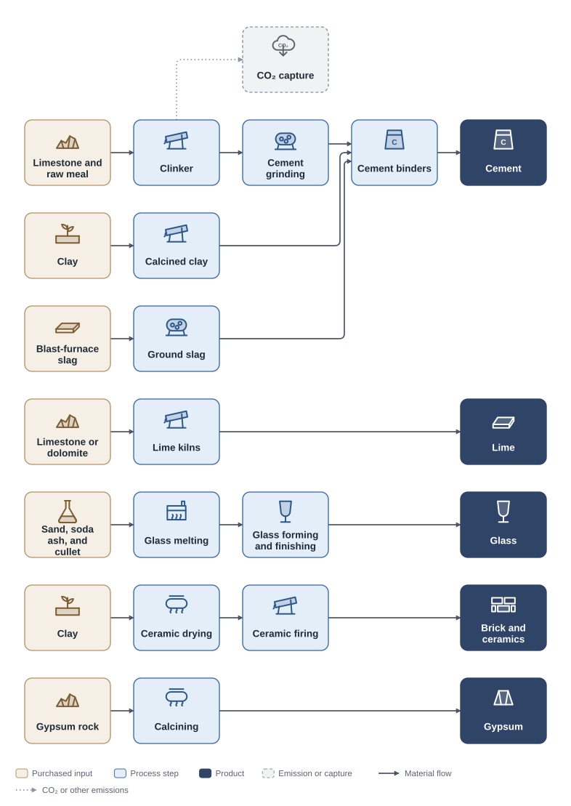
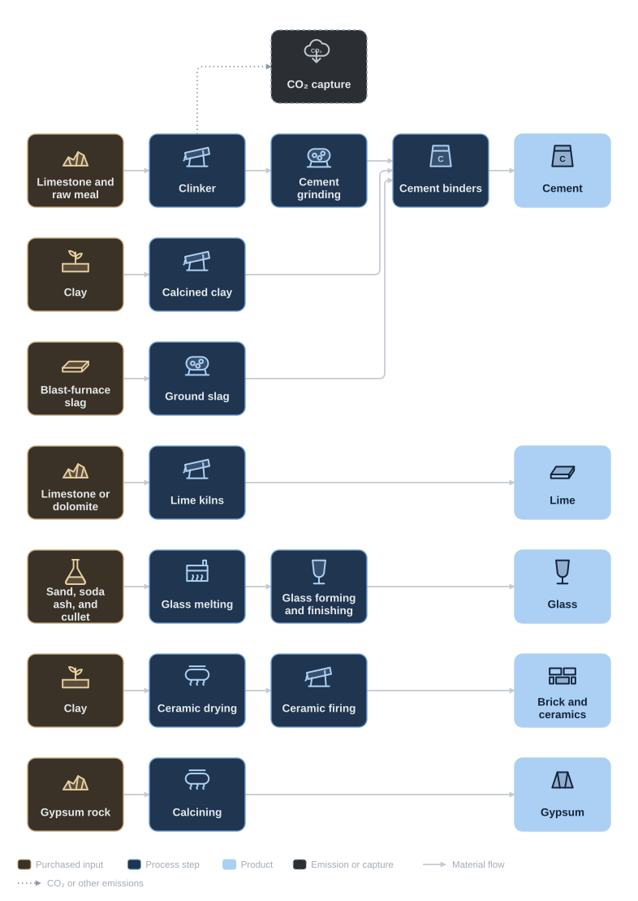

# Industrial Minerals {#sec-industrial-minerals}

The industrial minerals sector, the non-metallic mineral products industry, makes cement, lime, glass, ceramics, and gypsum products. It is defined by high-temperature thermal processing (calcining, clinkering, melting, and firing), and a large share of its emissions are process emissions released by the chemistry of calcination rather than by burning fuel. That fact shapes both the sub-model and its decarbonisation options.

## Scope

The sub-model covers five product groups: cement, lime, glass, ceramics (brick, tile, sanitaryware, and refractories), and gypsum products. Cement and lime dominate the sector's energy and emissions, because both calcine carbonate rock at high temperature. A forecast of each product's output, in tonnes and closely tied to construction activity, drives the steps and services beneath it.

Adjacent activities sit elsewhere to avoid double-counting:

- Quarrying limestone, silica, clay, and aggregate is part of @sec-mining; this sub-model begins inside the plant gate.
- Concrete batching and downstream fabrication (ready-mix concrete, precast products, and finished glazing) are downstream manufacturing and are not part of this sub-model.
- Granulated blast-furnace slag, a cement ingredient, comes from @sec-iron-and-steel.

## Context

The sector is small in tonnage relative to its emissions. Canadian cement manufacturing emitted about 11.2 Mt CO₂ in 2019, roughly 1.5 % of national emissions, and calcination accounts for some 60–65 % of the CO₂ from clinker production: limestone (CaCO₃) breaks down into lime (CaO) and CO₂, with the rest of the CO₂ coming from the fuel burned to reach clinkering temperature [@cac-netzero; @iea-cement]. Lime production is the same calcination without the clinkering, and carries an even higher process-CO₂ intensity per tonne. Glass is melted rather than calcined, so its emissions come mostly from furnace fuel and carbonate batch materials; brick and ceramics are fired clay.

Production is concentrated in the populous provinces and tracks construction demand. Ontario is the largest producer, followed by Québec and a fast-growing Alberta, with British Columbia and the Atlantic region smaller. Because so much of the CO₂ is intrinsic to the chemistry, deep decarbonisation depends on options most other sectors don't need: capture on the kiln, replacing clinker with other materials, alternative raw materials that avoid carbonate, and new binders.

## Process flow

@fig-industrial-minerals-process shows the five product chains. Cement is the most detailed: a cement binder (the recipe) requests clinker, grinding, and supplementary materials such as calcined clay and ground slag, each made at its own node.

::: {#fig-industrial-minerals-process}
{.light-content .lightbox group="industrial-minerals-light"}

{.dark-content .lightbox group="industrial-minerals-dark"}

Process flow of the industrial minerals sector.
:::

## Model structure

All the production steps sit in the Product sub-tree. The Service sub-tree holds a sector **kiln-heat** service, the diffuse **CCS** service that capture-equipped kilns and furnaces request, and the shared services.

### Cement

Cement is made by recipe. Each **binder** technology is a recipe for a tonne of cement: it requests clinker, finish grinding, and supplementary materials from their own nodes, and holds only its own blending and handling. Portland cement uses mostly clinker; blended cements, calcined clay cement (LC3), and slag cements replace part of it; and alkali-activated, carbonated, sulphoaluminate, hydrothermal, and electrochemical binders avoid conventional clinker altogether. The clinker ratio is decided here, which is why grinding is not part of the shared machine-drive service.



**Clinker** production covers raw meal preparation and drying, the preheater and precalciner, the rotary kiln, and the clinker cooler. It is measured in tonnes of clinker.



**Finish grinding** grinds clinker and additions to cement fineness.



**Calcined clay** is clay calcined at 700–900 °C into a pozzolan for LC3 and other blends; LC3 requests about 0.30 t per tonne of cement.



**Ground slag** is granulated blast-furnace slag dried and ground to cement fineness, for slag blends and alkali-activated binders.



### Lime

Lime and dolomitic lime are made in rotary and shaft kilns. The lime kilns request their fuel directly in the current data; the sector's **kiln-heat** service offers an indirectly heated or electrified calciner, which separates the process CO₂ from the combustion gases.



**Kiln heat**



### Glass

Glass melting covers batch and cullet preparation and melting in container, flat, fibre, and specialty glass furnaces, and mineral wool melting. Forming and finishing covers forming, annealing lehrs, tempering, and fire polishing. Both are measured in tonnes of glass.

**Melting**



**Forming and finishing**



### Ceramics

Ceramic ware is dried to remove forming water, then fired in tunnel, roller, or periodic kilns.

**Drying**



**Firing**



### Gypsum

Gypsum is calcined at low temperature to stucco for wallboard and plaster.



### Shared services

| Service | What it supplies | Technologies |
|:--------|:-----------------|:-------------|
| Machine drive | Pumps, fans and blowers, compressed air, materials handling, and materials processing | @sec-machine-drive |
| HVAC and lighting | Heating, cooling, and lighting of plant buildings | @sec-hvac-lighting |
| Fuel blends | Diesel and methane blends | @sec-fuel-blends |
| CCS | Diffuse capture for the cement kilns, lime kilns, and glass furnaces that send their flue gas to capture | @sec-ccus |

: Shared services in the industrial minerals sector {#tbl-industrial-minerals-shared}

## Decarbonisation

Efficiency and fuel switching reach only the combustion share of the sector's CO₂, so deep cuts must capture or avoid the process CO₂ too. Roughly the first 30–40 % of cement emissions can be abated with clinker substitution, alternative fuels, and efficiency; the remaining 60–70 %, the calcination CO₂, needs capture or new chemistry [@doe-liftoff-cement; @cac-netzero].

- **Less clinker.** Supplementary materials (slag, fly ash, calcined clay, limestone, and natural pozzolans) replace part of the clinker; calcined clay cement can cut cement CO₂ by around 40 % and is commercial [@doe-liftoff-cement]. The cement recipes and the calcined clay and ground slag nodes represent this directly.
- **New binders and raw materials.** Alkali-activated, carbonated, electrochemical, and hydrothermal binders, and clinker made from calcium-silicate rock, avoid or reduce calcination CO₂.
- **Capture.** Post-combustion capture on cement kilns, lime kilns, and glass furnaces, and kilns built to concentrate their CO₂ (oxy-fuel, calcium looping, and indirect calciners), reach the process CO₂.
- **Electrification and efficiency.** Electric kilns and melters, hybrid glass furnaces, electric dryers and lehrs, efficiency retrofits on kilns, and vertical roller mills for grinding cut combustion CO₂ and energy use.

## Regional coverage and differences

Five regions carry the sector: Alberta, the Atlantic region, British Columbia, Ontario, and Québec. Ontario is the largest producer and grows over the projection; Québec and a fast-growing Alberta follow; British Columbia and the Atlantic region are smaller. Unlike most heavy industry, modelled output rises in every region, because demand tracks population and construction.

<mark>TODO: Saskatchewan and the territories are absent. Confirm whether cement, lime, or glass capacity elsewhere should be added, and confirm that ceramics warrants its own branch in every province (check against Natural Resources Canada's NAICS 3271 energy series).</mark>

## Limitations and planned extensions

<mark>TODO: The cement recipes, the calcined clay and ground slag nodes, and the ceramics and gypsum nodes were added to the hierarchy ahead of the CIMS model inputs. Build them into the regional input files (draft scripts are in the technology database's `cims/model-changes/`).</mark>

<mark>TODO: Most lime kilns request their fuel directly rather than through the kiln-heat service; revisit the service requests when the sector is reviewed. Add an on-site power node so waste-heat power can compete at cement and glass plants.</mark>

<mark>TODO: Benchmark modelled cement, lime, and glass energy use and process emissions against CIEEDAC, the National Inventory Report, and the Cement Association of Canada's net-zero roadmap.</mark>



```{=latex}
\phantomsection
```

## References {.unnumbered}

```{=latex}
\printbibliography[heading=none]
```

::: {#refs}
:::
