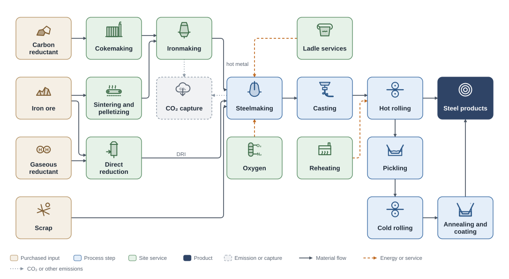
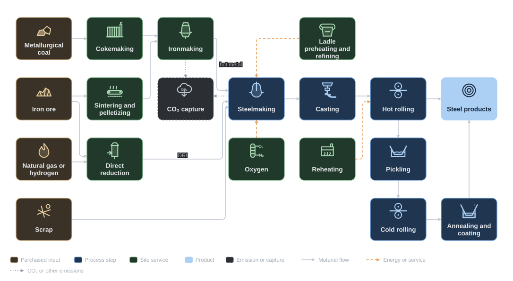

# Iron and Steel {#sec-iron-and-steel}

Iron and steel is one of the most energy- and emissions-intensive parts of Canadian industry, and almost all of its emissions come from a single step: reducing iron ore to metallic iron. That step is where the sector's main decarbonisation choices sit, between coke-based blast furnaces, gas- or hydrogen-based direct reduction, smelting reduction, and scrap-based electric steelmaking.

## Scope

The sub-model covers the integrated chain of primary and secondary steelmaking, from preparing iron-bearing feed to finished rolled and coated steel. It takes in purchased ore or pellets, metallurgical coal, scrap, and fuels; makes coke, sinter or pellets, oxygen, and iron on site; turns iron and scrap into liquid steel; and casts, rolls, and finishes it. A forecast of steel output, in tonnes, drives every upstream step and service.

Several adjacent activities sit elsewhere in CIMS to avoid double-counting:

- Iron-ore mining, concentration, and pelletizing at the mine are covered in @sec-mining. This sub-model takes ore or pellets as an input.
- Smelting and refining of non-ferrous metals is covered in @sec-metal-smelting.
- Fabricating steel into final goods (structural fabrication, stamping, and machining) belongs to the manufacturing branches in @sec-light-industrial.

Cokemaking and the use of the sector's own process gases stay inside the sub-model, because they are integral to ironmaking.

## Context

Canada produces about 12 Mt of crude steel a year, against world output of roughly 1,900 Mt [@worldsteel-2024]. Production is concentrated in Ontario, with the integrated plants at Hamilton (ArcelorMittal Dofasco and Stelco) and Sault Ste. Marie (Algoma Steel); in Québec, with electric arc furnace operations at Contrecœur and Longueuil; and in Saskatchewan, where the Regina works runs a scrap-based mini-mill of about 1 Mt per year.

Two routes dominate:

- The **integrated route** reduces iron ore to hot metal in a blast furnace using coke, then refines it, with some scrap, in a basic oxygen furnace (BOF). It uses roughly 18–21 GJ and emits about 1.8–2.3 t CO₂ per tonne of crude steel; most of the carbon enters as the coke that chemically reduces the ore [@iea-steel-roadmap; @cgep-steel].
- The **secondary route** melts scrap in an electric arc furnace (EAF). Because it skips ore reduction, it uses about 2–4 GJ of electricity per tonne and a small fraction of the integrated route's emissions; its footprint follows the carbon intensity of the grid [@cgep-steel].

The Canadian industry is shifting from the first route to the second: Algoma Steel and ArcelorMittal Dofasco are both replacing blast furnaces with electric arc furnaces, conversions expected to cut each plant's CO₂ by around 70 % [@algoma-eaf]. Globally, the EAF share of crude-steel output passed 29 % in 2024 [@worldsteel-2024].

## Process flow

@fig-iron-and-steel-process shows how the sector's process steps and services fit together. Ironmaking turns ore into hot metal (in a blast furnace or smelting-reduction vessel) or into solid direct-reduced iron (DRI); steelmaking turns hot metal, DRI, and scrap into liquid steel; and casting and rolling turn liquid steel into finished products.

::: {#fig-iron-and-steel-process}
{.light-content .lightbox group="iron-and-steel-light"}

{.dark-content .lightbox group="iron-and-steel-dark"}

Process flow of the iron and steel sector. Process steps belong to the sector's Product sub-tree; site services belong to its Service sub-tree and are requested by the process steps.
:::

## Model structure

The Product sub-tree holds steelmaking, casting and rolling, and foundry melting. Ironmaking and its feed preparation sit in the Service sub-tree, because the steelmaking technologies request hot metal and DRI as services: a BOF requests hot metal, and an EAF can request DRI. The tables below follow the flowchart, from feed preparation to finishing.

### Cokemaking

Coke ovens carbonize metallurgical coal into coke for the blast furnace, recovering coke-oven gas and chemicals. The service is measured in tonnes of coke.



### Sintering and pelletizing

Agglomeration binds fine ore into sinter or pellets that a furnace can use. It is measured in tonnes of sinter or pellets.



### Ironmaking: hot metal

The hot-metal service makes liquid iron for a BOF. The blast furnace is the incumbent; smelting reduction avoids coke ovens and sinter plants; electric smelting melts DRI from lower-grade ore into hot metal; and molten oxide electrolysis reduces ore with electricity alone. Ironmaking is measured in tonnes of iron.



### Ironmaking: direct reduction

Direct reduction removes oxygen from iron ore pellets in the solid state, with reformed natural gas, hydrogen, or coal, giving DRI for an EAF or an electric smelting furnace.



### Steelmaking

The molten-steel step turns hot metal, DRI, and scrap into liquid steel, measured in tonnes. The BOF and the EAF compete here, along with a whole-plant hydrogen route that bundles electrolysers, a hydrogen shaft furnace, and an EAF. Steelmaking also requests **oxygen**, from an on-site air separation unit, and **ladle preheating and refining** before the steel goes to the caster.



**Oxygen**



**Ladle preheating**



**Ladle refining**



### Casting

Casting solidifies liquid steel into slabs, blooms, or billets. Near-net-shape options (thin-slab casting with direct rolling and strip casting) cut out some or all of the reheating and rolling that follow. Casting is measured in tonnes of cast product.



### Reheating and hot rolling

Semi-finished steel is reheated to about 1,200 °C and hot rolled into plate, strip, sections, bar, rod, and tube. Rolling is measured in tonnes of rolled product, and reheating in tonnes reheated.

**Reheating**



**Hot rolling**



### Pickling and cold rolling

Strip for cold-rolled products is pickled in acid to remove scale, then cold rolled to its final thickness.

**Pickling**



**Cold rolling**



### Annealing and coating

Cold-rolled strip is annealed to restore its ductility, then coated: hot-dip or electro-galvanized, or tin plated. Both are measured in tonnes of finished product.

**Annealing**



**Coating**



### Foundry

The foundry branch melts iron, steel, and scrap for cast products that bypass the rolling chain. It is measured in tonnes of metal.



### Shared services

The sector also draws on the shared services documented in the General Services part:

| Service | What it supplies | Technologies |
|:--------|:-----------------|:-------------|
| Steam | Process steam, from boilers, CHP, heat pumps, and other heat supply | @sec-industrial-heat |
| Machine drive | Pumps, fans and blowers, compressed air, materials handling, and materials processing | @sec-machine-drive |
| HVAC and lighting | Heating, cooling, and lighting of mill buildings | @sec-hvac-lighting |
| Fuel blends | Diesel and methane blends, and the **process-gas** node that routes blast-furnace, coke-oven, and BOF gases to the steam and reheating services that burn them | @sec-fuel-blends |
| CCS | Capture of concentrated and diffuse CO₂ from the routes that send it there | @sec-ccus |

: Shared services in the iron and steel sector {#tbl-iron-and-steel-shared}

The concentrated capture node also offers one option specific to steel:



## Decarbonisation

The sector's emissions come mainly from the carbon that reduces iron ore, so the decisive lever is the ironmaking route; capture, electrification, and efficiency handle the rest.

- **Primary-route shift.** Gas-based direct reduction already cuts CO₂ to roughly 1.4–1.7 t per tonne of steel, against 1.8–2.3 t for the blast furnace and BOF; with green hydrogen as the reducing gas, the cut reaches about 95–98 % [@cgep-steel]. Smelting reduction avoids coke ovens and sinter plants and cuts energy and CO₂ by around a fifth on its own, and up to about 80 % with capture [@iea-steel-roadmap]. Electric smelting and molten oxide electrolysis are earlier-stage routes.
- **Scrap-based EAF steelmaking.** Where scrap is available, the EAF is already the lowest-emission route, and its footprint falls with the grid's. Scrap supply and quality limit how far it can go.
- **Carbon capture.** Routes that still reduce ore with carbon can only decarbonise deeply with capture. Their capture-equipped variants appear in the ironmaking tables, and the capture plants in @sec-ccus.
- **Heat and efficiency.** Induction reheating, induction strip heating, electric boilers, and heat pumps reach the combustion loads; near-net-shape casting removes reheating; and efficient motors and drives cut the auxiliary load.

## Regional coverage and differences

The tree is region-agnostic: each province is built from the same structure and carries no production on branches that don't apply. In the current regional data, Ontario carries most of Canada's steel with a mixed integrated and EAF fleet (about two-thirds integrated today); Québec is mixed but shifts strongly to EAF, reaching a majority-EAF split by 2050; and Saskatchewan is entirely EAF, reflecting its scrap-based mini-mill.

<mark>TODO: Only Ontario, Québec, and Saskatchewan are present in the current input files. Confirm whether any other province hosts steelmaking that should be represented; otherwise state that coverage is limited to these three regions.</mark>

<mark>TODO: The regional route trajectories are inherited from older calibrations. Revisit them against the BF-to-EAF conversions at Algoma and ArcelorMittal Dofasco, which will raise Ontario's EAF share within the projection period.</mark>

## Limitations and planned extensions

<mark>TODO: The hierarchy now competes the BOF and EAF at the molten-steel node rather than splitting steel exogenously between integrated and recycled routes. Consider a scrap-supply constraint so that EAF growth is limited by domestic and imported scrap availability.</mark>

<mark>TODO: The hydrogen direct-reduction technology excludes hydrogen production; check how the model supplies its hydrogen (the Hydrogen sector or the methane blend) so the route reflects hydrogen cost and availability.</mark>

<mark>TODO: Populate the foundry branch in the regional input files, and benchmark modelled iron and steel energy use and emissions against CIEEDAC, the National Inventory Report, and Natural Resources Canada data.</mark>



```{=latex}
\phantomsection
```

## References {.unnumbered}

```{=latex}
\printbibliography[heading=none]
```

::: {#refs}
:::
