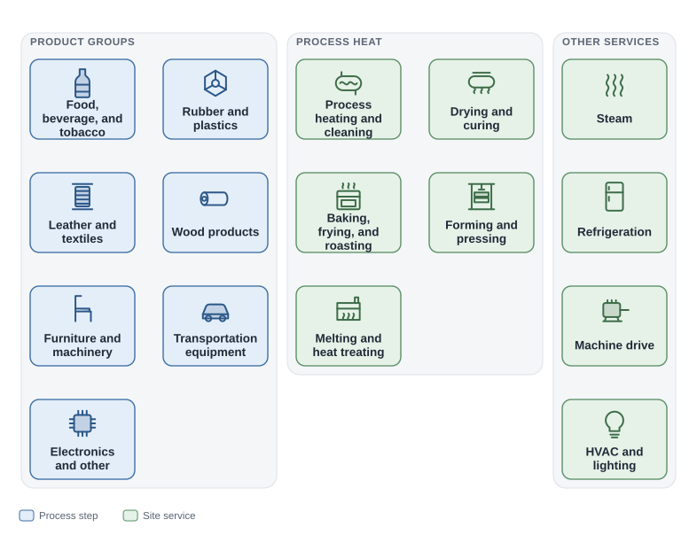

---
bibliography:
  - references.bib
  - tech-data_references.bib
aliases:
  - sector_light_industrial.html
---

# Light Industrial {#sec-light-industrial}

Light industrial covers the manufacturing industries that are each too small for a sub-model of their own but together use a large share of industrial energy in each region. The group has no common physical product, so it is the one industrial sector CIMS drives by economic output rather than tonnes. And instead of specific chemical or metal-making processes, CIMS represents it through the services its industries share: process heat, steam, refrigeration, motors, and building services.

## Scope

Light industrial groups the manufacturing industries that don't have their own sector into seven product groups: food, beverage, and tobacco; rubber and plastics; leather and textiles; wood products; furniture, printing, and machinery; transportation equipment; and electronics and other manufacturing. A forecast of each group's economic output drives how much of each service it needs.

The energy-intensive industries with their own sectors, such as iron and steel, chemicals, pulp and paper, industrial minerals, non-ferrous metals, and mining, are left out: light industrial is, by design, the rest of manufacturing. Fuels and electricity reach it through the energy supply sectors and the fuel blends.

## Context

The industries in this group make very different things, but they use energy in similar ways. Most of it goes to heat at low and medium temperatures, steam, motors, refrigeration, and heating and lighting buildings, rather than to high-temperature chemistry. Food and beverage processing is usually the largest energy user. Its heat is mostly low-temperature: around 97 % of the heat it needs is below about 130 °C, a range that modern industrial heat pumps can supply while delivering three and a half to four units of heat for each unit of electricity [@aceee-ihp; @arpagaus]. Wood products, plastics, textiles, and the rest add their own drying, pressing, melting, and heat-treating.

Because this heat isn't tied to a particular reaction, the sector is among the easiest parts of industry to electrify. Heat pumps, electric boilers and ovens, and induction heating can replace much of its fuel burning. Efficient motors and drives cut its motor load, and biomass, biogas, or hydrogen can supply the heat that remains.

## Process flow

@fig-light-industrial-process shows the sector's structure. The seven product groups request process heat, steam, refrigeration, machine drive, and building services. The technologies competing to supply those services decide the sector's energy use and emissions.

::: {#fig-light-industrial-process}
{.light-content .lightbox group="light-industrial-light"}

{.dark-content .lightbox group="light-industrial-dark"}

Structure of the light industrial sector. The product groups on the left request the services on the right.
:::

## Model structure

### Product groups

Each product group's output sets how much heat, steam, refrigeration, and motor power it requests; the groups differ mainly in that mix. Wood products also has one process step of its own: the refiners that grind wood chips into fibre for fibreboard, using large electric motors.



### Process heat

Process heat is split by the job it does, so that a technology suited to one job, such as an electric oven, a heat-pump lumber kiln, or an induction furnace, competes only where it fits.

**Process heating** covers cooking, blanching, scalding, pasteurizing, sterilizing, evaporating, and brewing. Most of it is done today with steam-heated kettles, retorts, and heat exchangers [@challis_2020_001]. The alternatives cut the heat needed, for example by heating a product quickly to a high temperature and cooling it again (ultra-high-temperature processing), by pasteurizing with pressure instead of heat, or by heating food directly with radio waves, microwaves, or electric current.



**Cleaning** covers washing products and containers and the clean-in-place systems that flush hot water and chemicals through processing equipment. Recovering heat from used wash water and reusing rinse water cut its energy.



**Drying and curing** covers spray, drum, belt, and grain dryers, lumber kilns, and the ovens that cure paint and coatings. Most dryers today burn gas or wood residue to heat air that carries the moisture away, and much of that heat leaves with the exhaust. Heat-pump lumber kilns recover heat from the moist air and reuse it [@minea_2012_001], superheated-steam dryers recover the evaporated water as useful steam, and infrared or ultraviolet curing heats only the coating.



**Baking, frying, and roasting** covers the ovens, fryers, and roasters of food processing. Electric versions replace burners with heating elements [@element-energy_2021_001].



**Forming and pressing** covers the heated presses that cure the resin in plywood, oriented strand board, and fibreboard panels, usually heated by thermal oil.



**Metal melting** covers foundry melting in fabricated metals, machinery, and transportation equipment. Coke-fired cupolas and gas-fired furnaces compete with electric arc and induction furnaces, which melt metal with electricity alone.



**Heat treatment** covers heating metal parts for forging, annealing, and normalizing, which changes their strength and hardness. Induction heaters can replace fuel-fired furnaces for many parts.



### Steam

Steam serves the process-heating and cleaning jobs that run on a site boiler and steam network. The shared heat-supply technologies compete here, with one option specific to the sector: digesting food-processing waste to make biogas, which an engine burns to make both electricity and heat [@etsap_2013_012].



### Refrigeration

Refrigeration covers chilling, freezing, and cold storage. Most plants use vapour-compression systems, in which an electric compressor drives a refrigerant (often ammonia or CO₂ in food plants) around a loop that pulls heat out of the cold space. High-efficiency chillers use variable-speed or magnetic-bearing compressors, free cooling uses cold outdoor air when it is available, and absorption chillers run on waste heat or steam instead of electricity [@etsap_2013_002].



### Machine drive

Unlike the other industrial sectors, light industrial has a single machine drive service rather than the five end uses described in @sec-machine-drive, and only motors compete there.



### Shared services

| Service | What it supplies | Technologies |
|:--------|:-----------------|:-------------|
| Steam | Shared heat-supply technologies, beyond the digester above | @sec-industrial-heat |
| HVAC and lighting | Heating, cooling, and lighting of plant buildings | @sec-hvac-lighting |
| Fuel blends | Diesel and methane blends | @sec-fuel-blends |

: Shared services in the light industrial sector {#tbl-light-industrial-shared}

## Decarbonisation

All of the sector's emissions come from burning fuel, so electrification, fuel switching, and efficiency are its levers:

- **Electric heat.** Industrial heat pumps can supply heat up to about 120–150 °C, delivering three and a half to four units of heat for each unit of electricity, which makes them a strong option wherever the grid is clean [@aceee-ihp; @arpagaus]. Electric ovens and dryers, electromagnetic food heating, induction melting and reheating, and electric boilers cover the jobs heat pumps can't reach.
- **Processes that need less heat.** Ultra-high-temperature and high-pressure processing, heat-pump lumber kilns, and infrared or ultraviolet curing cut the heat a process needs in the first place.
- **Low-carbon fuels.** Biomass and wood residues, biogas from food waste, and hydrogen in the methane blend can replace the fossil fuel that remains.
- **Efficiency.** Efficient motors and drives, high-efficiency chillers and free cooling, LED lighting, and heat recovery on cleaning systems cut the rest.

## Regional coverage and differences

Light industrial has the most complete regional coverage of any industrial sector: all seven regions (Alberta, the Atlantic region, British Columbia, Manitoba, Ontario, Québec, and Saskatchewan) carry the full structure. In the current regional data, Ontario and Québec are the largest. Québec and Alberta grow strongly over the projection, while Ontario's output stays roughly flat or declines. Because the sector follows economic output, its energy use rises with each region's economy unless efficiency and electrification offset it.

<mark>TODO: The energy intensities and product-group mix come from older calibrations. Revisit them against current CIEEDAC manufacturing energy data, since the share of food and beverage varies considerably by region.</mark>

## Limitations and planned extensions

<mark>TODO: The hierarchy splits process heat by job ahead of CIMS. Update the regional model input files to match; the unit changes for the heat and food nodes from the 2026-10-09 review are deferred.</mark>

<mark>TODO: Food and beverage has aggregate demand only. Consider process steps of its own, as the technology database requests.</mark>

<mark>TODO: Benchmark modelled light industrial energy use against CIEEDAC and Natural Resources Canada data, by product group where possible.</mark>



```{=latex}
\phantomsection
```

## References {.unnumbered}

```{=latex}
\printbibliography[heading=none]
```

::: {#refs}
:::
