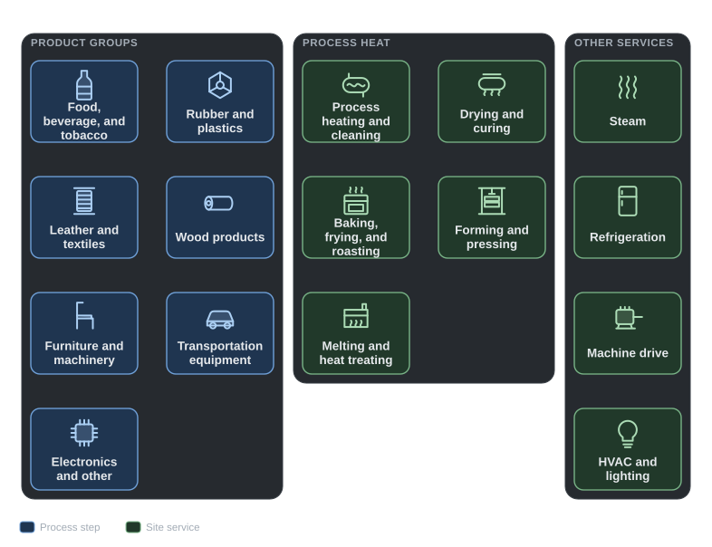

# Light Industrial {#sec-light-industrial}

Light industrial covers the manufacturing industries that are each too small for a sub-model of their own but together use a large share of regional industrial energy. Because the group has no common physical product, it is the one industrial sector CIMS drives by economic output rather than tonnes, and it is represented through the heat, steam, refrigeration, and motor services its industries share rather than through specific chemical or metallurgical processes.

## Scope

Light industrial groups the manufacturing industries not represented elsewhere into seven product groups: food, beverage, and tobacco; rubber and plastics; leather and textiles; wood products; furniture, printing, and machinery; transportation equipment; and electronics and other manufacturing. A forecast of each group's output, in millions of dollars of GDP, drives its demand for each service.

The energy-intensive industries with their own sub-models (iron and steel, chemicals, pulp and paper, industrial minerals, metal smelting, mining, and the rest) are excluded: light industrial is, by construction, the rest of manufacturing. Fuel and electricity supply enter through the energy supply sectors and the fuel blend nodes.

## Context

The group is diverse but shares an energy signature: low- and medium-temperature heat, steam, motor-driven systems, refrigeration, and building services dominate, rather than high-temperature process chemistry. Food and beverage processing is typically the largest energy user, and its heat is overwhelmingly low-temperature: on the order of 97 % of its thermal demand is below about 130 °C, a range that modern industrial heat pumps serve at a coefficient of performance of 3.5–4 [@aceee-ihp; @arpagaus]. Wood products, plastics, textiles, and the rest add their own drying, pressing, melting, and heat-treating loads.

Because this energy is general-purpose rather than tied to a specific reaction, the sector is among the most readily electrified parts of industry. Heat pumps, electric boilers and ovens, and induction heating can replace much of its fossil combustion, efficient motors and drives cut its motive load, and biomass, biogas, or hydrogen can take the duty that remains.

## Process flow

@fig-light-industrial-process shows the sector's structure. The seven product groups request process heat, steam, refrigeration, machine drive, and building services; the technologies competing to supply those services decide the sector's energy use and emissions.

::: {#fig-light-industrial-process}
{.light-content .lightbox group="light-industrial-light"}

{.dark-content .lightbox group="light-industrial-dark"}

Structure of the light industrial sector. The product groups on the left request the services on the right.
:::

## Model structure

### Product groups

Each product group is a Product node whose output, multiplied by energy-service intensities, generates requests on the services. The groups differ in how much heat, steam, refrigeration, and motive power they draw. Wood products also carries a sector-specific process step, the refiners that defibrate chips for fibreboard, measured in tonnes of dry fibre.



### Process heat

Process heat is split by operation, each measured in GJ of process heat, so that technologies suited to one operation (an electric oven, a heat-pump lumber kiln, or an induction furnace) compete only where they fit.

**Process heating** covers cooking, blanching, scalding, pasteurizing, sterilizing and retorting, evaporating and concentrating, and brewing.



**Cleaning** covers product and container washing and clean-in-place systems.



**Drying and curing** covers spray, drum, belt, and grain drying, lumber kilns, and paint and coating curing.



**Baking, frying, and roasting** covers ovens, fryers, and roasters.



**Forming and pressing** covers the heated presses that cure resin in plywood, OSB, and MDF panels.



**Metal melting** covers foundry melting in fabricated metals, machinery, and transport equipment.



**Heat treatment** covers forging heat, annealing, and normalizing.



### Steam

Steam serves the process-heating and cleaning duties that run on a site heat system. The shared heat-supply technologies compete here, with one option specific to the sector: anaerobic digestion of food-processing residues with engine CHP.



### Refrigeration

Refrigeration covers chilling, freezing, and cold storage: vapour-compression plant, ammonia and CO₂ systems, spiral and blast freezers, and the cold rooms they serve. It is measured in GJ.



### Machine drive

Unlike the other industrial sectors, light industrial has a single machine-drive node rather than the five end uses of @sec-machine-drive, and its competition is among motors only.



### Shared services

| Service | What it supplies | Technologies |
|:--------|:-----------------|:-------------|
| Steam | Shared heat-supply technologies, beyond the digester above | @sec-industrial-heat |
| HVAC and lighting | Heating, cooling, and lighting of plant buildings | @sec-hvac-lighting |
| Fuel blends | Diesel and methane blends | @sec-fuel-blends |

: Shared services in the light industrial sector {#tbl-light-industrial-shared}

## Decarbonisation

The sector's emissions all come from fuel combustion, so electrification, fuel switching, and efficiency are its levers:

- **Electrified heat.** Industrial heat pumps deliver heat up to about 120–150 °C at a coefficient of performance of 3.5–4, a strong case wherever the grid is clean [@aceee-ihp; @arpagaus]. Electric ovens and dryers, electromagnetic food heating, induction melting and reheating, and electric boilers cover duties heat pumps can't reach.
- **Process alternatives.** Aseptic and UHT processing, high-pressure processing, heat-pump lumber kilns, and infrared or ultraviolet curing cut the heat a process needs.
- **Low-carbon fuels.** Biomass and wood residues, biogas from food waste, and hydrogen through the methane blend decarbonize the remaining combustion.
- **Efficiency.** Efficient motors and drives, high-efficiency chillers and free cooling, LED lighting, and recovery on cleaning systems cut the rest.

## Regional coverage and differences

Light industrial has the most complete regional coverage of any industrial sector: all seven regions (Alberta, the Atlantic region, British Columbia, Manitoba, Ontario, Québec, and Saskatchewan) carry the full structure. In the current regional data, Ontario and Québec are the largest, with Québec and Alberta growing strongly over the projection while Ontario's output is roughly flat to declining. Because the sector follows economic output, its energy use rises with regional GDP unless efficiency and electrification offset it.

<mark>TODO: The energy intensities and product-group mix are inherited from older calibrations. Revisit them against current CIEEDAC manufacturing energy data, since the share of food and beverage varies considerably by region.</mark>

## Limitations and planned extensions

<mark>TODO: The hierarchy splits process heat by operation ahead of CIMS. Update the regional model input files to match; the unit changes for the heat and food nodes from the 2026-10-09 review are deferred.</mark>

<mark>TODO: Food and beverage has aggregate demand only. Consider process steps of its own, as the technology database requests.</mark>

<mark>TODO: Benchmark modelled light industrial energy use against CIEEDAC and Natural Resources Canada data, by product group where possible.</mark>



```{=latex}
\phantomsection
```

## References {.unnumbered}

```{=latex}
\printbibliography[heading=none]
```

::: {#refs}
:::
