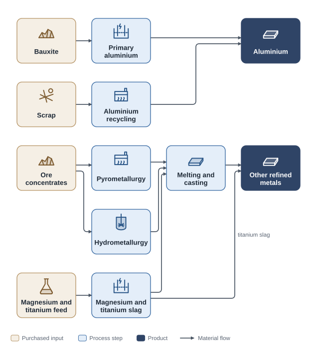
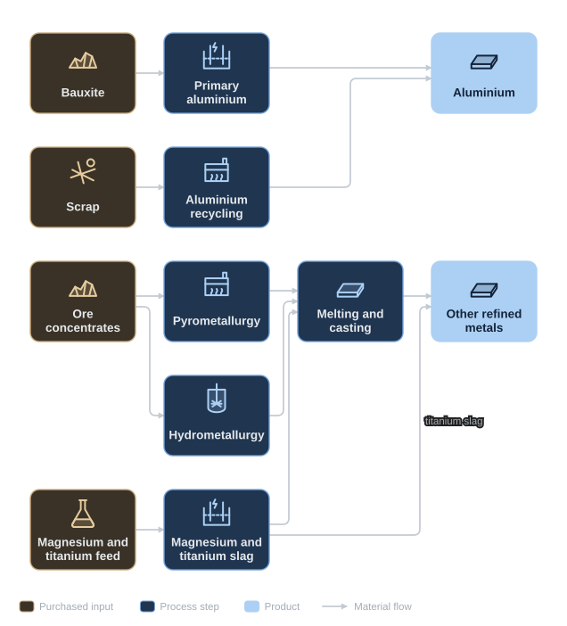

# Metal Smelting and Refining {#sec-metal-smelting}

Metal smelting and refining turns ore concentrates, alumina, and scrap into finished non-ferrous metals. Aluminium dominates the sector, and its production runs mainly on electricity, much of it hydropower in Québec. The sector's hardest-to-cut emissions are therefore process emissions rather than combustion: CO₂ from the consumable carbon anode in aluminium electrolysis, and SF₆ from magnesium melt protection. This chapter covers the sector as a whole; two sub-sector chapters cover its production chains in detail: @sec-metal-smelting-aluminum and @sec-metal-smelting-base-metals.

## Scope

The sub-model covers the smelting and refining of aluminium, copper, nickel, lead, zinc, and magnesium, and the electric smelting of titanium slag. A forecast of refined-metal output, in tonnes, drives every upstream step and service.

Several adjacent activities sit elsewhere in CIMS to avoid double-counting:

- Iron and steel are covered in @sec-iron-and-steel.
- Mining and concentrating the ores belong to @sec-mining; this sub-model takes concentrates, bauxite, and scrap as inputs.
- Fabricating metal into finished goods (rolling, extrusion, and casting of products) belongs to the manufacturing branches in @sec-light-industrial; this sub-model ends with refined and cast metal.

Minor and precious metals (gold, silver, the platinum-group metals, and cadmium) are not represented separately: they are recovered alongside the base metals or produced in quantities too small to model on their own.

## Context

Canada is one of the world's leading non-ferrous metal producers. Almost all Canadian primary aluminium is smelted in Québec, where low-cost hydroelectricity makes the energy-intensive Hall-Héroult process economic; Canadian smelters are among the lowest-carbon in the world for this reason [@iea-aluminium]. Nickel and copper smelting and refining are concentrated in Ontario (Sudbury) and Manitoba (Thompson), with zinc and other base metals in several provinces.

The sector's emissions profile is distinctive. Hall-Héroult electrolysis uses roughly 14 MWh of electricity per tonne of aluminium, but even on clean electricity it emits CO₂, because the reaction consumes the carbon anode: about 1.6–1.7 t CO₂ per tonne of aluminium. Intermittent anode effects also release perfluorocarbons (PFCs), very potent greenhouse gases [@iea-aluminium]. Magnesium production and casting use SF₆ as a cover gas; SF₆ has roughly 22,000 times the warming potential of CO₂, so small quantities matter. Pyrometallurgical copper, nickel, lead, and zinc smelting burns fuel for roasting, smelting, and converting, and its sulphur-rich off-gas feeds an acid plant.

## Process flow

@fig-metal-smelting-process shows the sector's production chains. Aluminium is made from bauxite, through alumina, or remelted from scrap. The base metals follow either a high-temperature (pyrometallurgical) route or an aqueous (hydrometallurgical) route, and most are then melted and cast. Magnesium comes from electrolysis or thermal reduction, and titanium slag from electric smelting of ilmenite.

::: {#fig-metal-smelting-process}
{.light-content .lightbox group="metal-smelting-light"}

{.dark-content .lightbox group="metal-smelting-dark"}

Process flow of the metal smelting and refining sector. Each production chain is detailed in its sub-sector chapter.
:::

## Model structure

The Product sub-tree holds one branch per metal: **aluminium** (primary aluminium and recycling), **copper**, **nickel**, **lead**, and **zinc** (each split into pyrometallurgy, hydrometallurgy where it applies, and melting and casting), **magnesium** (electrolysis, thermal reduction, and melting and casting), and **titanium slag**. The Service sub-tree holds three sector-specific services, **anode production**, **oxygen**, and the smelter **acid plant**, alongside the shared services.

- @sec-metal-smelting-aluminum covers alumina refining, anode production, electrolysis, and recycling.
- @sec-metal-smelting-base-metals covers copper, nickel, lead, zinc, magnesium, and titanium slag, with the oxygen and acid-plant services.

### Shared services

The sector also draws on the shared services documented in the General Services part:

| Service | What it supplies | Technologies |
|:--------|:-----------------|:-------------|
| Steam | Process steam for alumina digestion, leaching, and refining | @sec-industrial-heat |
| Machine drive | Pumps, fans and blowers, compressed air, materials handling, and materials processing | @sec-machine-drive |
| HVAC and lighting | Heating, cooling, and lighting of smelter and refinery buildings | @sec-hvac-lighting |
| Fuel blends | Diesel and methane blends | @sec-fuel-blends |
| CCS | Capture of concentrated and diffuse CO₂, including from alumina calciners and potlines | @sec-ccus |

: Shared services in the metal smelting sector {#tbl-metal-smelting-shared}

## Decarbonisation

Because Canadian smelting already runs largely on clean electricity, its decarbonisation problem is less about energy supply than about process chemistry and the amount of primary metal made.

- **Inert anodes.** Non-consumable anodes release oxygen instead of CO₂, removing both the anode CO₂ and the PFCs from anode effects. The ELYSIS joint venture in Québec produced primary aluminium at industrial scale with inert anodes in 2021 and targets wider commercial availability later this decade [@elysis].
- **Recycling.** Remelting scrap aluminium uses about 5 % of the energy of primary production.
- **Alumina refining.** Mechanical vapour recompression in digestion and electric or hydrogen-fired calciners displace the fuel burned in alumina refineries.
- **Base-metal smelting.** Oxygen-enriched flash and bath smelting and continuous converting cut fuel per tonne; hydrometallurgy avoids high-temperature smelting where it applies; and electrolytic smelting is an earlier-stage alternative.
- **Carbon capture.** Calciners and potlines with capture are in the technology lists, with the capture plants in @sec-ccus.
- **Magnesium cover gas.** Replacing SF₆ with alternative cover gases (sulphur dioxide or fluorinated ketones) removes almost all of this emission at low cost [@ipcc-sf6-mg]. No technology in the database represents the switch yet.

## Regional coverage and differences

The tree is region-agnostic: each region is built from the same structure and carries no production on branches that don't apply. Five regions are represented in the current regional data:

- Québec dominates the sector, carrying essentially all primary aluminium on its hydropower, and grows over the projection.
- Ontario (Sudbury) carries nickel and copper smelting and refining.
- Manitoba (Thompson) carries nickel; British Columbia and the Atlantic region carry smaller base-metal operations.

<mark>TODO: Alberta and Saskatchewan are absent, consistent with the absence of major non-ferrous smelters there. Confirm the regional metal mix, including the lead and titanium-slag branches, against current operations. The titanium-slag branch has no demand series yet.</mark>

## Limitations and planned extensions

<mark>TODO: Ferroalloys and silicon metal have no node; only titanium slag represents electric smelting. A node under metal smelting has been requested of the hierarchy.</mark>

<mark>TODO: Represent PFC emissions from aluminium anode effects explicitly (only the carbon-anode CO₂ is carried), and add an SF₆-free magnesium cover-gas technology so the magnesium emission can be abated in the model.</mark>

<mark>TODO: The CCS nodes and the acid-plant service were added to the hierarchy ahead of the CIMS model inputs. Add them to the regional input files, with the copper smelting and converting technologies requesting about 2.5–4.0 t of sulphuric acid per tonne of copper.</mark>

<mark>TODO: Benchmark modelled non-ferrous energy use and process emissions against CIEEDAC and the National Inventory Report.</mark>



```{=latex}
\phantomsection
```

## References {.unnumbered}

```{=latex}
\printbibliography[heading=none]
```

::: {#refs}
:::
