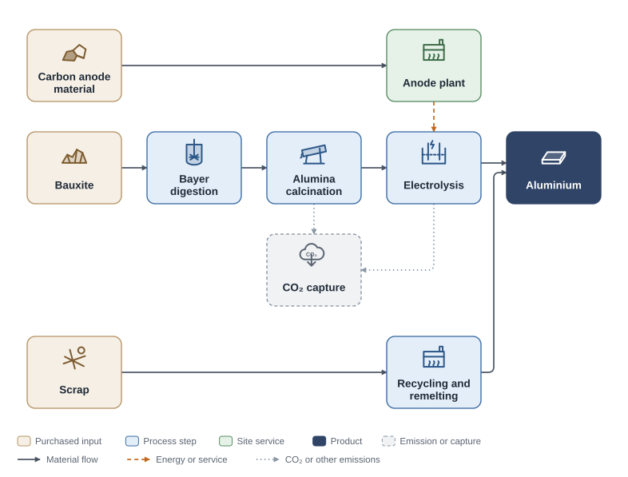
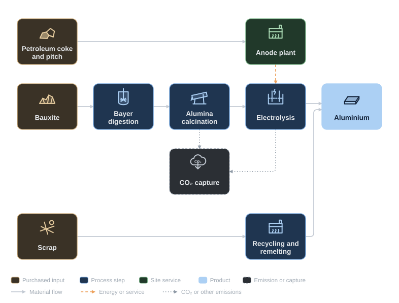

# Aluminium {#sec-metal-smelting-aluminum}

Aluminium is the largest chain in the metal smelting sector (see @sec-metal-smelting for the sector's scope, context, and shared services). Primary aluminium is made in two stages: refining bauxite to alumina, and electrolysing the alumina in Hall-Héroult cells that consume carbon anodes. Recycling remelts scrap aluminium at a small fraction of the energy.

## Process flow

::: {#fig-metal-smelting-aluminum-process}
{.light-content .lightbox group="aluminium-light"}

{.dark-content .lightbox group="aluminium-dark"}

Process flow of aluminium production. Bauxite is refined to alumina by Bayer digestion and calcination, and electrolysis reduces the alumina to aluminium using anodes from the anode plant. Recycling remelts scrap.
:::

## Model structure

The aluminium branch splits into **primary aluminium**, made up of the alumina steps and electrolysis, and **recycling**. Electrolysis requests anodes from the sector's **anode production** service. Canada imports most of its alumina, but the refining steps are represented so that domestic refining can be modelled.

### Bayer digestion

Digestion dissolves the alumina in bauxite in hot caustic soda under pressure, using steam; the liquor is clarified, and alumina hydrate is precipitated from it. It is measured in tonnes of alumina.



### Alumina calcination

Calcination drives the water out of alumina hydrate at high temperature, giving the alumina that feeds the cells. It is measured in tonnes of alumina, and is where most of a refinery's fuel is burned.



### Anode production

Prebake cells use carbon anodes baked in a ring furnace from petroleum coke and pitch; Søderberg cells bake their own anodes in place from paste. The service is measured in tonnes of anode.



### Electrolysis

Hall-Héroult cells reduce alumina dissolved in molten cryolite to aluminium. The process uses roughly 14 MWh of electricity per tonne and consumes the carbon anode, releasing about 1.6–1.7 t CO₂ per tonne [@iea-aluminium]. Prebake and Søderberg cells are the incumbents; the inert anode removes the anode CO₂ entirely [@elysis]. Electrolysis is measured in tonnes of aluminium.



### Recycling and remelting

The recycling branch melts scrap aluminium, ingot, and returns before casting, at about 5 % of the energy of primary production.



## Decarbonisation

On Québec's hydropower, the remaining direct emissions from primary aluminium come almost entirely from the carbon anode, so the **inert anode** is the largest lever. Elsewhere in the chain, mechanical vapour recompression replaces live steam in digestion, electric and hydrogen-fired calciners replace fuel-fired calcination, electric baking and biogenic anode materials cut the emissions of anode production, and capture-equipped calciners and potlines send their CO₂ to the sector's capture service. Expanding **recycling** reduces the primary metal needed in the first place.

<mark>TODO: The calcination node was added to the hierarchy ahead of the CIMS model inputs, with digestion narrowed to digestion and precipitation. Update the regional input files to match.</mark>



```{=latex}
\phantomsection
```

## References {.unnumbered}

```{=latex}
\printbibliography[heading=none]
```

::: {#refs}
:::
