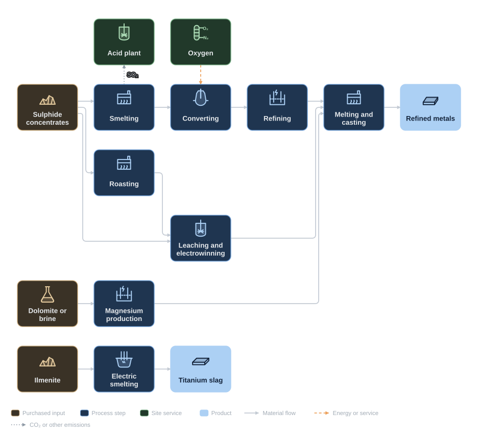

# Base Metals, Magnesium, and Titanium Slag {#sec-metal-smelting-base-metals}

This chapter covers the metal smelting chains other than aluminium: copper, nickel, lead, and zinc, which share the same process steps, and magnesium and titanium slag, which have chains of their own. See @sec-metal-smelting for the sector's scope, context, and shared services.

## Process flow

::: {#fig-metal-smelting-base-metals-process}
{.light-content .lightbox group="base-metals-light"}

{.dark-content .lightbox group="base-metals-dark"}

Process flow of base-metal, magnesium, and titanium-slag production. Sulphide concentrates follow either the pyrometallurgical route (smelting, converting, and refining) or, after roasting where needed, the hydrometallurgical route (leaching and electrowinning). Most metals are then melted and cast.
:::

## Model structure

Each base metal has its own branch in the Product sub-tree, but the branches share process steps and technologies:

| Metal | Pyrometallurgy | Hydrometallurgy | Melting and casting |
|:------|:---------------|:----------------|:-------------------:|
| Copper | Smelting, converting, refining | Leaching with SX-EW | Yes |
| Nickel | Smelting, converting, refining | Leaching with SX-EW | Yes |
| Lead | Roasting, smelting, refining | — | Yes |
| Zinc | Roasting | Leaching, purification, and electrowinning | Yes |

: Process steps by base metal {#tbl-base-metal-steps}

The tables below list each step's technologies once per metal, in the order of the flowchart.

### Roasting

Roasting heats sulphide concentrate in air to convert it to oxide before smelting (lead) or leaching (zinc). It is measured in tonnes of metal.

::: {.panel-tabset}
#### Zinc


#### Lead

:::

### Smelting

Smelting melts concentrate with oxygen-enriched air into a metal-rich matte (copper and nickel) or crude metal (lead), separating the gangue as slag. Smelting's sulphur-rich off-gas goes to the **acid plant**, and its oxygen comes from the **oxygen** service.

::: {.panel-tabset}
#### Copper


#### Nickel


#### Lead

:::

### Converting

Converting blows air or oxygen through the matte to remove the remaining iron and sulphur, giving blister copper or nickel.

::: {.panel-tabset}
#### Copper


#### Nickel

:::

### Refining

Refining turns blister or crude metal into marketable metal: electrorefining for copper, matte refining for nickel, and fire refining for lead.

::: {.panel-tabset}
#### Copper


#### Nickel


#### Lead

:::

### Leaching and electrowinning

The hydrometallurgical route dissolves metal into solution, purifies it, and plates it out by electrowinning. It uses more electricity than smelting but avoids high-temperature fuel use.

::: {.panel-tabset}
#### Copper


#### Nickel


#### Zinc

:::

### Melting and casting

Refined metal, scrap, and returns are melted and cast into ingot or other shapes. The same melting furnaces compete for every metal.

::: {.panel-tabset}
#### Copper


#### Nickel


#### Lead


#### Zinc


#### Magnesium

:::

### Oxygen and the acid plant

The **oxygen** service supplies oxygen for enriched smelting and converting from an air separation unit. The **acid plant** cleans the sulphur-dioxide-rich off-gas from smelting and converting and makes sulphuric acid from it; it accounts for about 30 % of a copper smelter's capital cost, and is measured in tonnes of acid.

**Oxygen**



**Acid plant**



### Magnesium

Primary magnesium comes from electrolysis of anhydrous magnesium chloride or from silicothermic reduction of calcined dolomite. Magnesium melting uses SF₆ as a cover gas, which carries a very high warming potential.

**Electrolysis**



**Thermal reduction**



### Titanium slag

Electric furnaces smelt ilmenite with a carbon reductant into titanium slag and iron. Pre-reducing the feed cuts furnace electricity, and biocarbon can replace fossil reductant.

**Pre-reduction**



**Electric smelting**



## Decarbonisation

For the base metals, oxygen-enriched flash and bath smelting and continuous converting cut fuel per tonne, and recover more of the off-gas heat in waste-heat boilers; hydrometallurgy avoids high-temperature smelting where it applies; and electrolytic smelting is an earlier-stage alternative to fuel-fired smelting. Induction and isothermal furnaces electrify melting. For titanium slag, biocarbon reductant replaces fossil carbon in the furnace charge. For magnesium, the main lever, replacing the SF₆ cover gas, is not yet represented (see @sec-metal-smelting).
