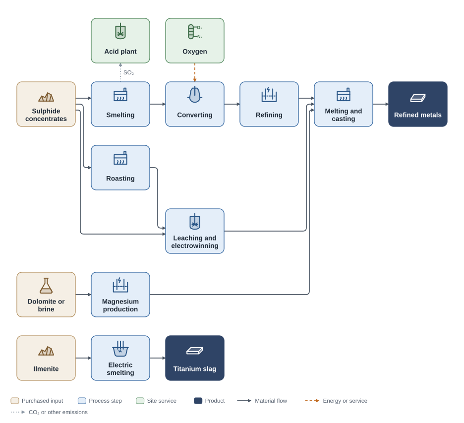

---
bibliography:
  - references.bib
  - tech-data_references.bib
---

# Base Metals, Magnesium, and Titanium Slag {#sec-metal-smelting-base-metals}

This chapter covers the non-ferrous metal chains other than aluminium. Copper, nickel, lead, and zinc share the same process steps, while magnesium and titanium slag have chains of their own. See @sec-metal-smelting for the sector's scope, context, and shared services.

## Process flow

::: {#fig-metal-smelting-base-metals-process}
{.light-content .lightbox group="base-metals-light"}

{.dark-content .lightbox group="base-metals-dark"}

Process flow of base-metal, magnesium, and titanium-slag production. Sulphide concentrates take either the high-temperature route (smelting, converting, and refining) or, after roasting where needed, the water-based route (leaching and electrowinning). Most metals are then melted and cast.
:::

## Model structure

Base-metal ores are mostly sulphides: the metal is bound to sulphur, along with iron and rock. Producers separate the metal in one of two ways.

- The **high-temperature route** (pyrometallurgy) melts the concentrate in furnaces and burns off the sulphur and iron with air or oxygen.
- The **water-based route** (hydrometallurgy) dissolves the metal in an acid or other solution, purifies the solution, and recovers the metal by electrolysis.

Each base metal has its own branch in the Product sub-tree, but the branches share process steps and technologies:

| Metal | High-temperature route | Water-based route | Melting and casting |
|:------|:-----------------------|:------------------|:-------------------:|
| Copper | Smelting, converting, refining | Leaching with solvent extraction and electrowinning | Yes |
| Nickel | Smelting, converting, refining | Leaching with solvent extraction and electrowinning | Yes |
| Lead | Roasting, smelting, refining | — | Yes |
| Zinc | Roasting | Leaching, purification, and electrowinning | Yes |

: Process steps by base metal {#tbl-base-metal-steps}

The technology lists below appear once for each metal, in the order of the flowchart. In the HTML version, each metal's list sits on its own tab.

### Roasting

Roasting heats sulphide concentrate in air, below its melting point, so that oxygen replaces the sulphur and turns the sulphide into an oxide. Lead oxide then goes on to smelting, and zinc oxide to leaching. The reaction itself gives off heat, so a roaster needs little added fuel once it is running. Its off-gas, rich in sulphur dioxide, goes to the acid plant.

::: {.panel-tabset}
#### Zinc


#### Lead

:::

### Smelting

Smelting melts the concentrate at around 1,200 °C. Most of the iron combines with silica to form a molten slag that floats off, and the copper or nickel collects in a heavier molten layer called matte, a mix of metal and the remaining sulphur. For lead, smelting reduces the oxide to crude metal. Modern flash and bath smelters blow oxygen-enriched air into the furnace, so that burning the sulphur in the concentrate supplies much of the heat and less fuel is needed [@coursol_2015_001; @schlesinger_2011_001]. The off-gas goes to the **acid plant**, and the oxygen comes from the **oxygen** service.

::: {.panel-tabset}
#### Copper


#### Nickel


#### Lead

:::

### Converting

Converting blows air or oxygen through the molten matte to burn out the remaining iron and sulphur, leaving blister copper (about 99 % pure) or a nickel-rich matte. The traditional Peirce-Smith converter is a batch vessel that is filled and emptied with ladles, letting sulphur-laden gas escape each time. Continuous converters keep the gas contained, which makes it easier to capture the sulphur and recover the heat [@schlesinger_2011_001].

::: {.panel-tabset}
#### Copper


#### Nickel

:::

### Refining

Refining turns blister or crude metal into marketable metal. Copper is cast into anodes and refined electrically: in a tankhouse, pure copper plates onto cathodes while impurities fall to the bottom. Nickel matte goes to a refinery that separates the nickel, cobalt, and precious metals. Lead is refined by heating it and removing impurities in stages.

::: {.panel-tabset}
#### Copper


#### Nickel


#### Lead

:::

### Leaching and electrowinning

The water-based route dissolves the metal out of ore or roasted concentrate with acid, sometimes in heaps open to the air and sometimes in pressurized vessels. Solvent extraction then transfers the metal into a clean solution, and electrowinning plates it out as pure metal on cathodes. The route uses more electricity than smelting, mostly for electrowinning, but it avoids high-temperature fuel use and sulphur dioxide [@schlesinger_2011_001].

::: {.panel-tabset}
#### Copper


#### Nickel


#### Zinc

:::

### Melting and casting

Refined metal, scrap, and production offcuts are melted and cast into ingots or other shapes for sale. The same melting furnaces compete for every metal: fuel-fired reverberatory and rotary furnaces, more efficient regenerative and oxy-fuel furnaces, and electric induction furnaces.

::: {.panel-tabset}
#### Copper


#### Nickel


#### Lead


#### Zinc


#### Magnesium

:::

### Oxygen and the acid plant

The **oxygen** service supplies oxygen for smelting and converting from an air separation unit, which cools air until it liquefies and then separates the oxygen by distillation. Using oxygen instead of air means less nitrogen to heat, so furnaces burn less fuel, but the air separation unit uses a lot of electricity.

The **acid plant** cleans the sulphur dioxide from smelting, converting, and roasting and turns it into sulphuric acid, which is sold. Without it, the sulphur would leave the stack. An acid plant accounts for about 30 % of a copper smelter's capital cost [@schlesinger_2011_001].

**Oxygen**



**Acid plant**



### Magnesium

Primary magnesium comes from one of two routes. Electrolysis splits molten magnesium chloride, made from brine or serpentine rock, into magnesium and chlorine. The silicothermic route heats calcined dolomite with ferrosilicon under vacuum, so that the silicon pulls the oxygen off the magnesium; it uses much more energy. Molten magnesium is protected from burning with a cover gas, traditionally SF₆, an extremely potent greenhouse gas [@nccp_1999_002].

**Electrolysis**



**Thermal reduction**



### Titanium slag

Electric furnaces smelt ilmenite, an iron-titanium oxide, with a carbon reductant. The carbon removes oxygen from the iron, which settles out as molten iron, leaving a slag rich in titanium oxide for pigment makers. Pre-reducing the feed in a kiln cuts the furnace's electricity use, and biocarbon can replace fossil carbon as the reductant.

**Pre-reduction**



**Electric smelting**



## Decarbonisation

- **Base metals.** Smelting with oxygen-enriched air, and continuous converting, cut fuel per tonne and let waste-heat boilers recover more of the off-gas heat. The water-based route avoids high-temperature smelting where the ore suits it, and electrolytic smelting is an earlier-stage alternative to fuel-fired smelting. Induction and immersion furnaces electrify melting.
- **Titanium slag.** Biocarbon replaces fossil carbon in the furnace charge.
- **Magnesium.** The main lever, replacing the SF₆ cover gas, is not yet represented (see @sec-metal-smelting).



```{=latex}
\phantomsection
```

## References {.unnumbered}

```{=latex}
\printbibliography[heading=none]
```

::: {#refs}
:::
