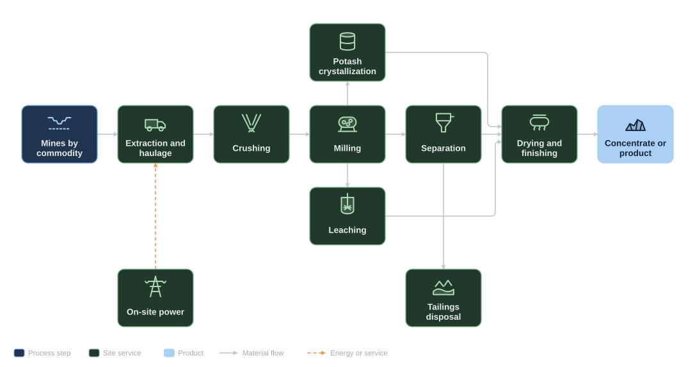

---
bibliography:
  - references.bib
  - tech-data_references.bib
---

# Mining {#sec-mining}

The mining sector digs up and concentrates metal ores, potash, uranium, diamonds, and aggregate. Most of its energy goes to a few jobs: moving rock with trucks, crushing and grinding it, and drying the finished product. Those jobs are also where its options to cut emissions lie.

## Scope

The sub-model covers five mined products, each split by how it is mined:

- metal ores, from open-pit and underground mines;
- potash, from conventional underground mines and from solution mines, which dissolve the ore underground and pump it to the surface as brine;
- uranium, from open-pit and underground mines;
- diamonds, from open-pit and underground mines; and
- aggregate (sand, gravel, and crushed stone), from open pits.

A forecast of each product's output drives everything beneath it. The sub-model stops at the mine gate, with a saleable concentrate or product.

Several activities that people often call mining sit elsewhere in CIMS, so that their energy is counted once:

- Coal mining is covered in @sec-coal-mining.
- Oil and gas extraction and oil sands mining are covered in @sec-crude-oil.
- Cement, lime, glass, brick, and other mineral products are covered in @sec-industrial-minerals.
- Smelting and refining mined concentrates is covered in @sec-non-ferrous-metals.

## Context

Canada is one of the world's leading mining nations, and each region mines different things. Metal mines produce copper, nickel, zinc, gold, iron ore, and other metals. Saskatchewan produces about 30 % of the world's potash [@nrcan-potash] and roughly a quarter of its uranium, from the high-grade deposits of the Athabasca Basin [@wna-uranium]. The Northwest Territories host Canada's diamond mines, and Nunavut has growing gold and iron ore production. Mining depends on world commodity prices and ore grades rather than on Canadian demand, so CIMS drives the sector with an output forecast set outside the model.

Crushing and grinding rock is usually the largest energy use at a metal mine. It takes about a quarter of a typical site's energy and most of its electricity [@ceec-comminution]. Diesel runs the trucks, loaders, and drills, and many remote northern mines have no grid connection, so they burn diesel to make all their electricity too. Underground mines also spend a lot of electricity on ventilation, moving large volumes of air to keep it breathable and at a safe temperature.

## Process flow

@fig-mining-process shows how ore moves through a mine. Every product starts with extraction and haulage. The ore is then crushed and ground, and the valuable minerals are separated from the waste rock: by flotation or magnetic methods, by leaching them out with a solution, or, for potash, by crystallizing the salt. The concentrate is then dried and, for some products, compacted or pelletized. The rejected rock goes to tailings disposal.

::: {#fig-mining-process}
{.light-content .lightbox group="mining-light"}

{.dark-content .lightbox group="mining-dark"}

Process flow of the mining sector. Each commodity and mining method draws on the same processing steps, from extraction to drying and finishing.
:::

## Model structure

CIMS lists the products by mining method, and the products have no technologies of their own. Instead, each product calls on shared processing steps, so the same crushing, grinding, separation, and drying technologies serve every commodity that needs them.

### Extraction and haulage

**Extraction** is the drilling, blasting, and loading that frees ore from the ground, plus the wells and pumps of a solution mine. The technology database does not yet hold technologies for it.

**Mine haulage** carries ore and waste rock out of the pit or up from underground. It is often the largest diesel use at a mine, because trucks haul heavy loads up long ramps. Open-pit and underground haulage are separate, because their equipment differs. In an open pit, haul trucks can be battery-electric, run on hydrogen fuel cells, burn a mix of liquefied natural gas and diesel, or draw power from an overhead line on the steep uphill ramps (trolley assist); a crusher in the pit can feed a conveyor and replace the trucks altogether [@paraszczak_2014_001]. Underground, a shaft hoist can lift ore instead of trucks driving it up a ramp.

**Open-pit haulage**



**Underground haulage**



### Crushing and milling

**Crushing** breaks blasted rock into pieces a few centimetres across. **Milling** then grinds it to a fine powder, so that the valuable mineral grains come free of the rock around them. Breaking rock takes a lot of energy, and the harder the ore and the finer the grind, the more it takes. That is why comminution (crushing and grinding together) stays in this sector rather than in the shared machine-drive service: the choice of grinding equipment matters more than the choice of motor.

The usual circuit is a large rotating drum (a semi-autogenous or SAG mill) followed by a ball mill. High-pressure grinding rolls squeeze the ore between two rollers instead and use less energy [@wang_2013_001]. Sensor-based ore sorting picks out waste rock before it reaches the mill, so less rock needs grinding [@robben_2019_001].

**Crushing**



**Milling**



### Separation, leaching, and crystallization

These steps pull the valuable mineral out of the ground rock.

- **Separation** concentrates the mineral by flotation, where chemicals and air bubbles carry mineral grains to the surface of a tank, or by gravity and magnetic methods, which suit iron ore.
- **Leaching** dissolves the metal out of the ore with an acid or other solution, in heaps, in tanks, in high-pressure vessels, or in the orebody itself. The metal is then recovered from the solution, usually by electricity in a process called electrowinning.
- **Crystallization** recovers potassium chloride at a potash mill. A conventional mill floats the potash away from the salt and clay; a solution mine evaporates the brine to grow potash crystals, which takes a lot of heat.

**Separation**



**Leaching**



**Crystallization**



### Drying, compaction, and pelletizing

Concentrates and potash are wet when they leave the mill, and are dried before shipping, mostly in fuel-fired dryers. Potash is also pressed into granules (compaction), a step the technology database does not yet cover. At iron ore mines, the fine concentrate is rolled into balls and baked hard in a furnace to make pellets that a steel mill can use. Pelletizing uses the same technologies as agglomeration in iron and steel (see @sec-iron-and-steel).

**Drying**



**Pelletizing**



### Tailings disposal

Tailings are the finely ground waste left after separation. Most mines pump them as a slurry to a storage pond and recover water from it. Filtering the tailings into a dry, stackable material uses more equipment but less water and a smaller, safer storage area [@kcb_2017_001].



### On-site power

Mining is the only sector with its own **on-site power** service, for mines that make their own electricity because they are off the grid. Diesel and gas generators compete there with solar, wind, and storage, waste-heat power, and small nuclear reactors. The technologies are listed in @sec-cogen.

### Shared services

| Service | What it supplies | Technologies |
|:--------|:-----------------|:-------------|
| Steam | Process heat for potash mills and other heating jobs | @sec-industrial-heat |
| Machine drive | Pumps, fans and blowers, compressed air, materials handling, and materials processing | @sec-machine-drive |
| HVAC and lighting | Heating, cooling, and lighting of mine buildings | @sec-hvac-lighting |
| Fuel blends | Diesel and natural gas blends | @sec-fuel-blends |

: Shared services in the mining sector {#tbl-mining-shared}

The pumps service also has one technology specific to mining, for pumping water out of the pit or the underground workings:



## Decarbonisation

- **Trucks and haulage.** Trolley assist powers haul trucks from an overhead line on the loaded uphill runs, cutting the energy used there by roughly 40–60 % and lifecycle CO₂ by about 28–36 % where the grid is clean [@bisulandu-mining-2026]. Battery-electric trucks remove tailpipe emissions but are limited by range and charging time [@tokac_2025_001]; hydrogen fuel-cell trucks are still in trials. In-pit crushing and conveying replaces trucks altogether, and biodiesel and renewable diesel reach the trucks that remain through the diesel blend.
- **Crushing and grinding.** High-pressure grinding rolls cut grinding energy by about 20 %, stirred mills save energy in fine grinding, and ore sorting keeps waste rock out of the mill [@bisulandu-mining-2026].
- **Heat.** Electric dryers and heat pumps, electric pelletizing furnaces, and the low-carbon heat options in the shared steam service can replace fuel-fired heat for drying and potash processing.
- **Ventilation.** Ventilation can take 40–50 % of an underground mine's energy. Ventilation on demand sends air only where people and vehicles are working, and can cut ventilation energy by up to about half [@abb-vod]. Efficient fans and variable-speed drives reach it through the shared machine-drive service.
- **Off-grid power.** Solar, wind, and storage, waste-heat power, and small nuclear reactors can displace diesel generation at remote mines.

## Regional coverage and differences

Every region is built from the same structure and simply carries no production where a product isn't mined. Potash is mined in Saskatchewan; iron ore in Québec and the Atlantic region (the Labrador Trough); base and precious metals in British Columbia, Ontario, Manitoba, Québec, and the Atlantic region; uranium in Saskatchewan; and diamonds in the Northwest Territories.

<mark>TODO: The hierarchy now has uranium, diamond, and aggregate products, and products by mining method. Populate them in the regional input files, and build out Alberta and the territories (the territories are not yet represented anywhere in CIMS).</mark>

## Limitations and planned extensions

<mark>TODO: The extraction and compaction services have no technologies in the technology database yet; add them, or document that their energy is carried by the haulage and drying technologies.</mark>

<mark>TODO: Metal mines have no mine-ventilation node (only coal mining has one), and mine air heating and mine-water treatment have no node either; ventilation fans currently sit in the shared fans service. See the hierarchy change requests in the technology database.</mark>

<mark>TODO: Mining has no carbon-capture service, on the assumption that its emissions are mostly spread across many small combustion sources. Confirm this, and benchmark modelled mining energy use against CIEEDAC and Natural Resources Canada data.</mark>



```{=latex}
\phantomsection
```

## References {.unnumbered}

```{=latex}
\printbibliography[heading=none]
```

::: {#refs}
:::
