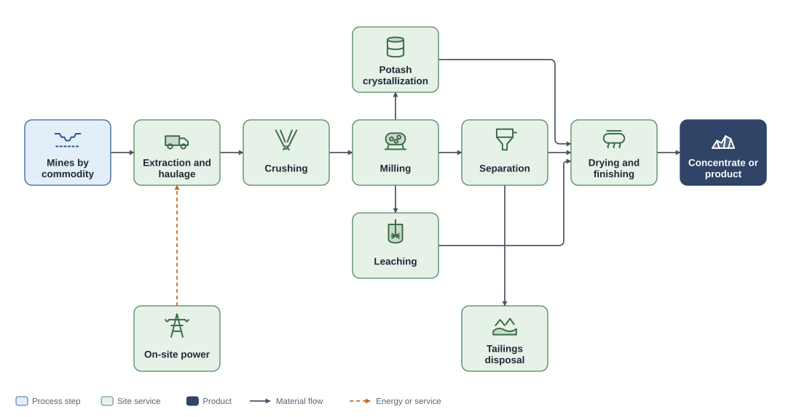

# Mining {#sec-mining}

Mining covers the extraction and concentration of metal ores, potash, uranium, diamonds, and aggregate. Its energy use is concentrated in a few activities: diesel for haulage, electricity for crushing and grinding, and heat for drying and potash processing. Those are where its decarbonisation choices sit.

## Scope

The sub-model represents five mined products, each by mining method: metal (open pit and underground), potash (conventional underground and solution mining), uranium (open pit and underground), diamonds (open pit and underground), and aggregate (open pit). A forecast of each product's output drives the extraction, processing, and service demands beneath it. The sub-model stops at the mine gate, with a saleable concentrate or product as its output.

Several activities that are often called mining sit elsewhere in CIMS to avoid double-counting:

- Coal mining is covered in @sec-coal-mining.
- Oil and gas extraction and oil sands mining are covered in @sec-petroleum-crude.
- Cement, lime, glass, brick, and other non-metallic mineral products are covered in @sec-industrial-minerals.
- Smelting and refining of mined concentrates is covered in @sec-metal-smelting.

## Context

Canada is one of the world's leading mining nations, and the industry is highly regional. Metal mines produce copper, nickel, zinc, gold, iron ore, and other metals from open-pit and underground operations. Saskatchewan accounts for about 30 % of global potash production [@nrcan-potash] and supplies roughly a quarter of the world's uranium from the high-grade deposits of the Athabasca Basin [@wna-uranium]. The Northwest Territories host Canada's diamond industry, and Nunavut has growing gold and iron-ore production. Mining is capital-intensive and export-oriented, so world commodity prices and ore grades, not domestic demand, drive its activity; CIMS therefore drives the sector with an exogenous output forecast.

Comminution (the crushing and grinding that reduce run-of-mine rock to particles fine enough for mineral separation) is typically the largest energy use at a metal mine: about a quarter of final energy at an average site, and most of its electricity [@ceec-comminution]. Diesel dominates mobile equipment, especially haulage, and many remote northern mines are off-grid and rely on diesel generation for all loads. Ventilation is a large electricity load underground, since deep mines must move large volumes of air for air quality and temperature control.

## Process flow

@fig-mining-process shows the sector's process steps. Each product and mining method requests extraction and haulage; ore then passes through crushing and milling to separation, leaching, or, for potash, crystallization, and on to drying, compaction, or pelletizing. Separation also sends tailings for disposal.

::: {#fig-mining-process}
{.light-content .lightbox group="mining-light"}

{.dark-content .lightbox group="mining-dark"}

Process flow of the mining sector. The product nodes, one for each commodity and mining method, request the processing steps in the Service sub-tree.
:::

## Model structure

The Product sub-tree holds the products by mining method; it carries no technologies of its own. Every processing step sits in the Service sub-tree, so that the same crushing, milling, separation, and drying technologies serve every commodity that needs them. Extraction, haulage, comminution, and separation are measured in tonnes of ore or concentrate, and drying and pelletizing in tonnes of product.

### Extraction and haulage

The **extraction** service covers drilling, blasting, and loading in open-pit and underground mines, and solution-mining extraction; it carries no technologies of its own in the database yet. **Mine haulage** moves ore and waste out of the pit or the workings, with separate nodes for open-pit and underground operations because their equipment differs.

**Open-pit haulage**



**Underground haulage**



### Crushing and milling

Crushing breaks run-of-mine ore down for grinding, and milling grinds it fine enough to free the valuable minerals. Ore hardness and grind size, not the choice of motor, set the energy here, so comminution stays in the sector rather than in the shared machine-drive service.

**Crushing**



**Milling**



### Separation, leaching, and crystallization

**Separation** concentrates the valuable minerals by flotation, gravity, or magnetic methods. **Leaching** dissolves metal from the ore, in heaps, tanks, autoclaves, or the orebody itself, and recovers it by solvent extraction and electrowinning. **Crystallization** recovers potassium chloride at a potash mill, by flotation or by evaporative crystallization of brine.

**Separation**



**Leaching**



**Crystallization**



### Drying, compaction, and pelletizing

Concentrates and potash are dried before shipping. Potash is also compacted into granules; the **compaction** service has no technologies in the database yet. Iron ore concentrate is hardened into pellets at the mine, using the same technologies as agglomeration in iron and steel.

**Drying**



**Pelletizing**



### Tailings disposal

Tailings disposal thickens, filters, and stores the rejected material and reclaims process water.



### On-site power

Mining is the only sector with an **on-site power** node, for power-only generation at off-grid and remote sites. Its technologies are listed in @sec-cogen.

### Shared services

| Service | What it supplies | Technologies |
|:--------|:-----------------|:-------------|
| Steam | Process heat for potash mills and other heating duties | @sec-industrial-heat |
| Machine drive | Pumps, fans and blowers, compressed air, materials handling, and materials processing | @sec-machine-drive |
| HVAC and lighting | Heating, cooling, and lighting of mine buildings | @sec-hvac-lighting |
| Fuel blends | Diesel and methane blends | @sec-fuel-blends |

: Shared services in the mining sector {#tbl-mining-shared}

The pumps node also carries a mining-specific technology for dewatering:



## Decarbonisation

- **Mobile equipment.** Trolley-assist systems power haul trucks from an overhead catenary on loaded uphill segments, cutting energy there by roughly 40–60 % and lifecycle CO₂ by about 28–36 % where the grid is low-carbon [@bisulandu-mining-2026]. Battery-electric trucks remove tailpipe diesel but are limited by range and charging time; hydrogen fuel-cell trucks are at the demonstration stage. In-pit crushing and conveying replaces truck haulage altogether, and biodiesel and renewable diesel reach the remaining fleet through the diesel blend.
- **Comminution.** High-pressure grinding rolls cut grinding energy by about 20 %, stirred mills save energy in fine and regrind duties, and ore sorting rejects waste rock before it is ground [@bisulandu-mining-2026].
- **Process heat.** Electric dryers and heat pumps, electric pelletizing furnaces, and the low-carbon options at the Steam node reach drying and potash processing.
- **Ventilation.** Ventilation can account for 40–50 % of an underground mine's energy. Ventilation on demand matches airflow to where crews and vehicles are working and can cut ventilation energy by up to about 50 % [@abb-vod]; efficient fans and variable-speed drives reach it through the shared machine-drive service.
- **Off-grid power.** Solar, wind, and storage, waste-heat power, and small nuclear reactors compete with diesel and gas generation at the on-site power node.

## Regional coverage and differences

The tree is region-agnostic: each region is built from the same structure and carries no production on branches that don't apply. Potash production is concentrated in Saskatchewan; iron ore in Québec and the Atlantic region (the Labrador Trough); base- and precious-metal mining in British Columbia, Ontario, Manitoba, Québec, and the Atlantic region; uranium in Saskatchewan; and diamonds in the Northwest Territories.

<mark>TODO: The hierarchy now has uranium, diamond, and aggregate products, and products by mining method. Populate them in the regional input files, and build out Alberta and the territories (the territories are not yet represented anywhere in CIMS).</mark>

## Limitations and planned extensions

<mark>TODO: The extraction and compaction services have no technologies in the technology database yet; add them, or document that their energy is carried by the haulage and drying technologies.</mark>

<mark>TODO: Metal mines have no mine-ventilation node (only coal mining has one), and mine air heating and mine-water treatment have no node either; ventilation fans currently sit in the shared fans service. See the hierarchy change requests in the technology database.</mark>

<mark>TODO: Mining has no carbon-capture service, on the assumption that its emissions are mostly dispersed combustion. Confirm this, and benchmark modelled mining energy use against CIEEDAC and Natural Resources Canada data.</mark>



```{=latex}
\phantomsection
```

## References {.unnumbered}

```{=latex}
\printbibliography[heading=none]
```

::: {#refs}
:::
