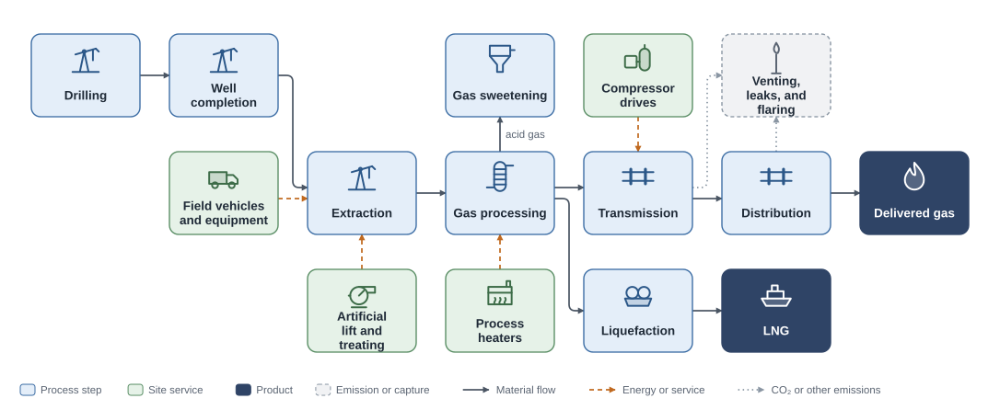
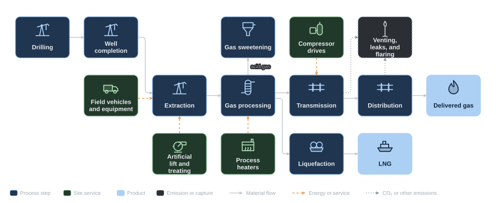

---
bibliography:
  - references.bib
  - tech-data_references.bib
aliases:
  - sector_natural_gas.html
---

# Natural Gas {#sec-natural-gas}

The natural gas sector finds gas underground, brings it to the surface, cleans it, and moves it to the people and industries that use it. Along the way it uses energy of its own, mostly to run compressors, drilling rigs, and heaters. The gas itself is almost pure methane, a powerful greenhouse gas, so leaks, venting, and flaring make methane the sector's largest emission that can be controlled. Much of that methane is also among the cheapest emissions to cut anywhere in the economy. This chapter follows the production and transport chain; @sec-natural-gas-methane covers the methane and flaring sources.

## Scope

The sub-model covers the supply of natural gas:

- drilling and completing new wells;
- producing gas from conventional, shale, tight, and coalbed-methane resources;
- processing raw gas at field facilities and gas plants;
- liquefying gas for export as liquefied natural gas (LNG);
- moving gas through long-distance transmission pipelines and local distribution networks; and
- the venting, leaks, and flaring along the way.

It also covers the energy the sector uses on itself for compression, drilling, field equipment, and heat. A forecast of gas production drives every step and service.

Several related activities sit elsewhere in CIMS:

- Burning the delivered gas counts in the sectors that use it: homes, businesses, industry, and electricity.
- Crude oil production is covered in @sec-crude-oil.
- Gas used to make chemicals is covered in [Chemicals](sector_chemicals.qmd), and gas used to make hydrogen in [Hydrogen](sector_hydrogen.qmd).

## Context

Canada is one of the world's largest natural gas producers. Most of its gas comes from the Western Canadian Sedimentary Basin, above all the Montney formation that spans Alberta and British Columbia. Because the product is methane, any gas that escapes adds directly to the sector's emissions. Leaks from equipment, gas vented by pneumatic devices and tanks, flaring, well blowdowns, and the gas released when wells are cleared of liquids together make up the sector's largest greenhouse gas source.

Cutting that methane is cheap. Canada has set a target to reduce oil and gas methane to 75 % below 2012 levels by 2030. The measures that get there, such as finding and fixing leaks, recovering vapours, replacing gas-driven controllers, capturing blowdown gas, and reducing flaring, cost roughly $11 to $48 per tonne of CO₂-equivalent, and much of the gas they save can be sold [@edf-methane-canada; @eccc-methane-og; @dunsky_2023_001]. Alberta accounts for roughly 68 % of the sector's methane. British Columbia has already cut its oil and gas methane by about 51 % from 2014 levels while increasing production [@edf-methane-canada].

## Process flow

@fig-natural-gas-process shows how gas moves from the well to the customer, and which services each step draws on. Methane and flaring occur at nearly every step; the flowchart shows them as one card, and @sec-natural-gas-methane breaks them down.

::: {#fig-natural-gas-process}
{.light-content .lightbox group="natural-gas-light"}

{.dark-content .lightbox group="natural-gas-dark"}

Process flow of the natural gas sector. Process steps make up the production and transport chain; site services supply the energy those steps need.
:::

## Model structure

The model splits the sector into two parts. The production chain covers **supply** (drilling, extraction, processing, liquefaction, and the emission sources), followed by **transmission** and **distribution**. The services part holds the compressor drives, artificial lift, treating, pumps, fuel blends, and carbon capture that the production chain draws on.

### Drilling and completion

**Drilling** makes the hole. A drilling rig turns the drill string, pumps drilling mud down the hole to carry rock cuttings back up, and powers the camp around it. Most rigs run on diesel engines today; rigs that run on grid power, or that pair engines with batteries to cover peaks, cut that fuel use.

**Completion** prepares a drilled well to produce. For shale and tight gas, that means hydraulic fracturing: pumping water, sand, and chemicals into the rock at very high pressure to open cracks the gas can flow through. A fracturing fleet uses large pumps driven by diesel engines, engines that burn a mix of diesel and natural gas, or electric motors.

**Drilling**



**Completion**



### Extraction and field services

**Extraction** is split by type of resource: conventional, shale, tight, and coalbed methane. These steps have no technologies of their own. Their energy goes to the field services that keep wells flowing and get produced fluids ready to move:

- **Artificial lift** pumps liquids out of wells that no longer flow on their own, or uses plunger lifts that let the well's own pressure push liquids out.
- **Treating** separates water and liquids from the gas and heats the flow so it doesn't freeze in the lines.
- **Field vehicles and equipment** carry crews and materials and run work equipment around the field.

**Artificial lift**



**Treating**



**Field vehicles and equipment**



### Gas processing

Raw gas from the well is not ready for a pipeline. Gas plants clean it in several steps:

- **Dehydration** removes water vapour, which would otherwise corrode pipes and form ice-like solids. Most plants absorb the water into glycol and then boil it back out, which takes heat; molecular sieves are an alternative.
- **Natural gas liquids recovery** chills the gas to condense out ethane, propane, butane, and heavier liquids, which are sold separately. A turboexpander does the chilling by letting the gas expand through a turbine.
- **Sulphur recovery** turns the hydrogen sulphide removed from sour gas into solid sulphur.
- **Sweetening** strips hydrogen sulphide and CO₂ from the gas, usually by absorbing them into an amine solvent and then heating the solvent to release them. The CO₂ that comes out is already concentrated, so sending it to storage instead of venting it is one of the cheaper capture options (see @sec-ccus).
- **Process heaters** supply the direct heat these steps need, for example to regenerate solvents.

**Dehydration**



**Natural gas liquids recovery**



**Sulphur recovery**



**Sweetening (formation CO₂)**



**Process heaters**



### LNG liquefaction

**Liquefaction** cools natural gas to about −160 °C, where it becomes a liquid that takes up about 1/600 of its volume as a gas, so it can be shipped overseas. Cooling that far takes large refrigeration compressors, which use a significant share of the gas they process. The compressors run on gas turbines or, in electric designs, on large electric motors that shift the emissions to the power grid [@kidnay_2019_001; @zhang_2020_001].



### Transmission and distribution

**Transmission** pipelines move gas long distances at high pressure. Gas loses pressure as it flows, so compressor stations along the line push it onward. **Distribution** networks take gas from city gates and deliver it to homes and businesses at lower pressure. At each pressure drop, the gas can drive a turboexpander and generate electricity instead of simply passing through a valve. The pipelines' compression comes from the compressor-drive services, which also serve gathering and processing [@etsap_2011_001].

**Transmission**



**Distribution**



**Compressor drives: engines**



**Compressor drives: turbines**



### Natural gas market

A separate **Natural Gas Market** sector carries the same three steps (supply, transmission, and distribution) at the level of the whole gas market rather than production. It has no technologies of its own in the technology database.

<mark>TODO: Document how the Natural Gas Market nodes relate to the production tree and to the Rest-of-World region for trade, and consolidate the two representations where appropriate.</mark>

### Shared services

| Service | What it supplies | Technologies |
|:--------|:-----------------|:-------------|
| Machine drive | Pumps | @sec-machine-drive |
| Fuel blends | Diesel, gasoline, and methane for the sector's own engines, compressors, and heaters | @sec-fuel-blends |
| CCS | Capture of concentrated CO₂ (from gas sweetening) and dilute CO₂ (from heater and turbine exhaust) | @sec-ccus |

: Shared services in the natural gas sector {#tbl-natural-gas-shared}

## Decarbonisation

- **Cutting methane** is the biggest and cheapest lever; @sec-natural-gas-methane covers it.
- **Electrifying compression and field equipment.** Electric compressors, drilling rigs, fracturing fleets, LNG trains, and battery-electric equipment move burning off site. How much they help depends on how clean the grid is.
- **Capturing formation CO₂.** Gas sweetening already separates a concentrated CO₂ stream, so storing it costs less than most capture.
- **Using less fuel.** Newer engines and turbines, turboexpanders at pressure drops, and recovering the gas that boils off LNG all cut fuel use.

## Regional coverage and differences

Alberta and British Columbia produce most of Canada's gas, and so hold most of the sector's emissions and of its chances to cut them. Saskatchewan adds some production; Ontario, Québec, Manitoba, and the Atlantic region mainly transmit and distribute gas. The model also includes a Rest-of-World region for trade and, in future, LNG exports. Alberta holds most of the remaining methane-cutting opportunity, while British Columbia has already gone further on methane controls.

<mark>TODO: Calibrate the regional production mix (conventional, shale, tight, and coalbed methane) against the National Inventory Report and provincial data.</mark>

## Limitations and planned extensions

<mark>TODO: The sulphur-recovery technology is per tonne of sulphur, but the processing nodes provide cubic metres of gas; converting needs the hydrogen sulphide content per cubic metre, which no source gives. Similarly, the sweetening technologies are per cubic metre of gas processed, while the formation-CO₂ node provides tonnes of CO₂.</mark>

<mark>TODO: The turboexpander at pressure let-down produces electricity as its main product; in CIMS it would be a negative electricity request on a let-down step rather than a provider of gas transport.</mark>

<mark>TODO: Build out the LNG export chain and replace the illustrative figures in this chapter with values from the model input files.</mark>



```{=latex}
\phantomsection
```

## References {.unnumbered}

```{=latex}
\printbibliography[heading=none]
```

::: {#refs}
:::
