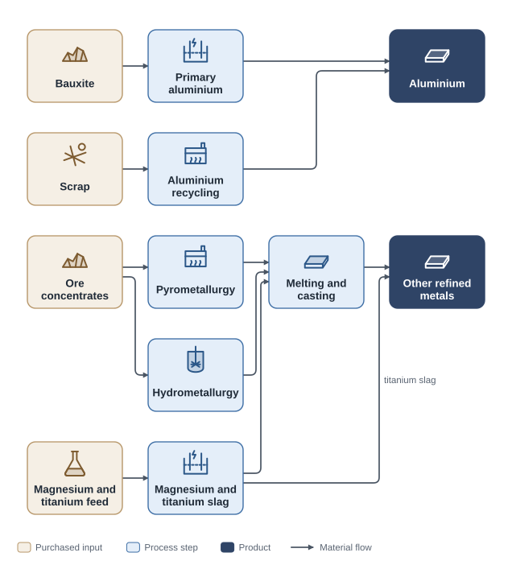
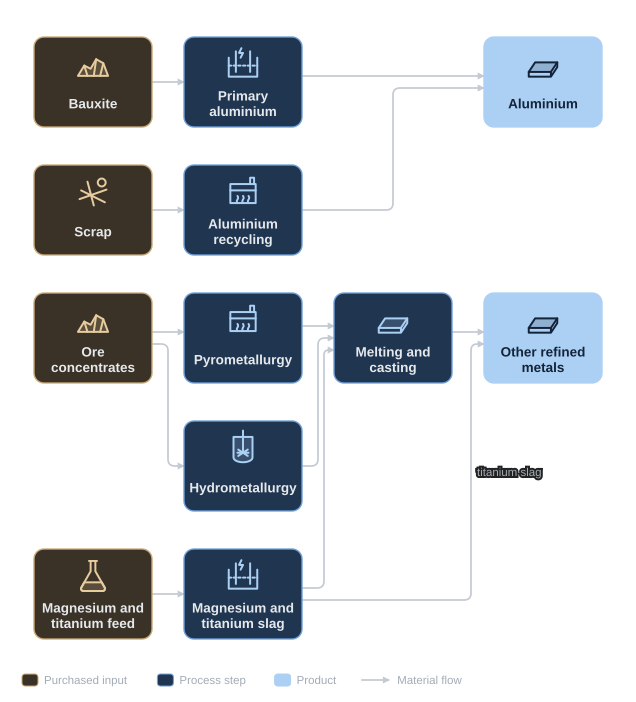

---
bibliography:
  - references.bib
  - tech-data_references.bib
aliases:
  - sector_metal_smelting.html
  - sector_metal-smelting.html
---

# Non-Ferrous Metals {#sec-non-ferrous-metals}

The non-ferrous metals sector smelts and refines ore concentrates, alumina, and scrap into finished metals other than iron and steel. Aluminium is by far the largest part of the sector. Making it takes a great deal of electricity, and in Canada most of that comes from hydropower in Québec. As a result, the sector's hardest emissions to cut don't come from burning fuel. They come from the chemistry of the processes themselves: the carbon anodes that aluminium cells consume, and the gas used to protect molten magnesium.

This chapter covers the sector as a whole. Two further chapters describe its production chains in detail: @sec-non-ferrous-metals-aluminum and @sec-non-ferrous-metals-base-metals.

## Scope

The sub-model covers the smelting and refining of aluminium, copper, nickel, lead, zinc, and magnesium, and the electric smelting of titanium slag, an iron-titanium ore concentrate used to make titanium pigment. A forecast of how much refined metal the sector produces drives every step and service in the chain.

Several related activities sit in other parts of CIMS, so their energy and emissions aren't counted twice:

- Iron and steel are covered in @sec-iron-and-steel.
- Mining and concentrating the ores belong to @sec-mining. This sub-model starts from concentrates, bauxite, and scrap.
- Turning metal into finished goods, such as rolled sheet, extrusions, and cast parts, belongs to the manufacturing branches in @sec-light-industrial. This sub-model ends with refined, cast metal.

Gold, silver, the platinum-group metals, and other minor metals aren't modelled on their own. Most are recovered alongside the base metals, and the rest are made in quantities too small to model separately.

## Context

Canada is one of the world's leading producers of non-ferrous metals. Almost all of its primary aluminium is smelted in Québec, where low-cost hydroelectricity makes the very electricity-hungry smelting process economic. For that reason Canadian smelters are among the lowest-carbon in the world [@iea-aluminium; @iai_2026_001]. Nickel and copper smelting and refining are concentrated in Ontario (Sudbury) and Manitoba (Thompson), with zinc and other base metals in several provinces.

The sector's emissions differ from most of industry's:

- **Aluminium.** Each smelting cell passes a large electric current through alumina dissolved in a molten salt bath. A carbon block, the anode, carries the current into the bath and is slowly burned away by the oxygen released from the alumina. Even on clean electricity, this releases about 1.6–1.7 t of CO₂ for every tonne of aluminium. When a cell's alumina runs low, it can also give off perfluorocarbons (PFCs), very powerful greenhouse gases [@iea-aluminium].
- **Magnesium.** Molten magnesium burns in air, so producers cover it with a protective gas, traditionally sulphur hexafluoride (SF₆). SF₆ traps roughly 22,000 times as much heat as CO₂, so small leaks matter [@nccp_1999_002].
- **Base metals.** Copper, nickel, lead, and zinc smelting burns fuel to roast, smelt, and convert sulphide concentrates. Their sulphur ends up in the off-gas as sulphur dioxide, which an acid plant turns into sulphuric acid [@schlesinger_2011_001].

## Process flow

@fig-non-ferrous-metals-process shows the sector's production chains. Aluminium is made from bauxite, by way of alumina, or remelted from scrap. The base metals take either a high-temperature route (pyrometallurgy: roasting, smelting, and converting in furnaces) or a water-based route (hydrometallurgy: dissolving the metal and recovering it by electrolysis), and most are then melted and cast. Magnesium comes from electrolysis or from reducing it out of dolomite with heat, and titanium slag from smelting ilmenite in an electric furnace.

::: {#fig-non-ferrous-metals-process}
{.light-content .lightbox group="non-ferrous-metals-light"}

{.dark-content .lightbox group="non-ferrous-metals-dark"}

Process flow of the non-ferrous metals sector. Each production chain is described in its sub-sector chapter.
:::

## Model structure

Each metal has its own branch in the sector's Product sub-tree:

- **Aluminium**, split into primary aluminium and recycling.
- **Copper**, **nickel**, **lead**, and **zinc**, each split into the high-temperature route, the water-based route where it applies, and melting and casting.
- **Magnesium**, split into electrolysis, thermal reduction, melting and casting, and the cover gas that protects the molten metal.
- **Titanium slag**.

Three services belong to this sector alone: **anode production** for the aluminium cells, **oxygen** for the base-metal furnaces, and the smelter **acid plant**. The sector also draws on the shared services below.

- @sec-non-ferrous-metals-aluminum covers alumina refining, anode production, electrolysis, and recycling.
- @sec-non-ferrous-metals-base-metals covers copper, nickel, lead, zinc, magnesium, and titanium slag, with the oxygen and acid-plant services.

### Shared services

| Service | What it supplies | Technologies |
|:--------|:-----------------|:-------------|
| Steam | Process steam for alumina digestion, leaching, and refining | @sec-industrial-heat |
| Machine drive | Pumps, fans and blowers, compressed air, materials handling, and materials processing | @sec-machine-drive |
| HVAC and lighting | Heating, cooling, and lighting of smelter and refinery buildings | @sec-hvac-lighting |
| Fuel blends | The diesel and gas blends the sector's equipment burns | @sec-fuel-blends |
| CCS | Capture of CO₂ from alumina calciners and aluminium cells | @sec-ccus |

: Shared services in the non-ferrous metals sector {#tbl-non-ferrous-metals-shared}

## Decarbonisation

Because Canadian smelting already runs largely on clean electricity, the sector's challenge is less about energy supply and more about process chemistry and how much new metal it has to make.

- **Inert anodes.** An anode that isn't consumed releases oxygen instead of CO₂, which removes both the anode CO₂ and the PFCs. The ELYSIS joint venture in Québec has produced aluminium with inert anodes at industrial scale and aims for wider commercial use later this decade [@elysis; @mpp_2023_001].
- **Recycling.** Remelting scrap aluminium takes about 5 % of the energy of making it from alumina.
- **Alumina refining.** Recompressing and reusing the steam in digestion, and electric or hydrogen-fired calciners, cut the fuel that alumina refineries burn.
- **Base-metal smelting.** Furnaces that smelt with oxygen-enriched air, and continuous converting, cut fuel use per tonne. The water-based route avoids high-temperature smelting where the ore suits it.
- **Carbon capture.** Calciners and aluminium cells fitted with capture appear in the technology lists, and the capture equipment in @sec-ccus.
- **Magnesium cover gas.** Replacing SF₆ with sulphur dioxide or fluorinated ketones removes almost all of this emission at low cost [@ipcc-sf6-mg]. The magnesium producers ask a cover-gas node for their SF₆, where an SF₆-free cover gas competes with it (@sec-non-ferrous-metals-base-metals).

## Regional coverage and differences

Each region is built from the same structure and carries no production on branches that don't apply to it. Five regions carry the sector in the current regional data:

- Québec dominates the sector. It carries essentially all primary aluminium, on its hydropower, and grows over the projection.
- Ontario (Sudbury) carries nickel and copper smelting and refining.
- Manitoba (Thompson) carries nickel. British Columbia and the Atlantic region carry smaller base-metal operations.

<mark>TODO: Alberta and Saskatchewan are absent, consistent with the absence of major non-ferrous smelters there. Confirm the regional metal mix, including the lead and titanium-slag branches, against current operations. The titanium-slag branch has no demand series yet.</mark>

## Limitations and planned extensions

<mark>TODO: Ferroalloys and silicon metal have no node; only titanium slag represents electric smelting. A node in this sector has been requested of the hierarchy.</mark>

<mark>TODO: Represent PFC emissions from aluminium anode effects explicitly (only the carbon-anode CO₂ is carried).</mark>

<mark>TODO: The CCS nodes and the acid-plant service were added to the hierarchy ahead of the CIMS model inputs. Add them to the regional input files, with the copper smelting and converting technologies requesting about 2.5–4.0 t of sulphuric acid per tonne of copper.</mark>

<mark>TODO: Benchmark modelled non-ferrous energy use and process emissions against CIEEDAC and the National Inventory Report.</mark>



```{=latex}
\phantomsection
```

## References {.unnumbered}

```{=latex}
\printbibliography[heading=none]
```

::: {#refs}
:::
