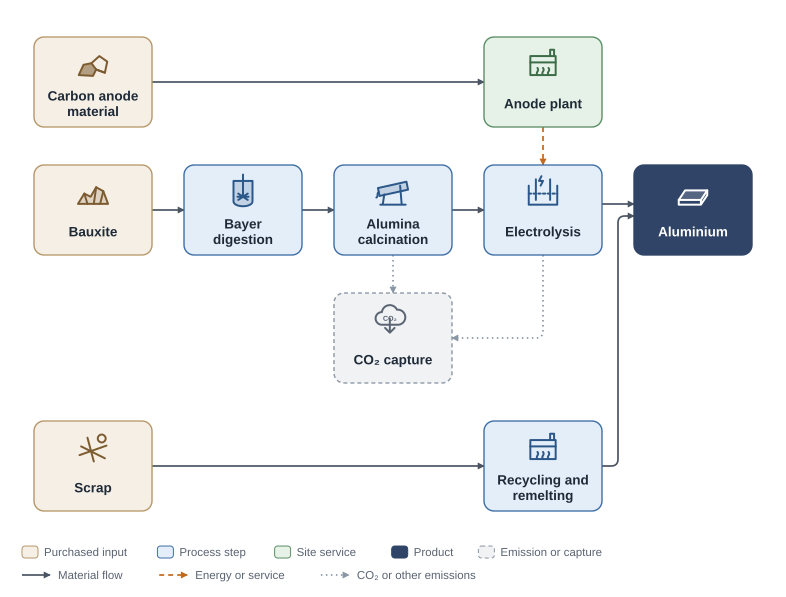
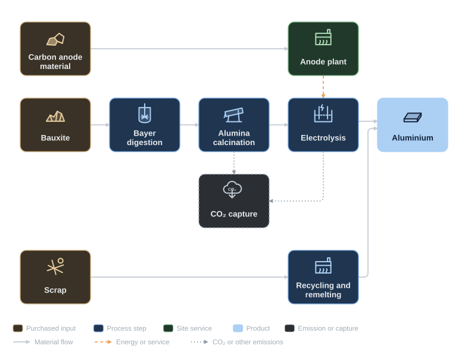

---
bibliography:
  - references.bib
  - tech-data_references.bib
aliases:
  - sector_metal-smelting_aluminum.html
---

# Aluminium {#sec-non-ferrous-metals-aluminum}

Aluminium is the largest production chain in the non-ferrous metals sector (see @sec-non-ferrous-metals for the sector's scope, context, and shared services). New, or primary, aluminium is made in two stages. A refinery first extracts alumina, a white aluminium oxide powder, from bauxite ore. A smelter then splits the alumina into aluminium and oxygen with electricity, in cells that burn away carbon anodes as they work. Recycling remelts scrap aluminium for a small fraction of the energy.

## Process flow

::: {#fig-non-ferrous-metals-aluminum-process}
{.light-content .lightbox group="aluminium-light"}

{.dark-content .lightbox group="aluminium-dark"}

Process flow of aluminium production. A refinery turns bauxite into alumina by digestion and calcination; smelting cells turn the alumina into aluminium, using anodes from the anode plant. Recycling remelts scrap.
:::

## Model structure

The aluminium branch splits into **primary aluminium**, made up of the two alumina refining steps and electrolysis, and **recycling**. Electrolysis requests its anodes from the sector's **anode production** service. Canada imports most of the alumina its smelters use, but the refining steps are represented so that domestic refining can be modelled.

### Bayer digestion

The Bayer process is the first stage of alumina refining. Crushed bauxite is mixed with hot caustic soda and held under pressure, which dissolves the alumina and leaves the iron and other impurities behind as a red mud. After the mud settles out, the solution is cooled and seeded so that crystals of alumina hydrate form, and the caustic soda is reheated and reused. Almost all of the energy goes into heating and evaporating the solution, usually with steam from fuel-fired boilers. Mechanical vapour recompression captures the vapour from the evaporators, compresses it with an electric compressor, and uses it again in place of fresh steam [@alcoa_2022_002].



### Alumina calcination

Calcination heats the alumina hydrate to about 1,000 °C to drive off its chemically bound water, leaving the dry alumina that feeds the smelting cells. It is where a refinery burns most of its fuel, usually natural gas in a gas-suspension calciner. Electric calciners and hydrogen-fired calciners can take its place, and a calciner's flue gas can be sent to capture [@deloitte_2022_001; @riotinto_2022_001].



### Anode production

The smelting cells need a steady supply of carbon anodes. Most Canadian cells use prebaked anodes: blocks of petroleum coke bound with pitch, baked for about two weeks in a gas-fired ring furnace. Older Søderberg cells instead bake their own anode in place from a carbon paste fed into the top of the cell. Baking with electricity, or making anodes from bio-based coke and pitch, cuts the emissions of this step.



### Electrolysis

The Hall-Héroult cell is where aluminium is made. Alumina dissolves in a bath of molten cryolite, a sodium aluminium fluoride salt, at about 960 °C. A large direct current flows from the carbon anodes through the bath to the cell's floor, splitting the alumina: aluminium collects as a molten pool on the floor, and the released oxygen combines with the anode carbon to form CO₂. A cell uses roughly 14 MWh of electricity for each tonne of aluminium and burns away about 0.4 t of anode [@iea-aluminium; @iai_2026_001].

Prebaked-anode and Søderberg cells are the incumbents. The inert anode is the main alternative: made of a material that isn't consumed, it releases oxygen rather than CO₂ [@elysis; @mpp_2023_001]. Cells can also be fitted with capture, although the CO₂ in their exhaust is very dilute.



### Recycling and remelting

The recycling branch melts scrap aluminium, ingot, and production offcuts in a furnace and casts the metal again. Because the metal is already reduced, this takes about 5 % of the energy of primary production. The furnaces compete on how efficiently they melt and on whether they burn fuel or use electricity, and some remove paint and coatings from scrap before melting.



## Decarbonisation

On Québec's hydropower, nearly all the remaining direct emissions from primary aluminium come from the carbon anode, so the **inert anode** is the largest lever. Elsewhere in the chain:

- Mechanical vapour recompression replaces live steam in digestion.
- Electric and hydrogen-fired calciners replace fuel-fired calcination.
- Electric baking and bio-based anode materials cut the emissions of anode production.
- Calciners and cells fitted with capture send their CO₂ to the sector's capture service.
- More **recycling** reduces the amount of new metal needed in the first place.

<mark>TODO: The calcination node was added to the hierarchy ahead of the CIMS model inputs, with digestion narrowed to digestion and precipitation. Update the regional input files to match.</mark>



```{=latex}
\phantomsection
```

## References {.unnumbered}

```{=latex}
\printbibliography[heading=none]
```

::: {#refs}
:::
