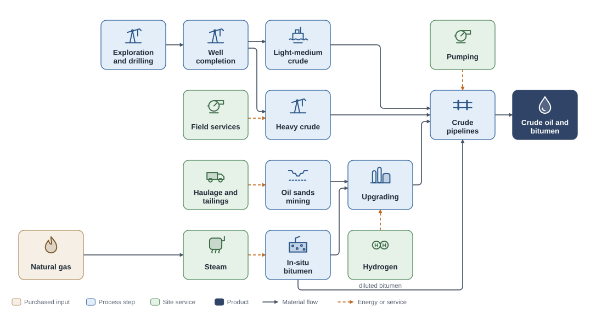
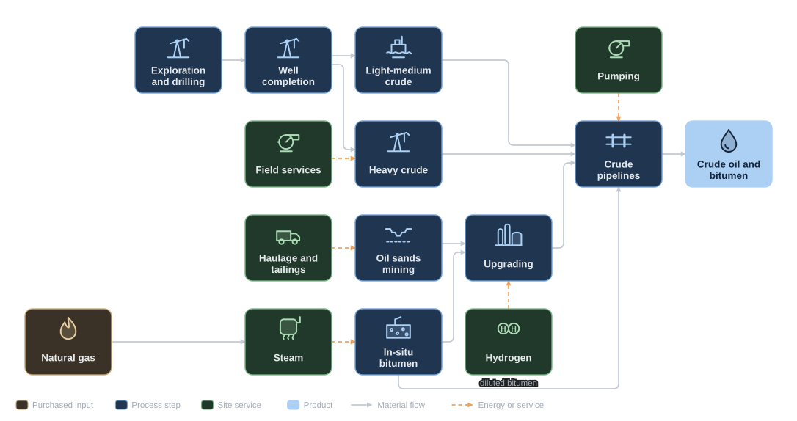

# Petroleum Crude {#sec-petroleum-crude}

Crude oil and bitumen production is one of the energy-supply sectors in CIMS. It covers conventional crude, onshore and offshore, and the oil sands, which dominate Canadian output and emissions. The energy used to produce the oil, above all the natural gas burned to raise steam for in-situ bitumen recovery, is itself a large emissions source, so the sector's decarbonisation is mostly about how that production energy is supplied and whether its CO₂ is captured. This chapter covers the whole sector and conventional crude; @sec-oil-sands covers the oil sands in detail.

## Scope

The sub-model covers the production of crude oil and bitumen: exploration and drilling, well completion, conventional light-medium crude (onshore and offshore) and heavy crude, the oil sands (surface mining with bitumen extraction, in-situ recovery, and upgrading to synthetic crude), and the trunk pipelines that move crude and bitumen to market. A forecast of oil and bitumen output drives every step and service.

Several adjacent activities sit elsewhere in CIMS:

- Refining crude into fuels and products is covered in @sec-petroleum-refining.
- Natural gas production, processing, and transport are covered in @sec-natural-gas.
- The hydrogen the sector uses can also come from the [Hydrogen](sector_hydrogen.qmd) sector.
- Burning the refined fuels is accounted in the demand sectors.

## Context

Canadian crude production is dominated by the Alberta oil sands, the largest source of both output and emissions in the sector, supplemented by conventional crude in Saskatchewan and Alberta and offshore production off Newfoundland. The oil sands come in two forms: surface mining and upgrading, which digs out near-surface bitumen and upgrades it to synthetic crude; and in-situ recovery, which uses steam to mobilize deeper bitumen and now rivals mining as the main production route.

For in-situ production, the single largest emissions source is steam generation: natural gas burned to make the steam that lowers bitumen viscosity in steam-assisted gravity drainage (SAGD) and cyclic steam stimulation. The carbon intensity of a barrel therefore depends heavily on how much steam it needs and how that steam is produced [@oilsands-intensity]. Upgrading adds the emissions of coking, hydroprocessing, and the hydrogen it consumes. The decarbonisation levers follow directly: solvent processes that cut steam use (by up to about 50 % in carbon intensity), low-carbon steam, and carbon capture, the focus of the Pathways Alliance, whose proposed oil sands capture network would be among the world's largest [@pathways-alliance; @oilsands-intensity].

## Process flow

@fig-petroleum-crude-process shows the sector's process steps and services. Conventional crude runs from exploration and completion to production; the oil sands run from mining or in-situ recovery, through upgrading for mined bitumen, to the pipelines. In-situ bitumen can also ship diluted, without upgrading.

::: {#fig-petroleum-crude-process}
{.light-content .lightbox group="petroleum-crude-light"}

{.dark-content .lightbox group="petroleum-crude-dark"}

Process flow of the petroleum crude sector. Process steps belong to the sector's Product sub-tree; site services belong to its Service sub-tree and are requested by the process steps.
:::

## Model structure

The Product sub-tree holds exploration, completion, conventional crude, the oil sands, and crude transmission. The Service sub-tree holds the field services, mine haulage and tailings, steam, hydrogen, pipeline pumping, fuel blends, and capture. This chapter follows conventional crude and transport; the oil sands steps and their services are in @sec-oil-sands.

### Exploration and drilling

Exploration and drilling covers the rigs and engines that drill and appraise new wells.



### Well completion

Completion fractures and prepares a new well for production. Its energy goes mainly to the high-pressure pumps of the fracturing fleet, measured as GJ of hydraulic work.



### Conventional crude production

Light-medium crude is split into onshore and offshore production, and heavy crude has its own node. Their energy goes to the field services that lift, treat, and handle the produced fluids. Production is measured in cubic metres of oil.

**Artificial lift**



**Treating**



**Field engines**



**Produced water**

Produced water is separated from the oil, then treated for reuse as steam or fracturing makeup, or disposed of by injection.



### Crude pipelines and pumping

Trunk pipelines move crude, bitumen blends, and refined products to refineries and export markets. The pipeline itself is the technology at the transmission node, measured in cubic metres moved 1,000 km; it requests its pumping energy from a separate pumping service, as a gas pipeline requests compression.

**Crude pipelines**



**Pipeline pumping**



### Shared services

| Service | What it supplies | Technologies |
|:--------|:-----------------|:-------------|
| Steam | Steam for in-situ recovery and upgrading, from boilers, cogeneration, electric boilers, and other heat supply | @sec-industrial-heat |
| Fuel blends | Diesel, gasoline, and methane blends, and the **still gas** node that routes upgrader off-gas to the heat it supplies | @sec-fuel-blends |
| CCS | Capture of concentrated CO₂ (upgrader hydrogen plants) and diffuse CO₂ (boiler and heater flue gas) | @sec-ccus |

: Shared services in the petroleum crude sector {#tbl-petroleum-crude-shared}

## Decarbonisation

- **Less steam per barrel.** Solvent-assisted and solvent-only in-situ processes, and electromagnetic heating, cut or replace steam (@sec-oil-sands).
- **Low-carbon steam.** The Steam service can switch from gas boilers to cogeneration, electric boilers, or nuclear heat; for in-situ production this choice largely sets a barrel's carbon intensity.
- **Carbon capture.** The oil sands produce large CO₂ streams from steam generation, upgrading, and hydrogen production, which the Pathways Alliance network proposes to capture [@pathways-alliance].
- **Electrifying field equipment.** Electric fracturing fleets, heat-pump treating, and battery-electric haul trucks move combustion off site, and dual-fuel engines displace diesel with field gas.

<mark>TODO: The hierarchy has no venting or fugitive methane nodes for petroleum crude, so oil-sector methane control is not represented here; decide whether crude production should share the methane sources modelled in @sec-natural-gas-methane.</mark>

## Regional coverage and differences

Six regions carry crude production, but it is highly concentrated:

- **Alberta** dominates, with essentially all of the oil sands (mining, in-situ, and upgrading) plus conventional crude, and therefore most of the sector's energy use and abatement opportunity.
- **Saskatchewan** carries conventional heavy and light-medium crude.
- The **Atlantic** region carries offshore light-medium production (Newfoundland).
- **British Columbia, Manitoba, and Ontario** carry smaller conventional volumes.

<mark>TODO: Calibrate the in-situ versus mining production split and the steam-to-oil ratios against current Alberta Energy Regulator data, since the sector's emissions and the value of steam decarbonisation depend heavily on both.</mark>

## Limitations and planned extensions

<mark>TODO: The crude transmission and pipeline pumping nodes were added to the hierarchy ahead of CIMS; the CIMS crude transmission node needs to request pumping before these technologies take effect.</mark>

<mark>TODO: Offshore platforms generate their own power without heat recovery, but the hierarchy has no on-site power node for petroleum crude; add one so offshore power options can compete.</mark>

<mark>TODO: Replace the illustrative figures in this chapter with values drawn from the model input files, and benchmark modelled crude and bitumen energy use and emissions intensity against the Alberta Energy Regulator and Environment and Climate Change Canada's National Inventory Report.</mark>



```{=latex}
\phantomsection
```

## References {.unnumbered}

```{=latex}
\printbibliography[heading=none]
```

::: {#refs}
:::
