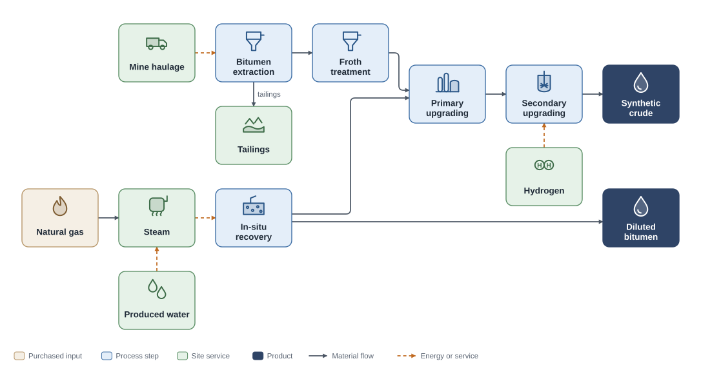
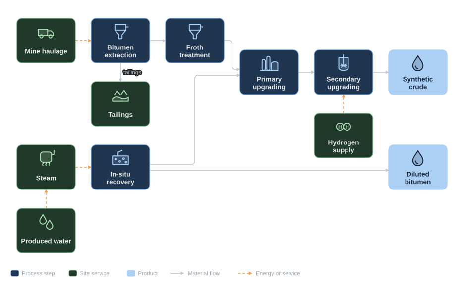

# Oil Sands {#sec-oil-sands}

The oil sands are the largest part of the petroleum crude sector (@sec-petroleum-crude) in both output and emissions. Bitumen is either mined from near-surface deposits and separated from the sand with warm water, or recovered in situ from deeper deposits with steam or solvents. Mined bitumen is usually upgraded to synthetic crude on site; in-situ bitumen is either upgraded or diluted and shipped by pipeline. This chapter covers those steps and the services they draw on.

## Process flow

::: {#fig-oil-sands-process}
{.light-content .lightbox group="oil-sands-light"}

{.dark-content .lightbox group="oil-sands-dark"}

Process flow of oil sands mining, in-situ recovery, and upgrading.
:::

## Mining and extraction

Surface mining digs oil sands ore with shovels and haul trucks. The ore is slurried in warm water and pumped to separation vessels, where bitumen floats off as froth; froth treatment then removes the remaining water and solids with a solvent. Extraction and froth treatment are measured in cubic metres of bitumen.

**Mine haulage**



**Bitumen extraction**



**Froth treatment**

Naphthenic froth treatment recovers about 98 % of the bitumen but leaves water, solids, and all the asphaltenes, so its product must be upgraded. Paraffinic treatment rejects asphaltenes and gives a cleaner bitumen.



**Tailings**

The sand, clay, and water left after extraction go to tailings, measured in tonnes. Dewatering the tailings shrinks the ponds and cuts the heat lost with recycled water.



## In-situ recovery

In-situ recovery mobilizes bitumen in the reservoir and lifts it to the surface through wells. Steam-assisted gravity drainage (SAGD) and cyclic steam stimulation inject steam, which the sector's Steam service supplies (@sec-industrial-heat); the steam generators are fed with treated produced water. Solvent-assisted and solvent-only processes, electromagnetic heating, and downhole oxy-combustion cut or replace that steam. In-situ recovery is measured in cubic metres of bitumen.

**In-situ recovery**



The produced-water technologies, which condition water for steam generation, are listed in @sec-petroleum-crude.

## Upgrading

Upgrading turns bitumen into synthetic crude. Primary upgrading breaks the heavy residue into lighter fractions by coking or by hydrocracking in an ebullated bed; secondary upgrading hydrotreats those fractions to remove sulphur and nitrogen. Both are measured in cubic metres of synthetic crude. Partial upgrading, a prospective field-scale option, treats bitumen just enough to meet pipeline specification without diluent.

**Primary upgrading**



**Secondary upgrading**



**Hydrogen**

Upgraders make their own hydrogen for hydroprocessing, measured in GJ. Steam methane reformers dominate; capture on the shifted syngas yields a concentrated CO₂ stream, and on-site electrolysis is the zero-carbon alternative.



## Decarbonisation

In-situ carbon intensity is dominated by steam, so the carbon price acts most strongly through the steam-to-oil ratio and the Steam service. Solvent-assisted processes can lower intensity by up to about 50 % [@oilsands-intensity]; electric boilers, cogeneration, and small nuclear reactors decarbonise the steam itself; and the concentrated CO₂ from upgrader hydrogen plants and the dilute CO₂ from steam generators are the main targets of the Pathways Alliance capture network [@pathways-alliance]. In mining, battery-electric and dual-fuel haul trucks cut diesel use, and non-aqueous extraction cuts both heat and tailings.

<mark>TODO: The upgraders' hydrogen is made on site; link it to the [Hydrogen](sector_hydrogen.qmd) sector so upgrading can also draw on merchant blue or green hydrogen at that sector's cost and carbon intensity.</mark>

<mark>TODO: Refresh the solvent-SAGD and capture options against the Pathways Alliance project and current pilots.</mark>



```{=latex}
\phantomsection
```

## References {.unnumbered}

```{=latex}
\printbibliography[heading=none]
```

::: {#refs}
:::
