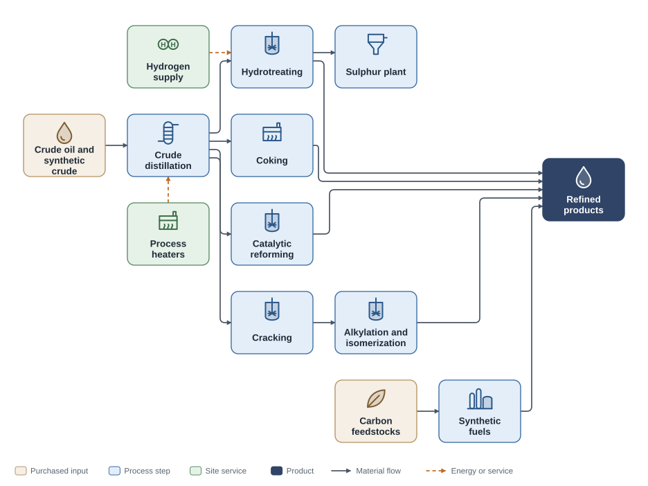
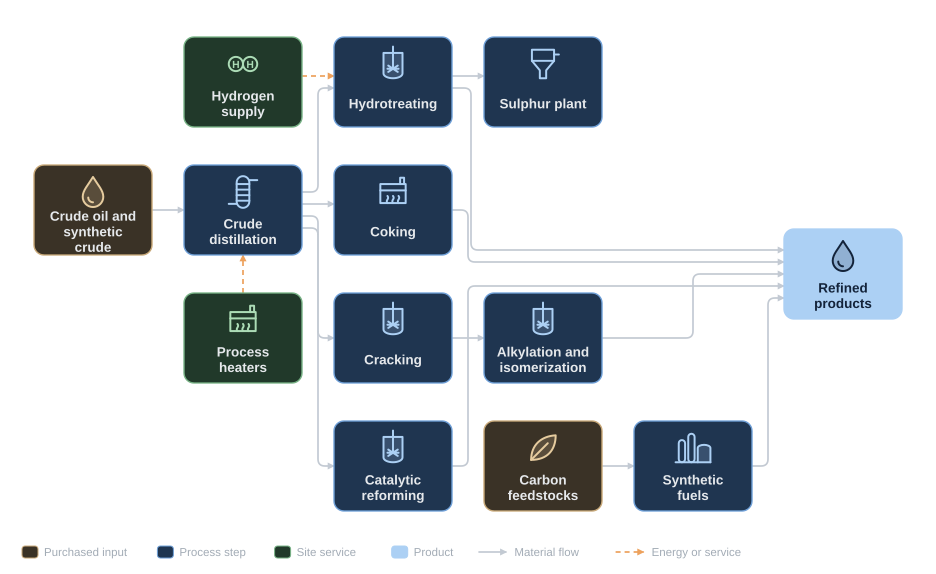

---
bibliography:
  - references.bib
  - tech-data_references.bib
aliases:
  - sector_petroleum_refining.html
---

# Petroleum Refining {#sec-petroleum-refining}

Petroleum refining turns crude oil and synthetic crude into gasoline, diesel, jet fuel, fuel oils, petrochemical feedstocks, asphalt, lubricants, and petroleum coke. Almost all of its emissions come from two sources: burning fuel for process heat and steam, and making hydrogen on site. Much of the fuel a refinery burns is its own still gas, a by-product of its processes. Cutting emissions is therefore mostly about how the refinery supplies its heat and hydrogen, and whether it captures the CO₂. Over the long run, demand for refined fuels is also expected to fall as transport electrifies.

## Scope

The sub-model covers the standard refinery process units:

- crude distillation;
- conversion, which breaks heavy oil into lighter products (coking, fluid catalytic cracking, and hydrocracking);
- hydrotreating and sulphur recovery;
- catalytic reforming, alkylation, and isomerization; and
- asphalt and lubricants.

It also covers synthetic fuels: plants that make liquid fuels from other carbon feedstocks. A forecast of refinery throughput drives every step and service.

Several related activities sit elsewhere in CIMS:

- Producing crude oil and bitumen, including upgrading bitumen in the oil sands, is covered in @sec-crude-oil.
- Natural gas processing is covered in @sec-natural-gas.
- Petrochemicals made from refinery streams are covered in [Chemicals](sector_chemicals.qmd).
- Burning the finished fuels counts in the sectors that use them.

## Context

Canada has a modest number of refineries spread across the country, supplying fuels to domestic and export markets. A refinery's energy use depends on its complexity: the kind of crude it runs, and how much cracking, hydrotreating, and reforming it does to turn that crude into high-value products. A simple refinery mostly distils crude, while a complex one converts nearly all of the heavy oil into light fuels and uses far more energy to do it [@kaiser_2017_001; @abella_2022_001].

Most refinery emissions come from burning fuel for process heat and steam. Making hydrogen for hydrotreating and hydrocracking adds a further large share [@wri-refining]. Canada's roadmap for cutting oil and gas emissions names the main levers: electrifying low- and medium-temperature process heat, using low-carbon hydrogen for high-temperature heat, energy efficiency, and carbon capture. Refining is one of the cheaper places to capture CO₂, because the hydrogen plant produces a concentrated stream [@nrcan-og-roadmap; @wri-refining]. Over the longer term, throughput is expected to fall as road transport electrifies, shifting the product mix toward jet fuel, petrochemicals, and exports.

## Process flow

@fig-petroleum-refining-process shows how the process units and services fit together. Distillation splits crude into fractions. Conversion, treating, and reforming units then turn those fractions into finished products, drawing on the refinery's heaters and hydrogen plant.

::: {#fig-petroleum-refining-process}
{.light-content .lightbox group="petroleum-refining-light"}

{.dark-content .lightbox group="petroleum-refining-dark"}

Process flow of the petroleum refining sector. Process steps belong to the sector's Product sub-tree; site services belong to its Service sub-tree and are requested by the process steps.
:::

## Model structure

The Product sub-tree holds the process units. Distillation, conversion, hydrotreating, asphalt, and lubricants sit under **petroleum fractions**, alongside alkylation, isomerization, reforming, and synthetic fuels. The Service sub-tree holds the fired process heaters, hydrogen, and the shared services.

### Crude distillation

**Distillation** is the first step in every refinery. Crude oil is a mix of many hydrocarbons that boil at different temperatures. A fired heater heats the crude until most of it turns to vapour, and the vapour rises up a tall column. Lighter hydrocarbons rise higher before they condense, so each tray of the column collects a different fraction: gases at the top, then naphtha, kerosene, and diesel, with heavy oil at the bottom. A second column, run under vacuum, splits that heavy oil further without heating it so much that it breaks down. Distillation uses a lot of heat, and much of it can be recovered by using the hot products to preheat the incoming crude [@gary_2007_001].



### Process heaters

**Process heaters** are the furnaces that supply the refinery's hottest heat, for distillation, reforming, coking, and hydrotreating. They burn still gas or natural gas in a firebox and heat oil flowing through tubes inside it. They are the only node in the high-temperature heat band (see @sec-industrial-heat). Electric heaters, heat stored from cheap electricity, concentrated solar heat, and small nuclear reactors compete with them, and fired heaters can also add carbon capture. The process units don't burn fuel of their own: each buys the heat its furnaces supply from this service, so the choice of heater is made here, once, for the whole refinery. Hydrogen reaches the fired heaters through the fuel blend, so there is no separate hydrogen-fired heater.



### Conversion

Distillation leaves a lot of heavy oil that sells for little. Conversion units break those heavy molecules into lighter, more valuable ones.

- **Coking** heats heavy residue until it cracks into lighter liquids and gas. It leaves solid petroleum coke behind, which is sold as a fuel or for making electrodes.
- **Fluid catalytic cracking** breaks heavy gas oil into gasoline and lighter products over a hot powdered catalyst. Coke builds up on the catalyst, and a regenerator burns it off so the catalyst can be reused. That regenerator is often the largest single source of CO₂ in a refinery.
- **Hydrocracking** also breaks gas oil apart over a catalyst, but adds hydrogen at high pressure, which gives cleaner products and uses a lot of hydrogen.

The hierarchy has no separate catalytic-cracking node, so the cracking technologies share the hydrocracking node.

**Coking**



**Cracking and hydrocracking**



### Hydrotreating and sulphur recovery

**Hydrotreating** removes sulphur and nitrogen from fuels so they meet clean-fuel standards. The fuel is heated and mixed with hydrogen over a catalyst, and the sulphur leaves as hydrogen sulphide gas. It buys its heat from the process heaters, which can run on fuel gas, electricity, or hydrogen through the fuel blend.

**Sulphur recovery** turns that hydrogen sulphide into solid sulphur. A solvent first strips the gas out of the refinery's gas streams. A Claus unit then burns part of it and reacts the rest to make elemental sulphur, and a final step cleans up the leftover gas.

**Hydrotreating**



**Sulphur recovery**



### Reforming, alkylation, and isomerization

These units make high-octane gasoline blending components:

- **Catalytic reforming** reshapes naphtha molecules into high-octane reformate over a hot catalyst. It gives off hydrogen as a by-product, which the refinery reuses. Its heat comes from the process heaters, fired or electric.
- **Alkylation** joins small gas molecules into larger, high-octane ones.
- **Isomerization** rearranges light naphtha molecules into branched shapes that have a higher octane rating.

**Catalytic reforming**



**Alkylation**



**Isomerization**



### Hydrogen

The refinery makes its own **hydrogen** for hydrotreating and hydrocracking. A steam methane reformer, the incumbent, reacts natural gas with steam over a catalyst in a fired furnace. This makes hydrogen and CO₂. More than half of that CO₂ is in a concentrated stream inside the process, which is cheap to capture; the rest leaves in the furnace exhaust, which is more dilute and costs more to capture [@collodi_2010_001]. An autothermal reformer makes its own heat inside the reactor, so nearly all of its CO₂ is concentrated. Water electrolysis makes hydrogen from water and electricity with no direct emissions.



### Synthetic fuels

**Synthetic fuels** plants make liquid fuels from carbon feedstocks such as coal or natural gas. They first turn the feedstock into a mix of hydrogen and carbon monoxide, called syngas, by gasifying solid fuels or reforming gas. The Fischer-Tropsch process then builds that syngas into liquid hydrocarbons over a catalyst. The process uses a lot of energy and, without capture, emits a lot of CO₂.



### Shared services

| Service | What it supplies | Technologies |
|:--------|:-----------------|:-------------|
| Steam | Process steam, from boilers, cogeneration, heat pumps, and other heat supply | @sec-industrial-heat |
| Machine drive | Pumps, fans and blowers, compressed air, and materials processing | @sec-machine-drive |
| HVAC and lighting | Heating, cooling, and lighting of refinery buildings | @sec-hvac-lighting |
| Fuel blends | Diesel and methane blends, and the **still gas** step that routes the refinery's own off-gas to the heaters and boilers that burn it | @sec-fuel-blends |
| CCS | Capture of concentrated CO₂ (from hydrogen plants) and dilute CO₂ (from heater, boiler, and catalytic cracker exhaust) | @sec-ccus |

: Shared services in the petroleum refining sector {#tbl-petroleum-refining-shared}

## Decarbonisation

- **Electrifying process heat.** Electric process heaters remove the combustion CO₂ from low- and medium-temperature heat. Stored heat lets refineries use cheaper off-peak electricity.
- **Hydrogen as fuel and feed.** Hydrogen blended into the fuel the heaters burn cuts emissions from high-temperature heat that is hard to electrify, and low-carbon hydrogen replaces hydrogen made from natural gas without capture.
- **Carbon capture.** The hydrogen plant's concentrated CO₂ is among the cheapest capture opportunities in the economy. Capture on the catalytic cracker's regenerator and on fired heaters is less mature and costs more, because their exhaust is more dilute [@ieaghg_2017_002].
- **Efficiency.** Better heat recovery and heater upgrades cut fuel use in the units that remain.

Because so much of the fuel is the refinery's own still gas, the carbon price acts mostly on how the refinery supplies heat and hydrogen, not on a single process emission. Falling throughput as transport electrifies also lowers total emissions, whatever technologies refineries choose.

## Regional coverage and differences

Six regions have refineries: Alberta, the Atlantic region, British Columbia, Ontario, Québec, and Saskatchewan. They differ in three ways:

- refinery complexity and product mix;
- the fuels available for process heat, with cheaper gas in the West; and
- how clean the electricity grid is, which sets how much electrifying heat actually cuts emissions. The gain is large in hydro-rich Québec and British Columbia, and smaller in Alberta and Saskatchewan until their grids get cleaner.

<mark>TODO: Calibrate the regional refinery configurations (complexity, product slate, hydrogen demand) and the long-run throughput trajectory against Canada Energy Regulator and Statistics Canada data.</mark>

## Limitations and planned extensions

<mark>TODO: Add a fluid catalytic cracking node; the FCC technologies currently share the hydrocracking node, the nearest catalytic gas-oil conversion.</mark>

<mark>TODO: The synthetic-fuels node was added to the hierarchy ahead of CIMS; CIMS needs the same node before its technologies take effect.</mark>

<mark>TODO: Link the refinery's hydrogen service to the [Hydrogen](sector_hydrogen.qmd) sector so it can draw on merchant blue and green supply as well as on-site production.</mark>

<mark>TODO: Replace the illustrative figures in this chapter with values from the model input files, and benchmark modelled refining energy use and emissions against Canada Energy Regulator and National Inventory Report data.</mark>



```{=latex}
\phantomsection
```

## References {.unnumbered}

```{=latex}
\printbibliography[heading=none]
```

::: {#refs}
:::
