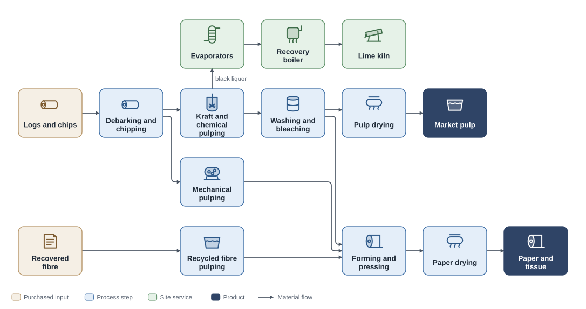
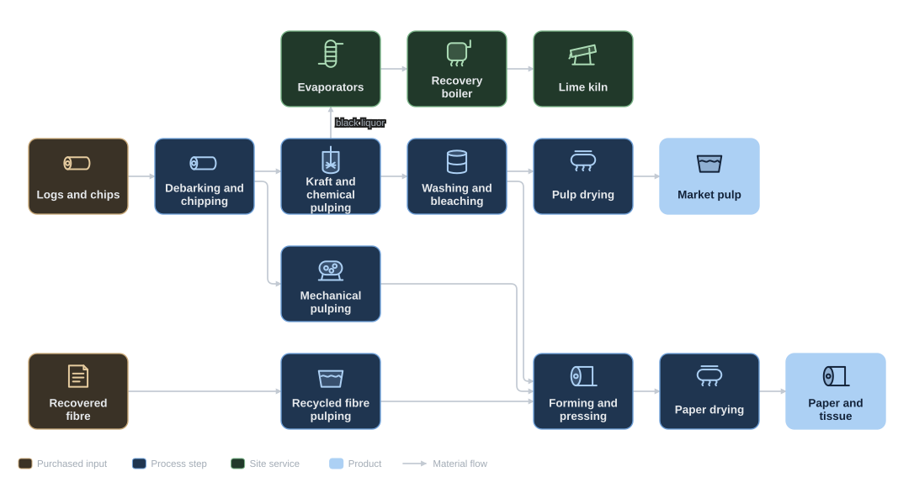

# Pulp and Paper {#sec-pulp-and-paper}

Pulp and paper stands out among the industrial sectors in two ways. Mills already run largely on biomass, the spent pulping liquor and wood residues they produce themselves, so their fossil emissions sit in a few steps rather than across the whole process. And many traditional mill products have been declining in Canada for years, as falling newsprint demand works through the fleet.

## Scope

The sub-model covers the manufacture of pulp, paper, and paperboard: a pulp-making chain feeding five paper grades. A forecast of pulp and paper output, in tonnes, drives every upstream step and service.

Several adjacent activities sit elsewhere in CIMS to avoid double-counting:

- Forest harvesting and the supply of roundwood and residues are covered in @sec-forestry; this sub-model takes logs, chips, and recovered paper as inputs.
- Converted paper products (boxes, bags, asphalt roofing, and other converting industries) belong to @sec-light-industrial.
- Fuel and electricity enter through the energy-supply sectors and the shared fuel blends. Mills can also generate their own steam and electricity.

## Context

Canadian pulp and paper is large, export-oriented, and regionally concentrated. The industry is largest in Québec, Ontario, and British Columbia, with significant capacity in the Atlantic region and a smaller presence in Alberta. Its economic output peaked around 2004 and fell by roughly 45 % to 2018 as newsprint demand collapsed [@cer-pulp].

The sector relies on **self-produced biomass energy**. Kraft mills concentrate and burn black liquor, the spent cooking chemicals and dissolved lignin left after pulping, in a recovery boiler that regenerates the chemicals and raises high-pressure steam; mills also burn hog fuel (bark and wood residues). Together these supply most mill energy, and many mills run biomass cogeneration, selling surplus electricity to the grid. Self-generation has supplied on the order of a quarter of the sector's electricity in recent years [@cer-pulp; @nrcan-pp-netzero]. Because this energy is biogenic, the sector's fossil emissions are comparatively small and concentrated, most prominently in the lime kiln, which has traditionally burned natural gas or oil, and in any remaining fossil-fired steam and drying [@ppc-limekiln].

## Process flow

@fig-pulp-and-paper-process shows the pulp-making chain, the kraft chemical recovery loop, and papermaking.

::: {#fig-pulp-and-paper-process}
{.light-content .lightbox group="pulp-and-paper-light"}

{.dark-content .lightbox group="pulp-and-paper-dark"}

Process flow of the pulp and paper sector. Chemical pulping sends its black liquor to the evaporators and recovery boiler, which regenerate the cooking chemicals (with the lime kiln) and raise most of the mill's steam.
:::

## Model structure

The Product sub-tree holds the **pulp** chain and the **paper** chain. The Service sub-tree holds two sector-specific services, **chemical recovery** and **effluent treatment**, alongside the shared services. The tables below follow the flowchart.

### Wood preparation

Logs are debarked and chipped before pulping. The step is measured in tonnes of wood.



### Pulping

Four pulping routes serve different products rather than competing head to head.

- **Chemical pulping** cooks chips in white liquor (kraft) or sulphite liquor, dissolving the lignin. It gives strong, bleachable pulp and produces the black liquor that fuels the mill.
- **Semi-chemical pulping** uses milder cooking for corrugating medium and specialty pulps.
- **Mechanical pulping** grinds logs or refines chips. It uses wood fibre efficiently but is very electricity-intensive; thermomechanical refiners recover their heat as steam.
- **Recycled pulping** repulps and de-inks recovered paper. It is the lowest-energy route, limited by feedstock supply.

**Chemical pulping**



**Semi-chemical pulping**



**Mechanical pulping**



**Recycled pulping**



### Chemical recovery

The chemical recovery service is the energy and chemical heart of a kraft mill: a closed loop that recovers pulping chemicals while generating most of the mill's energy. It is measured in tonnes of black liquor solids.

- The **evaporators** concentrate weak black liquor.
- The **recovery boiler** burns the concentrated liquor, recovering the cooking chemicals as smelt and raising high-pressure steam. Black liquor gasification is the alternative to the boiler, lifting energy recovery from roughly 65 % to about 75–80 % and producing a syngas for power or fuels [@iea-blg].
- The **lime kiln** calcines lime mud back to lime for causticizing the recovered chemicals. It is the mill's main fossil-fuel load, and is measured in tonnes of lime.

**Evaporators**



**Recovery boiler**



**Lime kiln**



### Washing, bleaching, and pulp drying

Pulp is washed to recover cooking chemicals, then bleached. Market pulp is dried into sheets for sale; pulp for an integrated paper mill goes straight to the paper machine. Pulp drying takes about a quarter of a kraft mill's heat. Washing has no competing technologies in the database.

**Bleaching**



**Pulp drying**



### Papermaking

The paper chain covers five grades: newsprint, uncoated and coated wood-free papers, linerboard, and tissue. Each has a **forming and pressing** step, where the paper machine forms the sheet and removes water mechanically, and a **drying** step, where steam-heated cylinders (or, for tissue, Yankee or through-air dryers) evaporate the rest. Drying uses most of a paper machine's energy, so water removed in the press section saves heat in the dryers. Both steps are measured in tonnes of paper.

::: {.panel-tabset}
#### Newsprint



#### Uncoated



#### Coated



#### Linerboard



#### Tissue


:::

In each tab, the first table lists the forming and pressing technologies and the second the drying technologies.

### Effluent treatment

Mills treat their wastewater in two stages: **primary** clarification removes solids, and **secondary** biological treatment removes dissolved organics. Aeration blowers make secondary treatment a significant electricity load.

**Primary treatment**



**Secondary treatment**



### Shared services

The sector also draws on the shared services documented in the General Services part:

| Service | What it supplies | Technologies |
|:--------|:-----------------|:-------------|
| Steam | The sector's largest energy service, including hog-fuel boilers and biomass cogeneration | @sec-industrial-heat |
| Machine drive | Pumps, fans and blowers, compressed air, materials handling, and materials processing | @sec-machine-drive |
| HVAC and lighting | Heating, cooling, and lighting of mill buildings | @sec-hvac-lighting |
| Fuel blends | Diesel and methane blends | @sec-fuel-blends |

: Shared services in the pulp and paper sector {#tbl-pulp-and-paper-shared}

The Steam node also offers one option specific to the sector:



## Decarbonisation

Because mills already run largely on bioenergy, decarbonisation means squeezing out the remaining fossil fuel, using less energy per tonne, and capturing biogenic CO₂.

- **Efficiency.** Low-energy refining and chemi-thermomechanical pulping cut refiner electricity; batch kraft digesters and oxygen delignification cut steam; dry or foam forming and better press sections remove water before the dryers; and mechanical vapour recompression drives the evaporators on electricity instead of live steam.
- **The lime kiln.** The kiln is the most stubborn fossil load, because calcination needs high-temperature heat [@ppc-limekiln]. Efficiency measures cut its fuel, and electrified kilns would remove the load entirely.
- **Electrified drying.** Electric and heat-pump dryers can replace steam and gas-fired drying.
- **Recovery and cogeneration.** High-solids recovery boilers and black liquor gasification raise the steam and power recovered from each tonne of liquor.
- **Negative emissions.** The recovery boiler and lime kiln emit large streams of biogenic CO₂; capturing them yields net-negative emissions. Capture-equipped versions of both are in the technology lists above.

## Regional coverage and differences

Five regions are represented: Alberta, the Atlantic region, British Columbia, Ontario, and Québec.

- Québec and Ontario are the largest, and both decline substantially over the projection as newsprint demand falls.
- The Atlantic region carries significant capacity with a particularly steep modelled decline.
- British Columbia is a major kraft and mechanical pulp region with biomass cogeneration, declining more gently.
- Alberta is the smallest and the only region whose modelled output grows.

<mark>TODO: Saskatchewan and the territories are absent. Confirm whether any other region hosts pulp and paper capacity that should be included.</mark>

## Limitations and planned extensions

<mark>TODO: The demand trajectories come from older calibrations of the newsprint decline. Revisit them against current production and the shift toward packaging (linerboard), tissue, and market pulp, which are not declining in the way newsprint is.</mark>

<mark>TODO: The pulp and paper hierarchy has no CCS node, although the recovery boiler and lime kiln carry capture-equipped technologies. Add capture nodes so those technologies have a capture service to request.</mark>

<mark>TODO: The effluent-treatment nodes were added to the hierarchy ahead of the CIMS model inputs. Update the regional input files to match.</mark>



```{=latex}
\phantomsection
```

## References {.unnumbered}

```{=latex}
\printbibliography[heading=none]
```

::: {#refs}
:::
