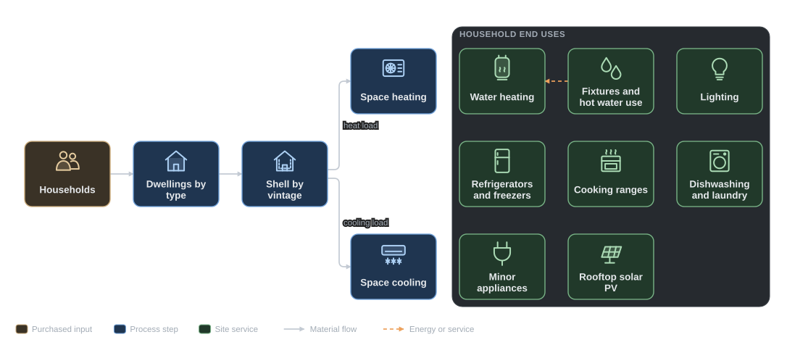

# Residential {#sec-residential}

The residential sector consumes energy to deliver household services: space and water heating, cooling, lighting, appliances, and cooking. It has no process emissions; all of its direct CO₂ comes from the fuels burned for space and water heating and for cooking. Decarbonising it is therefore a matter of electrification and efficiency, and the sub-model resolves the housing stock by building type, construction vintage, and climate so that both levers can be represented.

## Scope

The sub-model covers the energy use of all dwellings: single-family detached houses, attached and row housing, low-rise walk-ups, and large apartment buildings. Apartment buildings sit here rather than in @sec-commercial because their consumption patterns fit the residential model. The number of households, projected from population growth, drives every service except those set by other services: water-heating demand depends on the hot-water-using services, such as dishwashing and clothes washing.

The residential sector accounts for roughly 17 % of energy use in Canada. Space heating is about 60 % of that, water heating about 21 %, and lighting, appliances, and other uses the rest [@nrcan-ceud]. The sub-model accounts for the fuels burned in homes; the supply of those fuels and of electricity is in the energy-supply sectors.

## Context

Household energy is dominated by space and water heating, and that is where the direct emissions sit, because lighting and most appliances already run on electricity. Heating demand depends on the dwelling (its size, envelope, vintage, and climate) and on its heating system, which in Canada ranges from natural gas and oil furnaces through electric baseboards and wood stoves to heat pumps.

Because household heat is low-temperature, the stock is highly electrifiable. Air- and ground-source heat pumps deliver space and water heat at a coefficient of performance well above one, cold-climate and hybrid systems (a heat pump with fuel backup) extend that into Canadian winters, and envelope improvements cut the heat load at source. Efficient appliances, LED lighting, and low-flow fixtures reduce the rest.

## Process flow

@fig-residential-process shows the structure of the sub-model. Households set the number of dwellings; each dwelling's type and shell set its heating and cooling loads; and each household requests the other end uses directly.

::: {#fig-residential-process}
{.light-content .lightbox group="residential-light"}

{.dark-content .lightbox group="residential-dark"}

Process flow of the residential sector. The dwelling stock forms the Product sub-tree; the household end uses form the Service sub-tree.
:::

## Model structure

The technology database does not yet cover the residential sector. The technology tables in this chapter summarize the technologies in the current CIMS model input files and will be replaced by database archetypes when they are added.

### Dwellings, shells, and vintages

The **Dwellings** node splits the stock into two building types: low- and medium-density dwellings (detached, attached, and low-rise) and high-density dwellings (apartments). Each building type then splits into six construction **vintages**, by the building code in force when they were built: before 1960, 1961–1980, 1981–2000, 2001–2020, 2021–2035, and after 2035. A vintage carries the thermal performance of its era, and its shell options compete to improve it: a better shell lowers the load that the heating and cooling systems must meet.

::: {.tech-block}
Technologies (pending the technology database)

| Technology | What it is | Type | TRL |
|:------------------------|:------------------------------------------------------|:--------------|:------|
| Reference shell | The envelope typical of the vintage's building code. | Conventional | n/a |
| Average retrofit | Air sealing and added insulation on an existing dwelling. | Efficiency variant | n/a |
| Deep retrofit | Major envelope upgrade: insulation, windows, and air tightness. | Efficiency variant | n/a |
| Passive-house shell | Very high-performance envelope, offered for dwellings built after 2035. | Alternative | n/a |
:::

### Space heating

Each vintage of each building type has two heating competitions, one for the **cold** climate of most of Canada and one for the milder **marine** climate of coastal British Columbia and parts of the Atlantic region, because heating demand and heat-pump performance differ sharply between them.

::: {.tech-block}
Technologies (pending the technology database)

| Technology | What it is | Type | TRL |
|:------------------------|:------------------------------------------------------|:--------------|:------|
| Natural gas furnace | Existing, standard-efficiency, and high-efficiency (condensing) units. | Conventional | n/a |
| Heating oil furnace | Existing, standard-efficiency, and high-efficiency units. | Conventional | n/a |
| Electric resistance heating | Baseboards and electric furnaces. | Conventional | n/a |
| Wood heating | Wood stoves and furnaces. | Conventional | n/a |
| Air-source heat pump, electric backup | Heat pump with electric resistance heat for the coldest hours. | Alternative | n/a |
| Air-source heat pump, gas backup | Hybrid system: heat pump with a gas furnace for the coldest hours. | Alternative | n/a |
| Gas-fired heat pump | Heat pump driven by natural gas, with gas backup. | Alternative | n/a |
| Ground-source heat pump | Heat pump with a ground loop; offered for dwellings built after 2000. | Alternative | n/a |
:::

### Space cooling

Each building type has central and room air-conditioning competitions, which compete existing units with more efficient new ones.

::: {.tech-block}
Technologies (pending the technology database)

| Technology | What it is | Type | TRL |
|:------------------------|:------------------------------------------------------|:--------------|:------|
| Central air conditioner | Existing units and new units rated SEER 12 and SEER 14. | Conventional | n/a |
| Room air conditioner | Existing units and new units rated CEER 10, 12, and 14. | Conventional | n/a |
:::

### Water heating and hot water use

**Water heating** is split by building type. Its demand comes from the hot-water-using services: dishwashing, clothes washing, and **non-appliance hot water** (showers and faucets), where low-flow devices compete with standard use.

::: {.tech-block}
Technologies (pending the technology database)

| Technology | What it is | Type | TRL |
|:------------------------|:------------------------------------------------------|:--------------|:------|
| Electric storage water heater | Existing and efficient tank units. | Conventional | n/a |
| Natural gas storage water heater | Existing, standard, and efficient tank units. | Conventional | n/a |
| Natural gas tankless water heater | Standard and efficient on-demand units. | Efficiency variant | n/a |
| Oil storage water heater | Existing and efficient tank units. | Conventional | n/a |
| Heat-pump water heater | Electric or gas-fired heat-pump units. | Alternative | n/a |
| Solar water heating | Solar collectors with electric or gas backup; low- and medium-density dwellings only. | Alternative | n/a |
| Low-flow devices | Low-flow shower heads and faucets, cutting hot water use. | Efficiency variant | n/a |
:::

### Appliances, lighting, and solar

Households also request lighting, refrigerators, freezers, ranges, dishwashing, clothes washing and drying, and minor appliances (electronics, block heaters, and the rest), as well as **rooftop solar PV**. Each competes existing stock against more efficient new units.

::: {.tech-block}
Technologies (pending the technology database)

| Technology | What it is | Type | TRL |
|:------------------------|:------------------------------------------------------|:--------------|:------|
| Lighting | Incandescent, compact fluorescent, and LED lamps. | Conventional to alternative | n/a |
| Refrigerators and freezers | Existing, standard, medium-efficiency, and high-efficiency units. | Conventional to efficiency variant | n/a |
| Ranges | Natural gas and electric ranges, and induction cooktops. | Conventional to alternative | n/a |
| Dishwashers | Existing, standard, high-efficiency, and top-efficiency machines; hand washing with or without an aerator. | Conventional to efficiency variant | n/a |
| Clothes washers | Existing, standard, high-efficiency, and steam machines. | Conventional to efficiency variant | n/a |
| Clothes dryers | Electric and gas dryers, heat-pump dryers, and air drying. | Conventional to alternative | n/a |
| Minor appliances | Existing and new devices, devices with 1 W standby, and devices paired with solar panels. | Conventional to efficiency variant | n/a |
| Rooftop solar PV | Household solar generation, against no solar. | Alternative | n/a |
:::

### Shared services

Gas-fired equipment draws on the sector's methane blend, where natural gas competes with biogas, gas from biomass gasification, and hydrogen; see @sec-fuel-blends.

## Decarbonisation

- **Heat pumps.** The central lever is electrifying space heat. Air-source, ground-source, and hybrid heat pumps compete with furnaces in every vintage and climate; cold-climate heat pumps, which hold their output at low temperatures, are the key enabling technology for most of the country. Heat-pump and solar water heaters electrify hot water.
- **Envelope.** Newer vintages built to tighter codes, and average, deep, and passive-house retrofits, cut the heat load before any system runs.
- **Appliances and fixtures.** Efficient appliances, LED lighting, and low-flow fixtures cut the remaining loads, and the last also cuts water-heating demand.

Households weigh up-front cost heavily: the sub-model uses behavioural discount rates of around 25–30 % in the current data, which reproduces the observed gap between cost-effective and adopted efficiency (see @sec-technology-competition). The emissions benefit of electrification depends on the regional grid: large where it is clean (Québec, British Columbia, and Manitoba), smaller where it is fossil-heavy (Alberta and Saskatchewan).

## Regional coverage and differences

All seven modelled regions carry the residential structure, and regional differences are large because climate, fuel availability, and grid carbon intensity all vary:

- The cold and marine heating competitions separate most of Canada from coastal British Columbia and parts of the Atlantic region.
- Natural gas dominates heating in the West and Ontario, electricity in Québec and parts of the Atlantic region, and oil and wood remain significant in the Atlantic region and rural areas.
- Air conditioning is a large load in hot-summer regions such as Ontario and much smaller elsewhere.

<mark>TODO: Confirm the regional dwelling-type, vintage, and fuel-mix shares against current housing-stock and Comprehensive Energy Use Database data, since heating demand and heat-pump economics depend heavily on all three.</mark>

## Limitations and planned extensions

The sub-model relies on archetype generalisations, inherited calibration of dwelling and appliance intensities, and an incomplete representation of rebound effects, such as minor-appliance ownership growing faster than efficiency improves.

<mark>TODO: Add the residential technologies to the technology database, and reflect cold-climate heat-pump performance curves in the cold-climate heating competitions.</mark>

<mark>TODO: The industrial lighting nodes are moving to lumen-hours (see @sec-hvac-lighting); decide whether residential lighting should follow.</mark>

<mark>TODO: Benchmark modelled residential energy use by end use and dwelling type against Natural Resources Canada's Comprehensive Energy Use Database.</mark>



```{=latex}
\phantomsection
```

## References {.unnumbered}

```{=latex}
\printbibliography[heading=none]
```

::: {#refs}
:::
