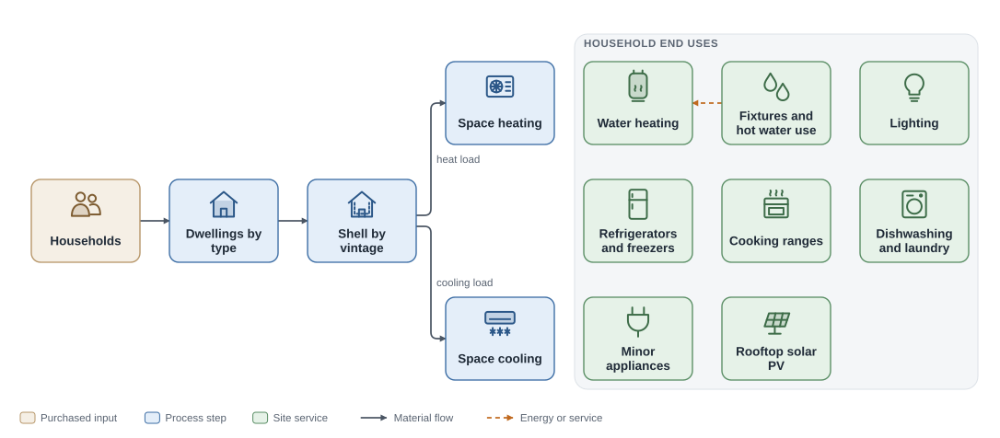

# Residential {#sec-residential}

Homes use energy for heating and cooling, hot water, lighting, appliances, and cooking. Homes have no industrial processes, so all of the sector's direct CO₂ comes from fuels burned on site: mainly natural gas, heating oil, propane, and wood for space and water heating, plus some gas for cooking. Cutting those emissions means switching heating to electricity and using less energy overall. To show both, CIMS divides the housing stock by building type, age, and climate.

## Scope

The sub-model covers energy use in all dwellings: detached houses, attached and row houses, low-rise walk-ups, and large apartment buildings. Apartment buildings sit here rather than in @sec-commercial because their energy use looks more like homes than like offices or stores. The number of households, projected from population growth, drives most of the sector. Hot water is the exception: its demand depends on how much the household uses showers, faucets, dishwashers, and washing machines.

Homes account for roughly 17 % of energy use in Canada. Space heating makes up about 60 % of that, water heating about 21 %, and lighting, appliances, and other uses the rest [@nrcan-ceud]. This chapter covers the fuel and electricity used in homes; producing that fuel and electricity belongs to the energy supply sectors.

## Context

Space and water heating dominate household energy use, and they produce nearly all of the sector's direct emissions, because lighting and most appliances already run on electricity. How much heat a home needs depends on its size, how well its walls, roof, and windows keep heat in, when it was built, and how cold the local climate is. Canadian homes heat with natural gas and oil furnaces, electric baseboards, wood stoves, and, increasingly, heat pumps.

Homes need heat at low temperatures, which makes them easy to electrify in principle. A heat pump moves heat from the outdoor air or the ground into the house, delivering several units of heat for each unit of electricity it uses. Cold-climate heat pumps keep working in Canadian winters, and hybrid systems pair a heat pump with a furnace for the coldest days. Better insulation and air sealing cut the heat a home needs in the first place, and efficient appliances, LED lighting, and low-flow fixtures cut the rest.

## Process flow

@fig-residential-process shows how the sub-model is put together. The number of households sets the number of dwellings; each dwelling's type and building shell (its walls, roof, windows, and air tightness) set how much heating and cooling it needs; and each household uses the other services directly. The chart shows structure only: the fuels and electricity each technology uses are not drawn, because the competition between technologies decides them.

::: {#fig-residential-process}
{.light-content .lightbox group="residential-light"}

{.dark-content .lightbox group="residential-dark"}

Process flow of the residential sector. The dwelling stock makes up the Product sub-tree, and the household services make up the Service sub-tree.
:::

## Model structure

The technology database does not cover homes yet. The tables in this chapter summarize the technologies in the current CIMS model input files; database technologies will replace them once they are added.

### Dwellings, shells, and building age

The **Dwellings** step splits the housing stock into two building types: low- and medium-density dwellings (detached, attached, and low-rise) and high-density dwellings (apartments). Each type then splits into six age groups, set by the building code in force when the homes were built: before 1960, 1961–1980, 1981–2000, 2001–2020, 2021–2035, and after 2035. Older homes generally lose more heat. In each age group, building **shell** options compete: a better shell means less heat lost in winter and less heat gained in summer, so the heating and cooling systems have less to do.

::: {.tech-block}
Technologies (pending the technology database)

| Technology | What it is | Type |
|:--------------------------|:----------------------------------------------------------|:----------------|
| Reference shell | The walls, roof, and windows typical of the building code when the home was built. | Conventional |
| Average retrofit | Air sealing and added insulation on an existing home. | Efficiency variant |
| Deep retrofit | A major upgrade of insulation, windows, and air tightness. | Efficiency variant |
| Passive-house shell | A very well-insulated, airtight shell, offered for homes built after 2035. | Alternative |
:::

### Space heating

Space heating keeps homes warm and is the sector's largest energy use and largest source of emissions. Each age group of each building type has two heating competitions: one for the **cold** climate of most of Canada, and one for the milder **marine** climate of coastal British Columbia and parts of the Atlantic region. The two need to be separate because homes in a mild climate need much less heat, and because heat pumps work more efficiently when winters are milder.

Furnaces and boilers burn natural gas, oil, or wood, so their emissions depend on the fuel. Electric baseboards and heat pumps produce no emissions at the house; their emissions depend on how the region generates electricity. A heat pump uses far less electricity than a baseboard for the same heat. Hybrid systems use a heat pump most of the time and a gas furnace on the coldest days.

::: {.tech-block}
Technologies (pending the technology database)

| Technology | What it is | Type |
|:--------------------------|:----------------------------------------------------------|:----------------|
| Natural gas furnace | Existing, standard-efficiency, and high-efficiency (condensing) furnaces. | Conventional |
| Heating oil furnace | Existing, standard-efficiency, and high-efficiency furnaces. | Conventional |
| Electric resistance heating | Electric baseboards and electric furnaces. | Conventional |
| Wood heating | Wood stoves and furnaces. | Conventional |
| Air-source heat pump, electric backup | A heat pump with electric heaters for the coldest hours. | Alternative |
| Air-source heat pump, gas backup | A hybrid system: a heat pump with a gas furnace for the coldest hours. | Alternative |
| Gas-fired heat pump | A heat pump driven by natural gas rather than electricity, with gas backup. | Alternative |
| Ground-source heat pump | A heat pump that draws heat from pipes buried in the ground; offered for homes built after 2000. | Alternative |
:::

### Space cooling

Air conditioning keeps homes cool in summer. It runs on electricity, so it produces no direct emissions, but it adds to summer electricity demand. Each building type has a central and a room air-conditioning competition, where existing units compete with more efficient new ones.

::: {.tech-block}
Technologies (pending the technology database)

| Technology | What it is | Type |
|:--------------------------|:----------------------------------------------------------|:----------------|
| Central air conditioner | Existing units, and new units at two efficiency levels. | Conventional |
| Room air conditioner | Existing units, and new units at three efficiency levels. | Conventional |
:::

### Water heating and hot water use

**Water heating** supplies hot water for showers, faucets, dishwashers, and washing machines, and is the second-largest energy use in homes. It is split by building type. How much hot water a home needs depends on the services that use it, including **fixtures and hot water use** (showers and faucets), where low-flow devices compete with standard ones. Gas and oil water heaters produce direct emissions; electric and heat-pump water heaters don't.

::: {.tech-block}
Technologies (pending the technology database)

| Technology | What it is | Type |
|:--------------------------|:----------------------------------------------------------|:----------------|
| Electric storage water heater | Existing and efficient tank heaters. | Conventional |
| Natural gas storage water heater | Existing, standard, and efficient tank heaters. | Conventional |
| Natural gas tankless water heater | Standard and efficient heaters that heat water on demand, without a tank. | Efficiency variant |
| Oil storage water heater | Existing and efficient tank heaters. | Conventional |
| Heat-pump water heater | Electric or gas-fired heat-pump water heaters. | Alternative |
| Solar water heating | Solar collectors with electric or gas backup; low- and medium-density homes only. | Alternative |
| Low-flow devices | Low-flow shower heads and faucets, which cut hot water use. | Efficiency variant |
:::

### Appliances, lighting, and rooftop solar

Each household also uses lighting, refrigerators, freezers, cooking ranges, dishwashers, clothes washers and dryers, and minor appliances (electronics, block heaters, and other plug-in devices). Most of these run on electricity, so their emissions depend on the regional grid; gas ranges and dryers burn natural gas. In each competition, existing appliances compete with more efficient new ones. Households can also install **rooftop solar panels**, which generate some of their own electricity.

::: {.tech-block}
Technologies (pending the technology database)

| Technology | What it is | Type |
|:--------------------------|:----------------------------------------------------------|:----------------|
| Lighting | Incandescent, compact fluorescent, and LED lamps. | Conventional to alternative |
| Refrigerators and freezers | Existing, standard, medium-efficiency, and high-efficiency units. | Conventional to efficiency variant |
| Ranges | Natural gas and electric ranges, and induction cooktops. | Conventional to alternative |
| Dishwashers | Existing, standard, high-efficiency, and top-efficiency machines, and washing by hand with or without an aerator. | Conventional to efficiency variant |
| Clothes washers | Existing, standard, high-efficiency, and steam machines. | Conventional to efficiency variant |
| Clothes dryers | Electric and gas dryers, heat-pump dryers, and air drying. | Conventional to alternative |
| Minor appliances | Existing and new devices, devices with low standby power, and devices paired with solar panels. | Conventional to efficiency variant |
| Rooftop solar PV | Solar panels generating household electricity, against no panels. | Alternative |
:::

### Shared services

Gas-fired equipment draws gas from the sector's methane blend, where natural gas competes with biogas, gas made from biomass, and hydrogen; see @sec-fuel-blends.

## Decarbonisation

- **Heat pumps.** Switching space heating to electricity is the main lever. Air-source, ground-source, and hybrid heat pumps compete with furnaces in every building type, age group, and climate. Cold-climate heat pumps, which keep producing heat at low outdoor temperatures, are what make this possible in most of the country. Heat-pump and solar water heaters do the same for hot water.
- **Better building shells.** New homes built to tighter codes, and retrofits of existing homes, cut the heat needed before any heating system runs.
- **Efficient appliances and fixtures.** Efficient appliances, LED lighting, and low-flow fixtures cut the remaining energy use; low-flow fixtures also cut the energy needed to heat water.

Households weigh up-front cost heavily. The current data use discount rates of around 25–30 % for household technologies, which reproduces the gap seen in practice between the efficiency upgrades that would pay off and the ones households actually make (see @sec-technology-competition). How much electrification cuts emissions depends on the regional grid: a lot where electricity is clean (Québec, British Columbia, and Manitoba), less where it still comes largely from fossil fuels (Alberta and Saskatchewan).

## Regional coverage and differences

All seven modelled regions include the residential sector, and they differ widely because climate, fuel availability, and the electricity grid all vary:

- The cold and marine heating competitions separate most of Canada from coastal British Columbia and parts of the Atlantic region.
- Natural gas dominates home heating in the West and Ontario, and electricity in Québec and parts of the Atlantic region; oil and wood remain important in the Atlantic region and rural areas.
- Air conditioning is a large summer load in hot-summer regions such as Ontario and much smaller elsewhere.

<mark>TODO: Confirm the regional dwelling-type, building-age, and fuel-mix shares against current housing-stock and Comprehensive Energy Use Database data, since heating demand and heat-pump economics depend heavily on all three.</mark>

## Limitations and planned extensions

The sub-model generalizes across homes of each type and age, relies on older calibration of dwelling and appliance energy use, and only partly represents rebound effects, such as households owning more plug-in devices faster than those devices become efficient.

<mark>TODO: Add the residential technologies to the technology database, and reflect how cold-climate heat-pump performance changes with outdoor temperature in the cold-climate heating competitions.</mark>

<mark>TODO: The industrial lighting nodes are moving to lumen-hours (see @sec-hvac-lighting); decide whether residential lighting should follow.</mark>

<mark>TODO: Benchmark modelled residential energy use by end use and dwelling type against Natural Resources Canada's Comprehensive Energy Use Database.</mark>



```{=latex}
\phantomsection
```

## References {.unnumbered}

```{=latex}
\printbibliography[heading=none]
```

::: {#refs}
:::
