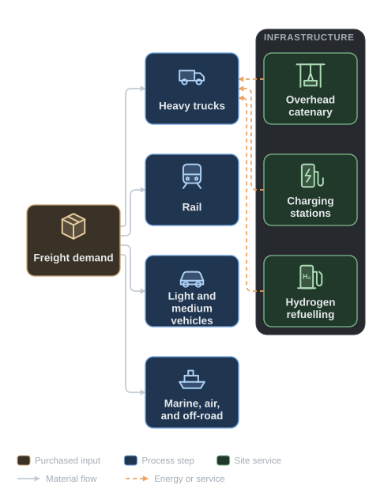

# Freight Transportation {#sec-transportation-freight}

Freight transportation covers moving goods by road, rail, ship, and plane, along with off-road machines. CIMS lets these ways of moving goods compete, and within each it lets different engines and fuels compete. The sector also includes the charging stations, overhead wires, and hydrogen stations that zero-emission trucks need. The general approach to transportation (competition between ways of travelling, non-financial costs, and the gradual turnover of vehicles) is described in @sec-transportation-passenger and is not repeated here.

## Scope

The sub-model covers goods moved by heavy trucks and rail, light and medium commercial vehicles (vans and delivery trucks), ships, and planes, plus off-road equipment such as construction and farm machines. Total freight demand is projected for each region, and it can shift between ways of moving goods, most importantly from road to rail.

Related activities sit elsewhere: passenger travel in @sec-transportation-passenger; supplying fuels and electricity in the energy supply sectors, including @sec-biofuels, @sec-hydrogen, and @sec-electricity; and building vehicles in @sec-light-industrial.

## Context

Freight is a large share of transport emissions, and a hard one to cut. Heavy trucks dominate it: in 2019, road freight produced about 64.8 Mt of Canada's transport emissions, against 7.8 Mt from rail and 4.5 Mt from ships [@icct-zet]. Rail is more than five times as efficient as trucks for each tonne of goods it moves a kilometre, so shifting goods from truck to rail, or to combined truck and rail service, can cut emissions by up to 30 % [@icct-zet]. Heavy trucks are among the hardest road vehicles to decarbonise, because their weight, long routes, and heavy use strain what batteries can do.

Three zero-emission options compete for heavy freight. Battery-electric trucks suit lighter loads and shorter routes; hydrogen fuel-cell trucks are emerging for heavy loads over long distances, where range and refuelling time matter [@icct-zet; @pembina-mhd]; and catenary trucks draw power from overhead wires along major highways. By the 2030s, catenary and battery-electric trucks are projected to cost roughly 30–35 % less to own and run than diesel trucks, and hydrogen trucks 15–25 % less [@icct-zet].

## Process flow

@fig-transportation-freight-process shows how the sub-model is put together. Freight demand splits by way of moving goods, and the zero-emission trucks draw on the infrastructure they need. The chart shows structure only: the fuels and electricity each vehicle uses are not drawn, because the competition between vehicles decides them.

::: {#fig-transportation-freight-process}
{.light-content .lightbox group="transportation-freight-light"}

{.dark-content .lightbox group="transportation-freight-dark"}

Process flow of the freight transportation sector. Freight demand by way of moving goods makes up the Product sub-tree, and charging, overhead wire, and hydrogen refuelling infrastructure make up the Service sub-tree.
:::

## Model structure

The technology database does not cover freight transportation yet. The tables in this chapter summarize the technologies in the current CIMS model input files; database technologies will replace them once they are added.

### Heavy freight on land: trucks and rail

The **heavy land** step splits heavy freight between trucks and rail. This is where goods can shift from road to rail. Trains move goods with much less energy than trucks, but they only serve places on the rail network, and trucks are usually still needed at each end. Within each, engines and fuels compete. Diesel and natural gas burn fuel and emit CO₂ directly; biodiesel cuts emissions depending on how it is made; battery-electric, catenary, and hydrogen trucks and trains produce no exhaust, and their emissions depend on how their electricity or hydrogen is made.

::: {.tech-block}
Technologies (pending the technology database)

| Technology | What it is | Type |
|:--------------------------|:----------------------------------------------------------|:----------------|
| Diesel truck | Existing, standard, and more efficient heavy diesel trucks. | Conventional |
| Biodiesel truck | A heavy truck running on biodiesel. | Alternative |
| Natural gas truck | A heavy truck running on compressed or liquefied natural gas. | Alternative |
| Plug-in hybrid truck | Drives on battery power, with a diesel engine for longer range. | Alternative |
| Battery-electric truck | A heavy electric truck, charged at depots or fast-charging stations. | Alternative |
| Hydrogen fuel-cell truck | A heavy truck powered by a hydrogen fuel cell. | Alternative |
| Catenary truck | An electric truck powered from overhead wires on equipped highways. | Prospective |
| Diesel locomotive | Existing, standard, and more efficient diesel freight trains. | Conventional |
| Biodiesel locomotive | A freight train running on biodiesel. | Alternative |
| Electric rail | Freight trains powered from overhead wires. | Alternative |
| Hydrogen locomotive | A freight train powered by a hydrogen fuel cell. | Prospective |
:::

### Light and medium vehicles

Delivery vans and medium trucks make shorter trips, often in cities and back to a depot each night, which makes them easier to electrify than heavy trucks. They form their own competition.

::: {.tech-block}
Technologies (pending the technology database)

| Technology | What it is | Type |
|:--------------------------|:----------------------------------------------------------|:----------------|
| Gasoline and diesel vehicles | Existing, standard, and more efficient vehicles of each. | Conventional |
| Propane vehicle | A light or medium vehicle running on propane. | Alternative |
| Biodiesel vehicle | A light or medium vehicle running on biodiesel. | Alternative |
| Plug-in hybrid | Drives on battery power, with a combustion engine for longer range. | Alternative |
| Battery-electric vehicle | A light or medium electric vehicle. | Alternative |
| Hydrogen fuel-cell vehicle | A light or medium vehicle powered by a hydrogen fuel cell. | Alternative |
:::

### Ships, planes, and off-road equipment

**Marine** and **air** freight each have their own competition between engines and fuels. Ships and planes travel long distances with heavy loads, so they are hard to run on batteries; their options are mainly biofuels and hydrogen. **Off-road** equipment (construction, farm, and other machines that don't run on public roads) competes diesel against electric machines.

::: {.tech-block}
Technologies (pending the technology database)

| Technology | What it is | Type |
|:--------------------------|:----------------------------------------------------------|:----------------|
| Fuel oil vessel | Existing, standard, and more efficient ship engines running on fuel oil. | Conventional |
| Biodiesel vessel | A ship engine running on biodiesel. | Alternative |
| Hydrogen vessel | A ship running on hydrogen. | Prospective |
| Aircraft | Existing and more efficient aircraft. | Conventional |
| Electric and hydrogen aircraft | Zero-emission aircraft, mainly for short routes. | Prospective |
| Diesel off-road equipment | Standard, medium-efficiency, and high-efficiency diesel machines. | Conventional |
| Electric off-road equipment | Battery-electric machines. | Alternative |
:::

### Zero-emission infrastructure

The Service sub-tree holds the infrastructure that zero-emission trucks need, so that the cost of building it is part of the competition rather than assumed to be free. **EV infrastructure** splits into depot stations (charging overnight or when trucks return to base) and fast-charging stations along routes; **catenary infrastructure** is overhead wire on equipped highways; and **FCEV infrastructure** is hydrogen refuelling stations.

::: {.tech-block}
Technologies (pending the technology database)

| Technology | What it is | Type |
|:--------------------------|:----------------------------------------------------------|:----------------|
| Depot charging station | Charging overnight or when trucks return to base. | Alternative |
| Fast-charging station | Fast charging along freight routes. | Alternative |
| Catenary road | Overhead wires that power trucks along a highway. | Prospective |
| Hydrogen refuelling station | Low- and high-capacity stations. | Alternative |
:::

### Shared services

Vehicles draw fuel from the sector's diesel, gasoline, and methane blends, where biodiesel, renewable diesel, ethanol, renewable natural gas, and hydrogen can replace part of the fossil fuel; see @sec-fuel-blends.

## Decarbonisation

- **Zero-emission trucks.** Battery-electric, hydrogen fuel-cell, and catenary trucks compete with diesel and biodiesel trucks. Which wins depends on how the truck is used, and on the non-financial costs of range, refuelling time, and infrastructure. Studies that count these costs find battery-electric trucks winning for lighter loads and regional routes, and hydrogen emerging for heavy loads over long distances [@icct-zet].
- **Moving goods by rail.** Shifting freight from truck to rail, which uses about a fifth of the energy per tonne moved, is a powerful lever; rail itself can switch to electricity, hydrogen, and biodiesel.
- **Ships and planes.** Ships can switch to biodiesel and hydrogen, and planes to more efficient, electric, and hydrogen aircraft. Sustainable aviation fuel, e-fuels, and ammonia for ships are not yet represented.

The current data discount costs at about 12.5 % for long-lived rail and about 25–30 % for road vehicles, and non-financial costs capture range, refuelling, payload, and unfamiliarity with new technology (see @sec-technology-competition). Electric and catenary trucks are only as clean as the regional grid, and hydrogen trucks only as clean as the hydrogen supply.

## Regional coverage and differences

All seven modelled regions include freight transportation. Long inland routes (across the Prairies and along the Ontario–Québec corridor) favour rail and long-haul trucking, while coastal and Great Lakes regions also move goods by ship. The regional grid sets how much electric trucks and rail cut emissions; hydrogen supply differs by region (made from natural gas with carbon capture in Alberta, or from hydroelectric power elsewhere); and building out charging and hydrogen stations is a regional matter.

<mark>TODO: Calibrate the regional shares of each way of moving goods, and where catenary and hydrogen refuelling are feasible along each corridor.</mark>

## Limitations and planned extensions

<mark>TODO: Add sustainable aviation fuel and e-fuels to the air freight competition, and ammonia as a fuel for ships.</mark>

<mark>TODO: Refresh the intangible-cost parameters, add the freight technologies to the technology database, and benchmark modelled freight energy use and mode shares against Transport Canada and Natural Resources Canada data.</mark>



```{=latex}
\phantomsection
```

## References {.unnumbered}

```{=latex}
\printbibliography[heading=none]
```

::: {#refs}
:::
