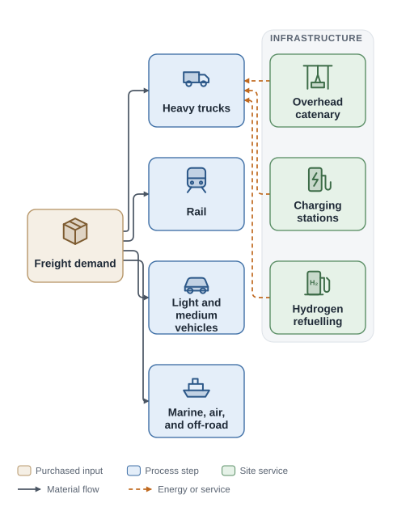

# Transportation (Freight) {#sec-transportation-freight}

Freight transportation meets a demand for goods movement, in tonne-kilometres, by competing modes (road, rail, marine, and air) and, within each, competing powertrains and fuels. It also carries the charging, overhead catenary, and hydrogen refuelling infrastructure that zero-emission freight depends on. The general approach to transportation (mode competition, intangible costs, and stock turnover) is described in @sec-transportation-passenger and is not repeated here.

## Scope

The sub-model covers goods moved by heavy trucks and rail, light and medium commercial vehicles, marine, and air, plus off-road equipment (construction, agricultural, and other off-highway machines). Freight demand is projected exogenously and can shift between modes, most importantly from road to rail.

Adjacent activities sit elsewhere: passenger travel in @sec-transportation-passenger; the fuels in the energy-supply sectors, including @sec-biofuels, @sec-hydrogen, and @sec-electricity; and vehicle manufacturing in @sec-light-industrial.

## Context

Freight is a large and stubborn share of transport emissions, dominated by heavy trucks. In 2019, on-road freight produced about 64.8 Mt of Canada's transport emissions, against 7.8 Mt from rail and 4.5 Mt from marine [@icct-zet]. Rail is more than five times as emissions-efficient per tonne-kilometre as road, so shifting goods from truck to rail or intermodal can cut emissions by up to 30 % [@icct-zet]. Heavy trucks are among the hardest road vehicles to decarbonise, because their weight, range, and duty cycles strain battery technology.

Three zero-emission pathways compete for heavy freight. Battery-electric trucks suit lighter and shorter-range duty; hydrogen fuel-cell trucks are emerging for heavy long-haul, where range and refuelling time matter [@icct-zet; @pembina-mhd]; and overhead catenary systems power trucks directly from the road on major corridors. By the 2030s, catenary and battery-electric trucks are projected to cost roughly 30–35 % less to own and run than diesel, and hydrogen trucks 15–25 % less [@icct-zet].

## Process flow

@fig-transportation-freight-process shows the structure of the sub-model. Freight demand splits by mode, and the zero-emission trucks request the infrastructure they need.

::: {#fig-transportation-freight-process}
{.light-content .lightbox group="transportation-freight-light"}

{.dark-content .lightbox group="transportation-freight-dark"}

Process flow of the freight transportation sector. Freight demand by mode forms the Product sub-tree; charging, catenary, and hydrogen refuelling infrastructure form the Service sub-tree.
:::

## Model structure

The technology database does not yet cover freight transportation. The tables in this chapter summarize the technologies in the current CIMS model input files and will be replaced by database archetypes when they are added.

### Heavy land freight: trucks and rail

The **heavy land** node splits heavy freight between trucks and rail, which is where road-to-rail mode shift happens. Each mode then competes its powertrains.

::: {.tech-block}
Technologies (pending the technology database)

| Technology | What it is | Type | TRL |
|:------------------------|:------------------------------------------------------|:--------------|:------|
| Diesel truck | Existing, standard, and efficient heavy diesel trucks. | Conventional | n/a |
| Biodiesel truck | Heavy truck running on biodiesel. | Alternative | n/a |
| Natural gas truck | Heavy truck running on compressed or liquefied natural gas. | Alternative | n/a |
| Plug-in hybrid truck | Battery-electric driving with a diesel engine for range. | Alternative | n/a |
| Battery-electric truck | Heavy electric truck, charged at depots or rapid-charging stations. | Alternative | n/a |
| Hydrogen fuel-cell truck | Heavy fuel-cell truck. | Alternative | n/a |
| Catenary truck | Electric truck powered from overhead wires on equipped corridors. | Prospective | n/a |
| Diesel locomotive | Existing, standard, and efficient diesel freight rail. | Conventional | n/a |
| Biodiesel locomotive | Freight rail on biodiesel. | Alternative | n/a |
| Electric rail | Electrified freight rail. | Alternative | n/a |
| Hydrogen locomotive | Fuel-cell freight rail. | Prospective | n/a |
:::

### Light and medium vehicles

Commercial vans and medium trucks form their own competition.

::: {.tech-block}
Technologies (pending the technology database)

| Technology | What it is | Type | TRL |
|:------------------------|:------------------------------------------------------|:--------------|:------|
| Gasoline and diesel vehicles | Existing, standard, and efficient units of each. | Conventional | n/a |
| Propane vehicle | Light or medium vehicle running on propane. | Alternative | n/a |
| Biodiesel vehicle | Light or medium vehicle running on biodiesel. | Alternative | n/a |
| Plug-in hybrid | Battery-electric driving with a combustion engine for range. | Alternative | n/a |
| Battery-electric vehicle | Light or medium electric vehicle. | Alternative | n/a |
| Hydrogen fuel-cell vehicle | Light or medium fuel-cell vehicle. | Alternative | n/a |
:::

### Marine, air, and off-road

**Marine** and **air** freight each compete their own fuels and powertrains, and **off-road** equipment competes diesel against electric machines.

::: {.tech-block}
Technologies (pending the technology database)

| Technology | What it is | Type | TRL |
|:------------------------|:------------------------------------------------------|:--------------|:------|
| Fuel oil vessel | Existing, standard, and efficient marine engines on fuel oil. | Conventional | n/a |
| Biodiesel vessel | Marine engine on biodiesel. | Alternative | n/a |
| Hydrogen vessel | Marine vessel on hydrogen. | Prospective | n/a |
| Aircraft | Existing and efficient aircraft. | Conventional | n/a |
| Electric and hydrogen aircraft | Zero-emission aircraft, mainly for short routes. | Prospective | n/a |
| Diesel off-road equipment | Standard, medium-, and high-efficiency diesel machines. | Conventional | n/a |
| Electric off-road equipment | Battery-electric machines. | Alternative | n/a |
:::

### Zero-emission infrastructure

The Service sub-tree carries the infrastructure that zero-emission trucks request, so that the cost of building it out is part of the competition rather than assumed to be free. **EV infrastructure** splits into depot stations (overnight and return-to-base charging) and rapid-charging stations (fast charging en route); **catenary infrastructure** is overhead wire on equipped roads; and **FCEV infrastructure** is hydrogen refuelling.

::: {.tech-block}
Technologies (pending the technology database)

| Technology | What it is | Type | TRL |
|:------------------------|:------------------------------------------------------|:--------------|:------|
| Depot charging station | Overnight and return-to-base charging. | Alternative | n/a |
| Rapid-charging station | Fast charging along freight routes. | Alternative | n/a |
| Catenary road | Overhead wires powering trucks on a road corridor. | Prospective | n/a |
| Hydrogen refuelling station | Low- and high-capacity stations. | Alternative | n/a |
:::

### Shared services

Vehicles draw fuel from the sector's diesel, gasoline, and methane blends, where biodiesel, renewable diesel, ethanol, renewable natural gas, and hydrogen can replace part of the fossil fuel; see @sec-fuel-blends.

## Decarbonisation

- **Zero-emission trucks.** Battery-electric, hydrogen fuel-cell, and catenary trucks compete against diesel and biodiesel. Which wins depends on duty cycle and on the intangible costs of range, refuelling time, and infrastructure: studies that include these costs find battery-electric trucks dominating lighter and regional duty, and hydrogen emerging for heavy long-haul [@icct-zet].
- **Mode shift.** Moving freight from truck to rail, which is five times as efficient per tonne-kilometre, is a powerful lever; rail itself decarbonises through electrification, hydrogen, and biodiesel.
- **Hard-to-electrify modes.** Marine switches to biodiesel and hydrogen, and aviation to efficient, electric, and hydrogen aircraft. Sustainable aviation fuel, e-fuels, and ammonia for shipping are not yet represented.

Financial costs are discounted at behavioural rates of around 12.5 % for long-lived rail assets and around 25–30 % for road vehicles in the current data, and intangible costs capture range, refuelling, payload, and familiarity barriers (see @sec-technology-competition). Electric and catenary trucks inherit the carbon intensity of the regional grid, and hydrogen trucks that of the hydrogen supply.

## Regional coverage and differences

All seven modelled regions carry the freight structure. Long inland corridors (the Prairies and the Ontario–Québec corridor) favour rail and long-haul trucking, while coastal and Great Lakes regions add marine. Grid carbon intensity sets the benefit of electric trucks and rail, regional hydrogen supply differs (blue hydrogen in Alberta, electrolytic hydrogen from hydro power elsewhere), and infrastructure build-out is inherently regional.

<mark>TODO: Calibrate the regional freight mode-share baselines and the corridor-level feasibility of catenary and hydrogen refuelling.</mark>

## Limitations and planned extensions

<mark>TODO: Add sustainable aviation fuel and e-fuels to the air freight competition, and ammonia as a marine fuel.</mark>

<mark>TODO: Refresh the intangible-cost parameters, add the freight technologies to the technology database, and benchmark modelled freight energy use and mode shares against Transport Canada and Natural Resources Canada data.</mark>



```{=latex}
\phantomsection
```

## References {.unnumbered}

```{=latex}
\printbibliography[heading=none]
```

::: {#refs}
:::
