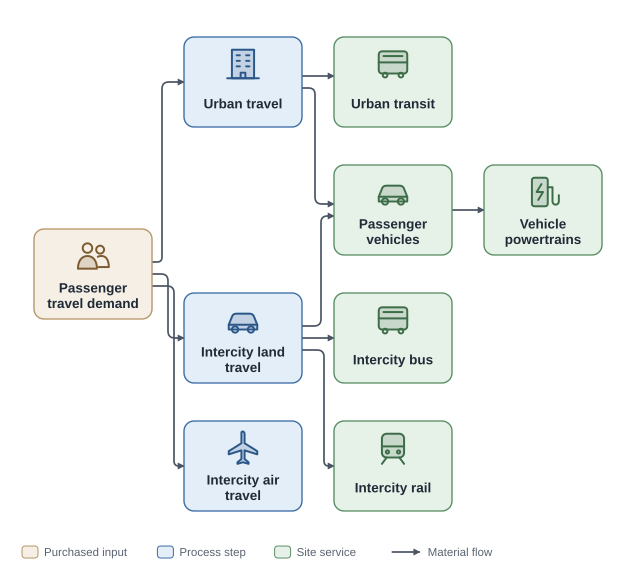
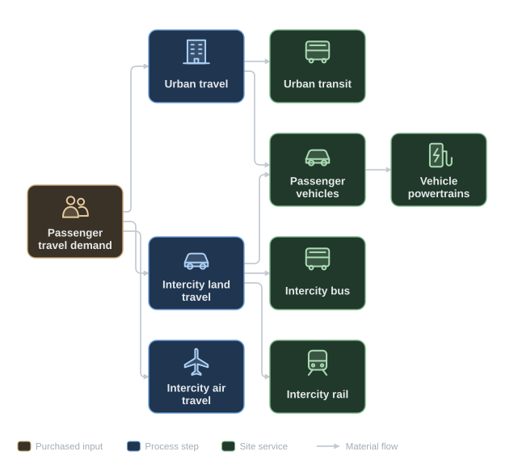

# Transportation (Passenger) {#sec-transportation-passenger}

Passenger transportation meets a demand for personal mobility, in passenger-kilometres, by competing travel modes and, within road travel, competing vehicle powertrains. It is among Canada's largest emitting sectors, and its technology choices are unusually shaped by consumer preferences (range, refuelling convenience, vehicle size, and power), which CIMS represents through intangible costs alongside financial costs.

## Scope

The sub-model covers urban and intercity travel by people: personal vehicles (cars and light trucks), urban transit (public bus, ferry, and light rail), intercity bus and rail, intercity air, and walking and cycling. Travel demand is projected exogenously and can shift between modes as relative costs change.

Adjacent activities sit elsewhere: freight movement in @sec-transportation-freight; the fuels in the energy-supply sectors, including @sec-biofuels, @sec-hydrogen, and @sec-electricity; and vehicle manufacturing in @sec-light-industrial.

## Context

Transportation is responsible for roughly a quarter of Canada's greenhouse-gas emissions, and light-duty passenger vehicles are its single largest part. The emissions come overwhelmingly from burning gasoline and diesel [@eccc-zev]. Policy is driving a rapid transition: Canada's zero-emission vehicle (ZEV) mandate requires all new light-duty vehicle sales to be zero-emission by 2035, with interim targets of 20 % by 2026 and 60 % by 2030, where a ZEV is a battery-electric, plug-in hybrid, or fuel-cell vehicle [@eccc-zev].

Battery-electric vehicles cost more to buy than gasoline vehicles but have 66–77 % lower fuel and maintenance costs, and the purchase-price gap is closing [@nrcan-ev]. Moving trips from single-occupant vehicles to shared vehicles, transit, and active modes cuts energy per passenger-kilometre, and electrifying transit buses cuts their emissions by around 93 % [@transit-elec]. Consumer choice is not driven by cost alone, though: range anxiety, refuelling availability, and preferences for larger, more powerful vehicles all matter, and CIMS carries intangible costs to reproduce observed behaviour.

## Process flow

@fig-transportation-passenger-process shows the structure of the sub-model. Travel demand splits into urban, intercity land, and intercity air travel; each mode requests the vehicles or transit services that carry it; and passenger vehicles request powertrains.

::: {#fig-transportation-passenger-process}
{.light-content .lightbox group="transportation-passenger-light"}

{.dark-content .lightbox group="transportation-passenger-dark"}

Process flow of the passenger transportation sector. Travel demand by mode forms the Product sub-tree; vehicles, transit, and powertrains form the Service sub-tree.
:::

## Model structure

The technology database does not yet cover passenger transportation. The tables in this chapter summarize the modes and technologies in the current CIMS model input files and will be replaced by database archetypes when they are added.

### Travel modes

The Product sub-tree splits travel demand into three nodes, each a competition among modes. Mode shift (from single-occupant vehicles to shared vehicles, transit, and walking and cycling, or from cars to buses and trains) is one of the main actions the sub-model simulates.

::: {.tech-block}
Modes (pending the technology database)

| Mode | What it is | Type | TRL |
|:------------------------|:------------------------------------------------------|:--------------|:------|
| Urban: single-occupant vehicle | A passenger vehicle carrying its driver alone. | Conventional | n/a |
| Urban: high-occupancy vehicle | A passenger vehicle carrying two or more people. | Conventional | n/a |
| Urban: public transit | Bus, ferry, and light rail. | Conventional | n/a |
| Urban: walking and cycling | Active travel. | Conventional | n/a |
| Intercity land | Passenger vehicle, intercity bus, and intercity rail. | Conventional | n/a |
| Intercity air | Conventional, efficient, electric, and hydrogen aircraft. | Conventional to prospective | n/a |
:::

### Passenger vehicles and powertrains

The **Passenger Vehicles** node splits vehicle travel by size class: small and large cars, and small and large light trucks. Each class requests **powertrains**, where the competition between gasoline and zero-emission vehicles takes place. Powertrain and efficiency are set for new vehicles; older vehicles are tracked and retired through stock turnover, so even a sales mandate changes the fleet gradually.

::: {.tech-block}
Technologies (pending the technology database)

| Technology | What it is | Type | TRL |
|:------------------------|:------------------------------------------------------|:--------------|:------|
| Gasoline vehicle | Existing, standard, and efficient internal-combustion vehicles. | Conventional | n/a |
| Hybrid electric vehicle | Gasoline vehicle with an electric drive and no plug. | Efficiency variant | n/a |
| Plug-in hybrid | Battery-electric driving with a gasoline engine for longer trips. | Alternative | n/a |
| Battery-electric vehicle | Two range classes, of about 500 and 800 km. | Alternative | n/a |
| Fuel-cell vehicle | Hydrogen fuel-cell vehicle. | Alternative | n/a |
:::

### Transit, intercity bus, and intercity rail

**Urban transit** splits into public buses (including urban ferries) and rapid transit (light rail). **Intercity bus** and **intercity rail** carry the intercity land travel that doesn't go by car.

::: {.tech-block}
Technologies (pending the technology database)

| Technology | What it is | Type | TRL |
|:------------------------|:------------------------------------------------------|:--------------|:------|
| Diesel bus | Urban and intercity diesel buses; intercity gasoline buses. | Conventional | n/a |
| Hybrid bus | Diesel-electric hybrid, on diesel or biodiesel. | Efficiency variant | n/a |
| Natural gas bus | Compressed natural gas bus. | Alternative | n/a |
| Battery-electric bus | Urban electric bus. | Alternative | n/a |
| Hydrogen bus | Fuel-cell bus, urban and intercity. | Alternative | n/a |
| Urban ferry | Ferry serving urban transit routes. | Conventional | n/a |
| Light rail | Electric rapid transit. | Conventional | n/a |
| Diesel train | Standard and efficient diesel locomotives, and diesel hybrids on biodiesel. | Conventional | n/a |
| Electric train | Electrified intercity rail. | Alternative | n/a |
| Hydrogen train | Fuel-cell intercity rail. | Prospective | n/a |
:::

### Shared services

Vehicles and transit draw fuel from the sector's gasoline, diesel, and methane blends, where ethanol, biodiesel, renewable natural gas, and hydrogen can replace part of the fossil fuel; see @sec-fuel-blends.

## Decarbonisation

- **Electrifying the light-duty fleet.** Battery-electric, plug-in hybrid, hybrid, and fuel-cell powertrains compete against gasoline, and the ZEV transition emerges from their falling capital costs and much lower running costs, tempered by the intangible costs of range, charging and refuelling availability, and vehicle size.
- **Mode shift.** Shifting trips from single-occupant cars to shared vehicles, transit, and active travel lowers energy per passenger-kilometre, governed by the intangible-cost differences between modes.
- **Transit and rail.** Electric and hydrogen buses and trains compete directly with diesel; electrifying transit buses cuts their emissions by around 90 % [@transit-elec].
- **Aviation.** Efficient, electric, and hydrogen aircraft compete for intercity air travel, the last two mainly on short routes. Sustainable aviation fuel, the main near-term route, is not yet represented.

Intangible costs matter more here than in any other sector: they encode consumers' revealed willingness to pay for size and power and their preferences for the range and refuelling convenience of gasoline, calibrated from market data and stated-preference surveys. Financial costs are discounted at behavioural rates of around 8 % for long-lived transit and rail assets and around 25 % for personal vehicles in the current data (see @sec-technology-competition). The emissions benefit of electrification depends on the regional grid, and that of biofuels on their lifecycle intensity.

## Regional coverage and differences

All seven modelled regions carry the passenger structure. Denser regions support more transit and active travel, while dispersed regions are more car-dependent; grid carbon intensity sets how much electrification reduces emissions (a lot in Québec, British Columbia, and Manitoba; less in Alberta and Saskatchewan until their grids decarbonise); and the availability of charging and hydrogen networks enters through the intangible costs.

<mark>TODO: Calibrate the regional mode-share baselines and the intangible costs of transit and active modes against current travel-survey data.</mark>

## Limitations and planned extensions

<mark>TODO: Add sustainable aviation fuel and e-fuels to the intercity air competition; they are the principal decarbonisation routes for aviation.</mark>

<mark>TODO: Many intangible-cost parameters are under review against stated-preference survey data, so the modelled pace of the ZEV transition is sensitive to them. Refresh them, add the passenger technologies to the technology database, and benchmark modelled energy use and mode shares against Transport Canada and Natural Resources Canada data.</mark>



```{=latex}
\phantomsection
```

## References {.unnumbered}

```{=latex}
\printbibliography[heading=none]
```

::: {#refs}
:::
