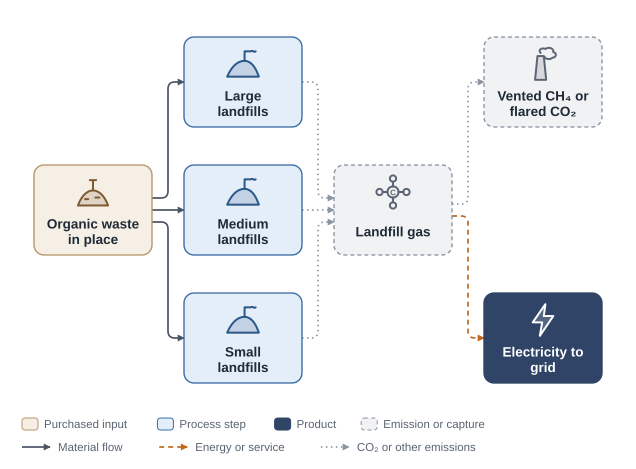

# Waste {#sec-waste}

Most of the waste sector's greenhouse-gas emissions come from one gas: methane released as food, paper, and other organic waste rots in landfills. CIMS builds the sector around what happens to that landfill gas: whether each landfill lets it escape, burns it in a flare, or burns it to generate electricity. The sector's activity is measured in tonnes of CO₂-equivalent (the warming effect of its gases expressed as CO₂).

## Scope

The sub-model covers **landfill gas management** at municipal solid-waste landfills. It groups landfills by size, because whether it pays to collect the gas depends on how much gas a site produces. A forecast of how much methane the waste already in landfills can produce drives the sector. That forecast falls over time, as programs that divert food and yard waste send less organic material to landfill.

Related activities sit elsewhere or are not yet represented:

- Collecting and hauling waste belongs to @sec-transportation-freight.
- Waste burned as fuel, such as fuel made from waste for cement kilns, is counted in the sector that burns it.
- Methane from wastewater treatment, and burning waste in incinerators, are not yet represented.

## Context

When organic waste (food, paper, wood, and yard trimmings) breaks down in a landfill, it is buried away from air. Without oxygen, microbes break it down into landfill gas, which is roughly half methane and half CO₂. Methane traps far more heat than CO₂: about 28 to 30 times as much over 100 years, and far more over 20 years. Uncontrolled landfill gas is therefore the sector's main problem and its biggest opportunity to cut emissions.

The ways to cut it are well established. A landfill can collect the gas through a network of wells and pipes and burn it in a **flare**, which turns the methane into CO₂ and cuts its warming effect about 25-fold at modest cost. It can instead use the gas for **energy**, by burning it in an engine to generate electricity or cleaning it into renewable natural gas. That cuts methane in the same way while replacing fossil energy and earning revenue. Further upstream, composting and anaerobic digestion (breaking organic waste down in sealed tanks to make biogas) keep organic waste out of landfills, so the methane never forms. Canada has committed under the Global Methane Pledge to cut methane sharply by 2030, and federal rules requiring large municipal landfills to capture their gas are central to that effort [@eccc-waste].

## Process flow

::: {#fig-waste-process}
{.light-content .lightbox group="waste-light" width=75%}

{.dark-content .lightbox group="waste-dark" width=75%}

Process flow of the waste sector. Organic waste in each size of landfill produces landfill gas, which is vented, flared, or burned to generate electricity.
:::

## Model structure

### Landfill sites

The Product sub-tree splits landfills into **large**, **medium**, and **small sites**. The same three ways of handling landfill gas compete at each size, but their costs differ:

- **No control** leaves the gas to seep out of the landfill surface. It costs nothing, but all the methane reaches the air.
- **Flaring** needs a gas collection system: wells drilled into the waste, pipes, and a blower that draws the gas to a flare, where it burns. Burning turns the methane into CO₂. The collection system costs roughly the same regardless of how much gas a site produces, so it is cheapest per tonne at large sites.
- **Electricity generation** uses the same collection system but burns the gas in an engine that drives a generator, sending power to the grid. The engine adds cost, but selling the electricity earns revenue. Large landfills produce enough gas to justify an engine; small ones often do not.

The technology database does not yet cover the waste sector, so the technologies come from the model inputs until the database adds them.

::: {.tech-block}
Technologies at each site size (from the model inputs, pending the technology database)

| Technology | What it is | Type |
|:--------------------------|:----------------------------------------------------------|:----------------|
| No control | Landfill gas escapes uncontrolled, so all the methane the site can produce reaches the air. | Conventional |
| Flaring | A collection system captures the gas and burns it in a flare, so the carbon leaves as CO₂ instead of methane. | Alternative |
| Electricity generation | The captured gas fuels an engine that generates electricity for the grid; the carbon also leaves as CO₂ instead of methane. | Alternative |

:::

The flaring and generation options draw on the captured gas as biogas, and generation sends electricity back to the grid. The sector also has a methane fuel blend (see @sec-fuel-blends).

<mark>TODO: Add upstream diversion of organic waste (composting and anaerobic digestion) to reduce how much methane the waste can produce, an option to clean the gas into renewable natural gas alongside electricity generation, and an explicit share of gas captured rather than an all-or-nothing choice.</mark>

## Decarbonisation

- **Stop venting.** Collecting and flaring the gas is cheap and cuts a lot of emissions, and works at almost any size of site.
- **Recover energy.** Where a site produces enough gas, selling electricity pays back part of the cost, which favours large sites.
- **Prevent the gas forming.** Composting and anaerobic digestion keep organic waste out of landfills. Federal and municipal policy increasingly emphasizes this, but the model does not yet represent it.

Almost all of the sector's emissions are methane rather than CO₂. With no control, a site releases all its potential methane; flaring and generation release the same carbon as CO₂ instead. Counted by warming effect, the difference is large, so even a modest carbon price or a landfill methane regulation shifts sites from venting to flaring and energy recovery.

## Regional coverage and differences

All seven modelled regions carry the waste sector, each with large, medium, and small landfills. How much methane the waste can produce follows population and the amount of waste generated, and falls as diversion programs cut the organic share. The value of the electricity recovered depends on each region's grid and power price.

<mark>TODO: Calibrate the regional split across site sizes and the starting mix of venting, flaring, and energy recovery against the National Inventory Report and provincial landfill data.</mark>

## Limitations and planned extensions

The waste sub-model captures the largest source, landfill methane, and the central choice between venting, flaring, and energy recovery. It leaves out diverting organic waste, renewable natural gas, the share of gas actually captured, methane from wastewater treatment, and waste incineration.

<mark>TODO: Add methane from wastewater treatment and waste incineration, make the landfill methane forecast respond to waste composition and diversion policy, and check modelled landfill methane against the National Inventory Report.</mark>



```{=latex}
\phantomsection
```

## References {.unnumbered}

```{=latex}
\printbibliography[heading=none]
```

::: {#refs}
:::
