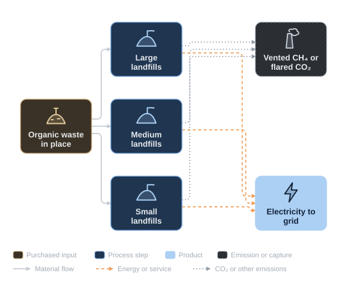

# Waste {#sec-waste}

The waste sector's greenhouse-gas footprint is dominated by one non-CO₂ gas: methane generated as organic waste decomposes in landfills. CIMS builds the sector around managing that landfill gas, choosing whether each landfill vents it, flares it, or burns it to generate electricity. The sector's activity is measured in tonnes of CO₂-equivalent.

## Scope

The sub-model covers the **management of landfill gas** at municipal solid waste disposal sites, grouped by size, because the economics of gas collection depend strongly on how much gas a site produces. An exogenous forecast of the methane-generation potential of waste in place drives it; the forecast declines over the projection as diversion reduces the organic material sent to landfill.

Adjacent activities sit elsewhere or are not yet represented:

- Waste collection and haulage belong to @sec-transportation-freight.
- Waste burned as fuel, such as waste-derived fuel in cement kilns, is counted in the sector that burns it.
- Wastewater treatment methane and waste incineration are not yet represented.

## Context

As the organic fraction of municipal solid waste (food, paper, wood, and yard trimmings) decomposes without oxygen in a landfill, it generates landfill gas that is roughly half methane and half CO₂. Methane's global-warming potential is many times CO₂'s (about 28–30 over 100 years, and far higher over 20 years), so uncontrolled landfill gas is the sector's defining problem and its largest abatement opportunity.

The levers are well established. Collecting the gas and **flaring** it converts the methane to CO₂, cutting its warming impact roughly 25-fold at modest cost. Using it for **energy**, by generating electricity or upgrading it to renewable natural gas, does the same while displacing fossil energy and earning revenue. Upstream, diverting organics through composting and anaerobic digestion stops the methane forming. Canada has committed under the Global Methane Pledge to cut methane sharply by 2030, and federal regulations requiring gas capture at large municipal landfills are central to that effort [@eccc-waste].

## Process flow

::: {#fig-waste-process}
{.light-content .lightbox group="waste-light" width=75%}

{.dark-content .lightbox group="waste-dark" width=75%}

Process flow of the waste sector. Each landfill size class vents, flares, or generates electricity from its landfill gas.
:::

## Model structure

### Landfill sites

The Product sub-tree splits the landfill stock into **Large Sites**, **Medium Sites**, and **Small Sites**. The same three gas-management options compete at each, with costs that differ by size: large landfills produce enough gas to justify a collection system and an engine, while small ones often cannot. The technology database does not yet cover the waste sector, so the technologies come from the model inputs, pending the database.

::: {.tech-block}
Technologies at each site size (from the model inputs, pending the technology database)

| Technology | What it is | Type | TRL |
|:------------------------|:------------------------------------------------------|:--------------|:------|
| No control | Landfill gas vents uncontrolled, so the site emits its full methane potential as CH₄. | Conventional | 9 |
| Flaring | A collection system captures the gas and flares it, so the carbon leaves as CO₂ instead of CH₄. | Alternative | 9 |
| Electricity generation | The captured gas fuels an engine that generates electricity for the grid, also emitting CO₂ instead of CH₄. | Alternative | 9 |

:::

The flaring and generation options request the captured gas as biogas, and generation returns electricity to the grid. The sector also carries a methane fuel blend node (see @sec-fuel-blends).

<mark>TODO: Add upstream organics diversion (composting and anaerobic digestion) to reduce the methane-generation potential itself, a renewable natural gas upgrading option alongside electricity generation, and an explicit gas-capture efficiency rather than an all-or-nothing control choice.</mark>

## Decarbonisation

- **Stop venting.** Collection and flaring is cheap and high-impact, and works at almost any site size.
- **Recover energy.** Where a site produces enough gas, electricity generation earns revenue that offsets its cost, which favours large sites.
- **Prevent generation.** Composting and anaerobic digestion keep organics out of landfill, the lever that federal and municipal policy increasingly emphasises, but the model does not yet represent them.

The emissions accounting is almost entirely non-CO₂. No control emits the site's full potential as CH₄, while flaring and generation emit the same carbon as CO₂; on a CO₂-equivalent basis the difference is the large methane-versus-CO₂ warming gap. Even a modest carbon price or a landfill methane regulation therefore drives a large shift from venting to flaring and energy recovery.

## Regional coverage and differences

All seven modelled regions carry the waste structure, each with large, medium, and small landfills. The methane-generation potential follows population and waste arisings, and declines as diversion programmes cut the organic fraction. The value of recovered electricity depends on each region's grid and power price.

<mark>TODO: Calibrate the regional split across site sizes and the baseline control levels (vent, flare, or energy) against the National Inventory Report and provincial landfill data.</mark>

## Limitations and planned extensions

The waste sub-model captures the dominant source, landfill methane, and the central choice between venting, flaring, and energy recovery. It omits organics diversion, renewable natural gas, explicit capture efficiency, wastewater treatment methane, and waste incineration.

<mark>TODO: Add wastewater-treatment methane and waste incineration, make the methane-generation potential respond to waste composition and diversion policy, and benchmark modelled landfill methane against the National Inventory Report.</mark>



```{=latex}
\phantomsection
```

## References {.unnumbered}

```{=latex}
\printbibliography[heading=none]
```

::: {#refs}
:::
